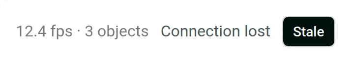

<!-- Written by `npm run docs:pages` from the kit and its examples. Do not edit. -->

# Stale

_Components › Status_ · [All topics](../README.md)

Shows that what the host shows is stale (a figure from before a connection dropped, a frame of a stream that stopped): `<span [neatStale]="lost()">12.4 fps</span>`. While true the host is faded and gray; once fresh it is shown as it is. The change is instant, with no transition, so a value that comes back is never shown half-faded as if still in doubt. It is the look only: the app says in words why the value is stale, since gray alone tells no one what happened.

<picture>
<source media="(prefers-color-scheme: dark)" srcset="../images/stale/lost-connection.dark.webp">

</picture>

```ts
import { NeatStale } from '@sima/neat-ui';
```

## Examples

### Lost connection

A readout from before a connection dropped. Press Stale to switch it between stale and fresh.

<picture>
<source media="(prefers-color-scheme: dark)" srcset="../images/stale/lost-connection.dark.webp">

</picture>

<details>
<summary>Code</summary>

`1-lost-connection.example.ts`

```ts
import { ChangeDetectionStrategy, Component, signal } from '@angular/core';
import { NeatButton, NeatStale } from '@sima/neat-ui';

@Component({
  selector: 'app-lost-connection',
  imports: [NeatButton, NeatStale],
  changeDetection: ChangeDetectionStrategy.OnPush,
  template: `
    <div class="showcase-row">
      <span [neatStale]="stale()">12.4 fps · 3 objects</span>
      @if (stale()) {
        <span class="showcase-muted">Connection lost</span>
      }
      <button
        neatButton
        type="button"
        variant="outlined"
        size="small"
        [pressed]="stale()"
        (click)="stale.set(!stale())"
      >
        Stale
      </button>
    </div>
  `,
})
export class LostConnection {
  protected readonly stale = signal(true);
}
```

</details>

## API

### `NeatStale`

Directive from `@sima/neat-ui`, selector `[neatStale]`.

**Inputs**

- **`neatStale`** `boolean`, required

  Whether what the host shows is stale.
