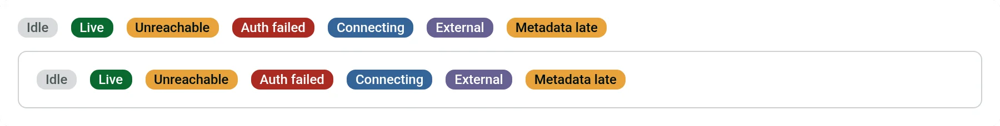
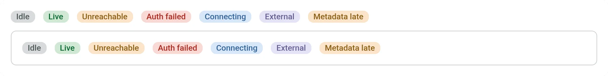
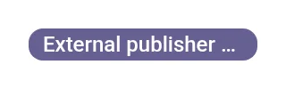

<!-- Written by `npm run docs:pages` from the kit and its examples. Do not edit. -->

# Status chip

_Components › Status_ · [All topics](../README.md)

A short status on a status color, such as Live or Idle.

```html
<neat-status-chip tone="success">Live</neat-status-chip>
```

<picture>
<source media="(prefers-color-scheme: dark)" srcset="../images/status-chip/tones.dark.webp">

</picture>

```ts
import { NeatStatusChip, NeatStatusChipButton } from '@sima/neat-ui/status-chip';
```

## Examples

### Tones

The six tones on the page and on a card, each worded as a stream's slot states are: the words carry the state, the color repeats it. The gray of `neutral` shows on both surfaces.

The last chip is a [`NeatStatusChipButton`](../components/status-chip.md#neatstatuschipbutton): it looks the same, and opens more about the status, here a video tile's "Metadata late".

<picture>
<source media="(prefers-color-scheme: dark)" srcset="../images/status-chip/tones.dark.webp">

</picture>

<details>
<summary>Code</summary>

`1-tones.example.ts`

```ts
import { ChangeDetectionStrategy, Component, signal } from '@angular/core';
import { NeatStatusChip, NeatStatusChipButton } from '@sima/neat-ui/status-chip';
import { CHIPS, SURFACES } from './chips';

@Component({
  selector: 'app-tones',
  imports: [NeatStatusChip, NeatStatusChipButton],
  changeDetection: ChangeDetectionStrategy.OnPush,
  template: `
    @for (surface of surfaces; track surface) {
      <div class="showcase-row" [class.card]="surface === 'card'">
        @for (chip of chips; track chip.tone) {
          <neat-status-chip [tone]="chip.tone">{{ chip.label }}</neat-status-chip>
        }
        <button neatStatusChip type="button" tone="warning" (click)="opened.set(true)">
          Metadata late
        </button>
      </div>
    }
    @if (opened()) {
      <p class="showcase-muted">The late notice would open here.</p>
    }
  `,
  styleUrl: './surfaces.css',
})
export class Tones {
  protected readonly surfaces = SURFACES;
  protected readonly chips = CHIPS;
  protected readonly opened = signal(false);
}
```

`chips.ts`

```ts
/** The surfaces a chip is shown on: the page, and a card. */
export const SURFACES = ['page', 'card'] as const;

/** One chip per tone, each worded as a stream's slot states are. */
export const CHIPS = [
  { tone: 'neutral', label: 'Idle' },
  { tone: 'success', label: 'Live' },
  { tone: 'warning', label: 'Unreachable' },
  { tone: 'danger', label: 'Auth failed' },
  { tone: 'info', label: 'Connecting' },
  { tone: 'highlight', label: 'External' },
] as const;
```

`surfaces.css`

```css
:host {
  display: flex;
  flex-direction: column;
  gap: var(--neat-space-3);
}

/*
 * A card as an app draws one: its own surface, so each chip is seen on it as well as on the
 * page.
 */
.card {
  --neat-surface: var(--card);

  padding: var(--neat-space-4);
  border: 1px solid var(--border);
  border-radius: var(--radius);
  background: var(--card);
  color: var(--card-foreground);
}
```

</details>

### Tinted

`variant="tinted"` puts each tone's color on a tint of itself, for chips that label the parts of a card, as a diagram block's do. `neutral` is the same gray as in the solid variant. A tinted chip belongs on the page or a card, as here, and not on a toned list row.

<picture>
<source media="(prefers-color-scheme: dark)" srcset="../images/status-chip/tinted.dark.webp">

</picture>

<details>
<summary>Code</summary>

`2-tinted.example.ts`

```ts
import { ChangeDetectionStrategy, Component } from '@angular/core';
import { NeatStatusChip, NeatStatusChipButton } from '@sima/neat-ui/status-chip';
import { CHIPS, SURFACES } from './chips';

@Component({
  selector: 'app-tinted',
  imports: [NeatStatusChip, NeatStatusChipButton],
  changeDetection: ChangeDetectionStrategy.OnPush,
  template: `
    @for (surface of surfaces; track surface) {
      <div class="showcase-row" [class.card]="surface === 'card'">
        @for (chip of chips; track chip.tone) {
          <neat-status-chip [tone]="chip.tone" variant="tinted">{{ chip.label }}</neat-status-chip>
        }
        <button neatStatusChip type="button" tone="warning" variant="tinted">Metadata late</button>
      </div>
    }
  `,
  styleUrl: './surfaces.css',
})
export class Tinted {
  protected readonly surfaces = SURFACES;
  protected readonly chips = CHIPS;
}
```

`chips.ts`

```ts
/** The surfaces a chip is shown on: the page, and a card. */
export const SURFACES = ['page', 'card'] as const;

/** One chip per tone, each worded as a stream's slot states are. */
export const CHIPS = [
  { tone: 'neutral', label: 'Idle' },
  { tone: 'success', label: 'Live' },
  { tone: 'warning', label: 'Unreachable' },
  { tone: 'danger', label: 'Auth failed' },
  { tone: 'info', label: 'Connecting' },
  { tone: 'highlight', label: 'External' },
] as const;
```

`surfaces.css`

```css
:host {
  display: flex;
  flex-direction: column;
  gap: var(--neat-space-3);
}

/*
 * A card as an app draws one: its own surface, so each chip is seen on it as well as on the
 * page.
 */
.card {
  --neat-surface: var(--card);

  padding: var(--neat-space-4);
  border: 1px solid var(--border);
  border-radius: var(--radius);
  background: var(--card);
  color: var(--card-foreground);
}
```

</details>

### Narrow column

A chip in a column narrower than its text: it truncates and keeps the column's width, where a list's cell or a bar would otherwise grow.

<picture>
<source media="(prefers-color-scheme: dark)" srcset="../images/status-chip/narrow-column.dark.webp">

</picture>

<details>
<summary>Code</summary>

`3-narrow-column.example.ts`

```ts
import { ChangeDetectionStrategy, Component } from '@angular/core';
import { NeatStatusChip } from '@sima/neat-ui/status-chip';

@Component({
  selector: 'app-narrow-column',
  imports: [NeatStatusChip],
  changeDetection: ChangeDetectionStrategy.OnPush,
  template: `
    <div class="column">
      <neat-status-chip tone="highlight"
        >External publisher on a very narrow column</neat-status-chip
      >
    </div>
  `,
  styleUrl: './narrow-column.example.css',
})
export class NarrowColumn {}
```

`narrow-column.example.css`

```css
.column {
  width: 8rem;
}
```

</details>

## API

### `NeatStatusChip`

Component from `@sima/neat-ui/status-chip`, selector `neat-status-chip`.

Use it for a state in a list's cell or over a panel (Live, Idle, External), or for a fact beside a value (a codec that cannot be decoded). The words are the app's. The color repeats them and is never the only way a state is told.

`highlight` is for a state that is none of the statuses but should stand out, such as a stream that someone else publishes. A `neat-select-list` row can take the same tone as its chip, with `rowTone`.

A chip truncates rather than widen the cell or bar that holds it.

`variant="tinted"` softens the chip to its tone's color on a tint. A tinted chip belongs on a card or the page, not on a toned list row, whose selected fill is the same tint.

**Inputs**

- **`tone`** `NeatTone`, default `'neutral'`

  The status the chip states, which sets its colors; `neutral` for a plain label.

- **`variant`** `NeatStatusChipVariant`, default `'solid'`

  `solid` (the default) fills the chip with the tone; `tinted` shows it on a light tint.

### `NeatStatusChipButton`

Directive from `@sima/neat-ui/status-chip`, selector `button[neatStatusChip]`.

The chip as a button, for a status that opens more about itself, such as a video tile's "Metadata late" that shows why: `<button neatStatusChip tone="warning" type="button">`. It looks like the chip of its tone and stays a native button (focus, Enter and Space, `disabled`), with a pointer and a focus outline. Its name is its text.

**Inputs**

- **`tone`** `NeatTone`, default `'neutral'`

  The status the chip states, which sets its colors; `neutral` for a plain label.

- **`variant`** `NeatStatusChipVariant`, default `'solid'`

  `solid` (the default) fills the chip with the tone; `tinted` shows it on a light tint.

### `NeatStatusChipVariant`

Type from `@sima/neat-ui/status-chip`.

How a chip carries its tone: `solid`, the default, on the tone's status fill; `tinted`, the tone's color on a light tint of itself, for chips that label parts of a card (a diagram block's) rather than state a status beside a value.

```ts
type NeatStatusChipVariant = 'solid' | 'tinted'
```
