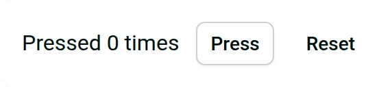

<!-- Written by `npm run docs:pages` from the kit and its examples. Do not edit. -->

# Stored signal

_Components › Data_ · [All topics](../README.md)

A signal kept in localStorage, for a setting an app remembers per browser.

```ts
readonly bars = neatStoredSignal('my-app:bars', true, (stored) =>
  typeof stored === 'boolean' ? stored : undefined,
);
```

<picture>
<source media="(prefers-color-scheme: dark)" srcset="../images/stored-signal/press-counter.dark.webp">

</picture>

```ts
import { neatStoredSignal } from '@sima/neat-ui';
```

## Examples

### Press counter

A count kept in localStorage: press, then reload the page, and the count stays.

<picture>
<source media="(prefers-color-scheme: dark)" srcset="../images/stored-signal/press-counter.dark.webp">

</picture>

<details>
<summary>Code</summary>

`1-press-counter.example.ts`

```ts
import { ChangeDetectionStrategy, Component } from '@angular/core';
import { NeatButton, neatStoredSignal } from '@sima/neat-ui';

@Component({
  selector: 'app-press-counter',
  imports: [NeatButton],
  changeDetection: ChangeDetectionStrategy.OnPush,
  template: `
    <div class="showcase-row">
      <span>Pressed {{ presses() }} times</span>
      <button
        neatButton
        type="button"
        variant="outlined"
        size="small"
        (click)="presses.set(presses() + 1)"
      >
        Press
      </button>
      <button neatButton type="button" variant="text" size="small" (click)="presses.set(0)">
        Reset
      </button>
    </div>
  `,
})
export class PressCounter {
  protected readonly presses = neatStoredSignal('neat-ui-showcase:presses', 0, (stored) =>
    typeof stored === 'number' && Number.isInteger(stored) && stored >= 0 ? stored : undefined,
  );
}
```

</details>

## API

### `neatStoredSignal`

Function from `@sima/neat-ui`.

Use it for a panel's choices or a view's options. It needs no injection context.

It starts at what is stored under `key`, as `parse` accepts it. `parse` gets the stored JSON, of any shape an older version of the app may have written. It answers the value, or undefined to refuse it. Nothing stored, text that is not JSON, or a refusal starts the signal at `initial`.

`set` and `update` store the new value as JSON. Storage that is missing, refuses or cannot hold the value never throws: the signal then holds its value for this page load only.

```ts
neatStoredSignal<T>(key: string, initial: T, parse: (stored: unknown) => T | undefined): WritableSignal<T>
```
