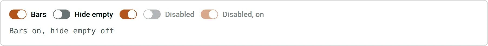

<!-- Written by `npm run docs:pages` from the kit and its examples. Do not edit. -->

# Switch

_Components › Forms_ · [All topics](../README.md)

An on/off switch, for a setting that applies at once, as it is toggled.

```html
<button neatSwitch [(checked)]="bars">Bars</button>
```

<picture>
<source media="(prefers-color-scheme: dark)" srcset="../images/switch/on-and-off.dark.webp">

</picture>

```ts
import { NeatSwitch } from '@sima/neat-ui/switch';
```

## Examples

### On and off

Two switches with a label, and a third without content, which takes an `aria-label`. The third shares its value with the first: try toggling either. Last come two disabled ones, off and on.

<picture>
<source media="(prefers-color-scheme: dark)" srcset="../images/switch/on-and-off.dark.webp">

</picture>

<details>
<summary>Code</summary>

`1-on-and-off.example.ts`

```ts
import { ChangeDetectionStrategy, Component, signal } from '@angular/core';
import { NeatSwitch } from '@sima/neat-ui/switch';

@Component({
  selector: 'app-on-and-off',
  imports: [NeatSwitch],
  changeDetection: ChangeDetectionStrategy.OnPush,
  templateUrl: './1-on-and-off.example.html',
  styleUrl: './on-and-off.example.css',
})
export class OnAndOff {
  protected readonly bars = signal(true);
  protected readonly hideEmpty = signal(false);
}
```

`1-on-and-off.example.html`

```html
<div class="showcase-row">
  <button neatSwitch [(checked)]="bars">Bars</button>
  <button neatSwitch [(checked)]="hideEmpty">Hide empty</button>
  <button neatSwitch aria-label="Bars, without a visible label" [(checked)]="bars"></button>
  <button neatSwitch disabled>Disabled</button>
  <button neatSwitch disabled [checked]="true">Disabled, on</button>
</div>
<p class="showcase-code showcase-muted">
  Bars {{ bars() ? 'on' : 'off' }}, hide empty {{ hideEmpty() ? 'on' : 'off' }}
</p>
```

`on-and-off.example.css`

```css
/* The example's rows one gap apart. */
:host {
  display: flex;
  flex-direction: column;
  gap: var(--neat-space-3);
}
```

</details>

## API

### `NeatSwitch`

Component from `@sima/neat-ui/switch`, selector `button[neatSwitch]`.

It is a native button. The content is the visible label and the accessible name. Without content, give it an `aria-label`. Space and Enter toggle it, as they click any button.

**Inputs**

- **`disabled`** `boolean`, default `false`, transform `booleanAttribute`

  Turns the switch off: dimmed, out of the Tab order and not toggled by a click.

**Models (two-way)**

- **`checked`** `boolean`, default `false`

  Whether the switch is on; off by default. Bind it two-way, `[(checked)]`.
