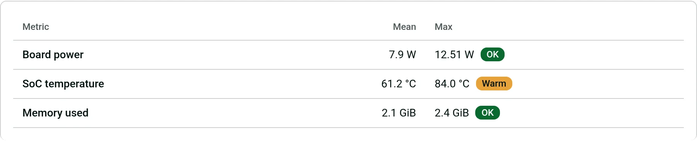

<!-- Written by `npm run docs:pages` from the kit and its examples. Do not edit. -->

# Table

_Components › Data_ · [All topics](../README.md)

A data table's look, on a native `table` whose rows and cells the app writes.

```html
<table neatTable aria-label="Metrics of the run">
  <thead>
    <tr><th scope="col">Metric</th><th scope="col" neatNumeric>Mean</th></tr>
  </thead>
  <tbody>
    <tr><th scope="row">Power</th><td neatNumeric>12.5 W</td></tr>
  </tbody>
</table>
```

<picture>
<source media="(prefers-color-scheme: dark)" srcset="../images/table/run-metrics.dark.webp">

</picture>

```ts
import { NeatTable, NeatNumeric, NeatFigure } from '@sima/neat-ui/table';
```

## Examples

### Run metrics

The metrics of a run.

The Mean column is end-aligned (`neatNumeric`). The Max column is not, since each of its figures is followed by a badge (`neatFigure`). The figure and the badge stay on one line while there is room.

<picture>
<source media="(prefers-color-scheme: dark)" srcset="../images/table/run-metrics.dark.webp">

</picture>

<details>
<summary>Code</summary>

`1-run-metrics.example.ts`

```ts
import { ChangeDetectionStrategy, Component } from '@angular/core';
import { NeatFigure, NeatNumeric, NeatTable } from '@sima/neat-ui/table';
import { NeatBadge } from '@sima/neat-ui/badge';

@Component({
  selector: 'app-run-metrics',
  imports: [NeatFigure, NeatNumeric, NeatBadge, NeatTable],
  changeDetection: ChangeDetectionStrategy.OnPush,
  templateUrl: './1-run-metrics.example.html',
  styleUrl: './run-metrics.example.css',
})
export class RunMetrics {
  protected readonly metrics = [
    { name: 'Board power', mean: '7.9 W', max: '12.51 W', tone: 'success', status: 'OK' },
    { name: 'SoC temperature', mean: '61.2 °C', max: '84.0 °C', tone: 'warning', status: 'Warm' },
    { name: 'Memory used', mean: '2.1 GiB', max: '2.4 GiB', tone: 'success', status: 'OK' },
  ] as const;
}
```

`1-run-metrics.example.html`

```html
<table neatTable aria-label="Metrics of a run">
  <thead>
    <tr>
      <th scope="col">Metric</th>
      <th scope="col" neatNumeric>Mean</th>
      <th scope="col" neatFigure>Max</th>
    </tr>
  </thead>
  <tbody>
    @for (metric of metrics; track metric.name) {
      <tr>
        <th scope="row">{{ metric.name }}</th>
        <td neatNumeric>{{ metric.mean }}</td>
        <td neatFigure>
          <div class="max">
            {{ metric.max }}
            <neat-badge [tone]="metric.tone">{{ metric.status }}</neat-badge>
          </div>
        </td>
      </tr>
    }
  </tbody>
</table>
```

`run-metrics.example.css`

```css
/* A cell's own layout: the figure and its status on one line, wrapping when the cell is narrow. */
.max {
  display: flex;
  flex-wrap: wrap;
  align-items: center;
  gap: var(--neat-space-2);
}
```

</details>

## API

### `NeatTable`

Directive from `@sima/neat-ui/table`, selector `table[neatTable]`.

The table is Spartan's: full width, a rule under every row, a row filling under the pointer, and its headings medium-weight.

It sets the look only. The columns and what a cell holds are the app's. So is how a table gives up a column when its container is narrow: the kit cannot know the container, or which columns matter. The table's name for assistive technology is the app's too (`aria-label`).

### `NeatNumeric`

Directive from `@sima/neat-ui/table`, selector `td[neatNumeric], th[neatNumeric]`.

A figure's cell or heading as `neatFigure`, end-aligned as well. Put it on a column's heading as well as on its cells so that the heading sits over the figures. It marks the cell as a figure itself, so the cell needs no `neatFigure` beside it.

### `NeatFigure`

Directive from `@sima/neat-ui/table`, selector `td[neatFigure], th[neatFigure]`.

A figure's cell or heading in a `neatTable`, on one line with tabular digits, not end-aligned.

Put it on a `th` or `td`. The figures of a column line up, and the cell starts where any cell does. Use it where the figures cannot end-align, such as a cell that holds something after the figure. Otherwise use `neatNumeric`.

It only marks the cell. The look is the table's, which is why the cell does nothing outside one.
