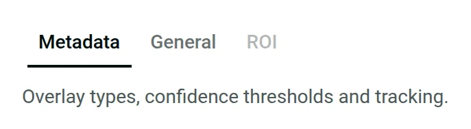

<!-- Written by `npm run docs:pages` from the kit and its examples. Do not edit. -->

# Tabs

_Components › Forms_ · [All topics](../README.md)

Tabs that show one panel at a time, for views inside one page.

```html
<neat-tabs label="Channel settings" [(value)]="tab">
  <neat-tab label="Metadata" value="metadata">
    <ng-template>…</ng-template>
  </neat-tab>
  <neat-tab label="General" value="general">
    <ng-template>…</ng-template>
  </neat-tab>
</neat-tabs>
```

<picture>
<source media="(prefers-color-scheme: dark)" srcset="../images/tabs/channel-settings.dark.webp">

</picture>

```ts
import { NeatTabs, NeatTab } from '@sima/neat-ui/tabs';
```

## Examples

### Channel settings

Three tabs, the third disabled: the arrow keys wrap between the first two and skip it.

<picture>
<source media="(prefers-color-scheme: dark)" srcset="../images/tabs/channel-settings.dark.webp">

</picture>

<details>
<summary>Code</summary>

`1-channel-settings.example.ts`

```ts
import { ChangeDetectionStrategy, Component, signal } from '@angular/core';
import { NeatTab, NeatTabs } from '@sima/neat-ui/tabs';

@Component({
  selector: 'app-channel-settings',
  imports: [NeatTab, NeatTabs],
  changeDetection: ChangeDetectionStrategy.OnPush,
  template: `
    <neat-tabs label="Channel settings" [(value)]="tab">
      <neat-tab label="Metadata" value="metadata">
        <ng-template>
          <p class="showcase-muted">Overlay types, confidence thresholds and tracking.</p>
        </ng-template>
      </neat-tab>
      <neat-tab label="General" value="general">
        <ng-template>
          <p class="showcase-muted">Video sync buffer, metadata retention and line width.</p>
        </ng-template>
      </neat-tab>
      <neat-tab label="ROI" value="roi" disabled>
        <ng-template><p class="showcase-muted">Regions of interest.</p></ng-template>
      </neat-tab>
    </neat-tabs>
  `,
})
export class ChannelSettings {
  protected readonly tab = signal('metadata');
}
```

</details>

## API

### `NeatTabs`

Component from `@sima/neat-ui/tabs`, selector `neat-tabs`.

Use tabs for views that are not addresses, such as a dialog's sections. A page's route-linked views are its rail item's `children` or links in its page nav, never tabs.

The open tab is underlined. The tab list is named by `label`. When `value` names no tab, or is unset, the first enabled tab is open, so the list stays reachable.

The arrow keys move to the next or previous tab and open it, skipping disabled tabs and wrapping. Home and End jump to the ends. The open tab is the only tab stop.

Every tab has a panel element, so each tab's `aria-controls` names one that exists. Only the open tab's panel holds its content: the others are empty and `hidden`.

A panel taller than the space it has is for the surrounding page or pane to scroll, which keeps one scroll context. The tab list is the one part that scrolls itself. Tabs that do not fit their container's width, such as an aside's, scroll sideways and never wrap. The open tab is brought into view when it changes.

Two tab sets with the same values do not share element ids. A value with spaces ("Board 1") works as any other, so `value` stays in the app's terms.

**Inputs**

- **`label`** `string`, required

  The tab list's accessible name.

**Models (two-way)**

- **`value`** `string`

  The open tab's `value`.

### `NeatTab`

Component from `@sima/neat-ui/tabs`, selector `neat-tab`.

One tab of a `neat-tabs`, its panel in an `<ng-template>`.

```html
<neat-tab label="General" value="general">
  <ng-template>…</ng-template>
</neat-tab>
```

The panel's content is created only while the tab is open, and destroyed when another one opens.

**Inputs**

- **`label`** `string`, required

  The text on the tab's trigger, which names the tab.

- **`value`** `string`, required

  Identifies the tab in `neat-tabs`' `value`; unique within one `neat-tabs`.

- **`disabled`** `boolean`, default `false`, transform `booleanAttribute`

  Turns the tab off: it is shown dimmed and cannot be opened, and the arrow keys skip it.
