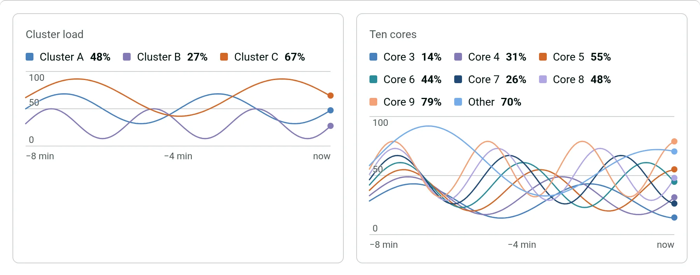
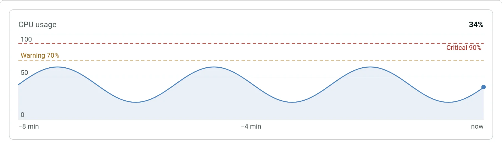
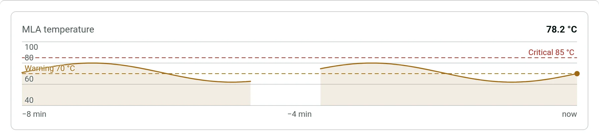
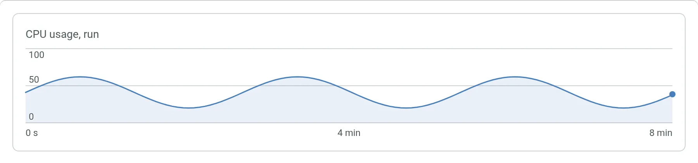
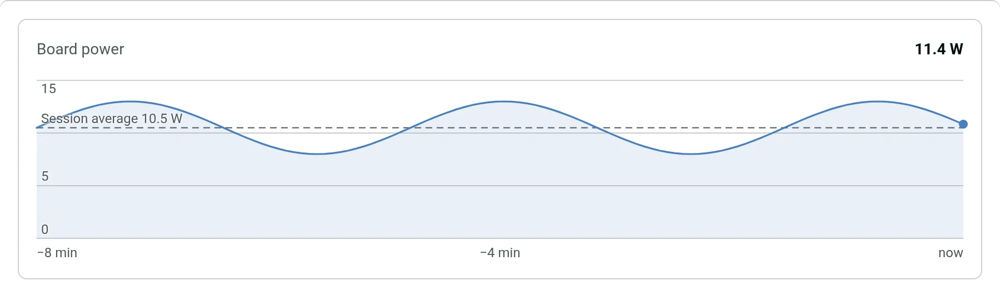
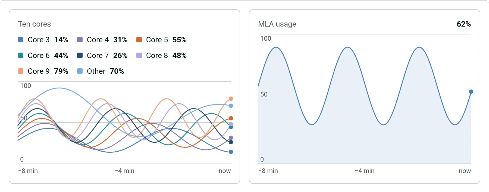
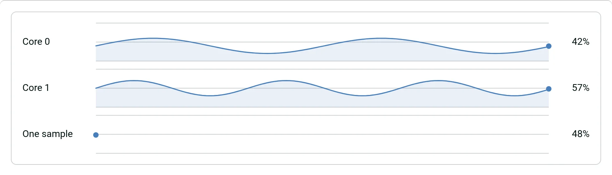
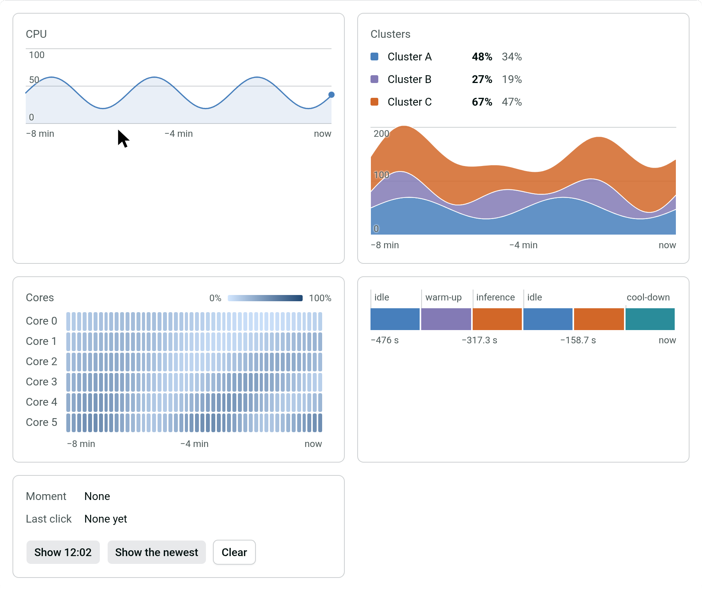

<!-- Written by `npm run docs:pages` from the kit and its examples. Do not edit. -->

# Time chart

_Components › Charts_ · [All topics](../README.md)

A metric over time as a line chart with a hover and keyboard readout:

```html
<neat-time-chart
  label="CPU usage"
  headline="34%"
  [series]="[{ key: 'cpu', label: 'CPU', values: cpu }]"
  [times]="times"
  [domain]="[0, 100]"
  [thresholds]="[{ value: 85, tone: 'danger', label: 'Critical 85%' }]"
  [format]="percent"
/>
```

<picture>
<source media="(prefers-color-scheme: dark)" srcset="../images/time-chart/several-series.dark.webp">

</picture>

```ts
import { NeatTimeChart } from '@sima/neat-ui/charts';
```

## Examples

### CPU usage

One series with a warning and a critical threshold, the headline beside the title. The app fixes the domain, 0 to 100 for a percentage, so the line never rescales under the reader. The card sets `--neat-surface` to its fill, for the labels' halos.

<picture>
<source media="(prefers-color-scheme: dark)" srcset="../images/time-chart/cpu-usage.dark.webp">

</picture>

<details>
<summary>Code</summary>

`1-cpu-usage.example.ts`

```ts
import { ChangeDetectionStrategy, Component } from '@angular/core';
import { NeatTimeChart } from '@sima/neat-ui/charts';
import { CPU, CPU_THRESHOLDS, percent, TIMES } from './data';

@Component({
  selector: 'app-cpu-usage',
  imports: [NeatTimeChart],
  changeDetection: ChangeDetectionStrategy.OnPush,
  templateUrl: './1-cpu-usage.example.html',
  styleUrl: './chart-card.css',
})
export class CPUUsage {
  protected readonly series = CPU;
  protected readonly times = TIMES;
  protected readonly thresholds = CPU_THRESHOLDS;
  protected readonly percent = percent;
}
```

`1-cpu-usage.example.html`

```html
<div class="chart-card">
  <neat-time-chart
    label="CPU usage"
    headline="34%"
    size="large"
    [series]="series"
    [times]="times"
    [domain]="[0, 100]"
    [thresholds]="thresholds"
    [format]="percent"
  />
</div>
```

`data.ts`

```ts
import type {
  NeatChartFormat,
  NeatReference,
  NeatSeries,
  NeatThreshold,
} from '@sima/neat-ui/charts';

/** A sine wave of `count` samples, the demo data of every chart: a plausible, smooth metric. */
export function sine(count: number, cycles: number, low: number, high: number): number[] {
  return Array.from({ length: count }, (_, index) => {
    const wave = (Math.sin((index / count) * cycles * 2 * Math.PI) + 1) / 2;
    return Number((low + wave * (high - low)).toFixed(2));
  });
}

/** The same with `gap` samples missing from `from`: a daemon that did not answer for a while. */
export function withGap(values: number[], from: number, gap: number): (number | null)[] {
  return values.map((value, index) => (index >= from && index < from + gap ? null : value));
}

/**
 * Eight minutes of samples four seconds apart, ending at a fixed instant so the demo stands
 * still.
 */
export const SAMPLES = 120;
export const TIMES: readonly number[] = Array.from(
  { length: SAMPLES },
  (_, index) => Date.UTC(2026, 9, 24, 12, 0, 0) + index * 4000,
);

export const percent: NeatChartFormat = (value) => `${value.toFixed(0)}%`;
export const celsius: NeatChartFormat = (value) => `${value.toFixed(1)} °C`;
export const watts: NeatChartFormat = (value) => `${value.toFixed(1)} W`;

export const CPU: readonly NeatSeries[] = [
  { key: 'cpu', label: 'CPU', values: sine(SAMPLES, 3, 20, 62) },
];
export const CPU_THRESHOLDS: readonly NeatThreshold[] = [
  { value: 70, tone: 'warning', label: 'Warning 70%' },
  { value: 90, tone: 'danger', label: 'Critical 90%' },
];

export const TEMPERATURE: readonly NeatSeries[] = [
  { key: 'mla', label: 'MLA', values: withGap(sine(SAMPLES, 2, 62, 80), 50, 14) },
];
export const TEMPERATURE_THRESHOLDS: readonly NeatThreshold[] = [
  { value: 70, tone: 'warning', label: 'Warning 70 °C' },
  { value: 85, tone: 'danger', label: 'Critical 85 °C' },
];

export const CLUSTERS: readonly NeatSeries[] = [
  { key: 'a', label: 'Cluster A', values: sine(SAMPLES, 2, 30, 70) },
  { key: 'b', label: 'Cluster B', values: sine(SAMPLES, 3, 10, 50) },
  { key: 'c', label: 'Cluster C', values: sine(SAMPLES, 1.5, 40, 90) },
];

export const CORES: readonly NeatSeries[] = Array.from({ length: 10 }, (_, index) => ({
  key: `core${index}`,
  label: `Core ${index}`,
  values: sine(SAMPLES, 1 + index / 4, 5 + index * 3, 25 + index * 6),
}));

export const MLA: readonly NeatSeries[] = [
  { key: 'mla', label: 'MLA', values: sine(SAMPLES, 3, 30, 90) },
];

export const POWER: readonly NeatSeries[] = [
  { key: 'power', label: 'Power', values: sine(SAMPLES, 2.5, 8, 13) },
];
export const POWER_AVERAGE: NeatReference = { value: 10.5, label: 'Session average 10.5 W' };

/** A list of metrics, one compact chart a row: two that fill the window and one just started. */
export const ROWS = [
  {
    label: 'Core 0',
    series: [{ key: 'core0', label: 'Core 0', values: sine(SAMPLES, 2, 20, 60) }],
    times: TIMES,
    value: '42%',
  },
  {
    label: 'Core 1',
    series: [{ key: 'core1', label: 'Core 1', values: sine(SAMPLES, 3, 30, 70) }],
    times: TIMES,
    value: '57%',
  },
  {
    label: 'One sample',
    series: [{ key: 'lone', label: 'One sample', values: [48] }],
    times: [TIMES[0]],
    value: '48%',
  },
] satisfies readonly {
  label: string;
  series: readonly NeatSeries[];
  times: readonly number[];
  value: string;
}[];
```

`chart-card.css`

```css
:host {
  display: block;
}

/* The chart's labels carry a halo in the fill of the surface they sit on, so a card says which. */
.chart-card {
  --neat-surface: var(--card);

  padding: var(--neat-space-4);
  border: 1px solid var(--border);
  border-radius: var(--radius);
  background: var(--card);
  color: var(--card-foreground);
}

.chart-grid {
  display: grid;
  grid-template-columns: repeat(auto-fit, minmax(min(100%, 22rem), 1fr));
  gap: var(--neat-space-4);
}
```

</details>

### MLA temperature

A single series in the warning color (`tone="warning"`), on a domain that starts at 40 so the range that matters fills the box. The gap is a daemon that did not answer for a while: a missing sample breaks the line.

<picture>
<source media="(prefers-color-scheme: dark)" srcset="../images/time-chart/mla-temperature.dark.webp">

</picture>

<details>
<summary>Code</summary>

`2-mla-temperature.example.ts`

```ts
import { ChangeDetectionStrategy, Component } from '@angular/core';
import { NeatTimeChart } from '@sima/neat-ui/charts';
import { celsius, TEMPERATURE, TEMPERATURE_THRESHOLDS, TIMES } from './data';

@Component({
  selector: 'app-mla-temperature',
  imports: [NeatTimeChart],
  changeDetection: ChangeDetectionStrategy.OnPush,
  templateUrl: './2-mla-temperature.example.html',
  styleUrl: './chart-card.css',
})
export class MLATemperature {
  protected readonly series = TEMPERATURE;
  protected readonly times = TIMES;
  protected readonly thresholds = TEMPERATURE_THRESHOLDS;
  protected readonly celsius = celsius;
}
```

`2-mla-temperature.example.html`

```html
<div class="chart-card">
  <neat-time-chart
    label="MLA temperature"
    headline="78.2 °C"
    tone="warning"
    [series]="series"
    [times]="times"
    [domain]="[40, 100]"
    [thresholds]="thresholds"
    [format]="celsius"
  />
</div>
```

`data.ts`

```ts
import type {
  NeatChartFormat,
  NeatReference,
  NeatSeries,
  NeatThreshold,
} from '@sima/neat-ui/charts';

/** A sine wave of `count` samples, the demo data of every chart: a plausible, smooth metric. */
export function sine(count: number, cycles: number, low: number, high: number): number[] {
  return Array.from({ length: count }, (_, index) => {
    const wave = (Math.sin((index / count) * cycles * 2 * Math.PI) + 1) / 2;
    return Number((low + wave * (high - low)).toFixed(2));
  });
}

/** The same with `gap` samples missing from `from`: a daemon that did not answer for a while. */
export function withGap(values: number[], from: number, gap: number): (number | null)[] {
  return values.map((value, index) => (index >= from && index < from + gap ? null : value));
}

/**
 * Eight minutes of samples four seconds apart, ending at a fixed instant so the demo stands
 * still.
 */
export const SAMPLES = 120;
export const TIMES: readonly number[] = Array.from(
  { length: SAMPLES },
  (_, index) => Date.UTC(2026, 9, 24, 12, 0, 0) + index * 4000,
);

export const percent: NeatChartFormat = (value) => `${value.toFixed(0)}%`;
export const celsius: NeatChartFormat = (value) => `${value.toFixed(1)} °C`;
export const watts: NeatChartFormat = (value) => `${value.toFixed(1)} W`;

export const CPU: readonly NeatSeries[] = [
  { key: 'cpu', label: 'CPU', values: sine(SAMPLES, 3, 20, 62) },
];
export const CPU_THRESHOLDS: readonly NeatThreshold[] = [
  { value: 70, tone: 'warning', label: 'Warning 70%' },
  { value: 90, tone: 'danger', label: 'Critical 90%' },
];

export const TEMPERATURE: readonly NeatSeries[] = [
  { key: 'mla', label: 'MLA', values: withGap(sine(SAMPLES, 2, 62, 80), 50, 14) },
];
export const TEMPERATURE_THRESHOLDS: readonly NeatThreshold[] = [
  { value: 70, tone: 'warning', label: 'Warning 70 °C' },
  { value: 85, tone: 'danger', label: 'Critical 85 °C' },
];

export const CLUSTERS: readonly NeatSeries[] = [
  { key: 'a', label: 'Cluster A', values: sine(SAMPLES, 2, 30, 70) },
  { key: 'b', label: 'Cluster B', values: sine(SAMPLES, 3, 10, 50) },
  { key: 'c', label: 'Cluster C', values: sine(SAMPLES, 1.5, 40, 90) },
];

export const CORES: readonly NeatSeries[] = Array.from({ length: 10 }, (_, index) => ({
  key: `core${index}`,
  label: `Core ${index}`,
  values: sine(SAMPLES, 1 + index / 4, 5 + index * 3, 25 + index * 6),
}));

export const MLA: readonly NeatSeries[] = [
  { key: 'mla', label: 'MLA', values: sine(SAMPLES, 3, 30, 90) },
];

export const POWER: readonly NeatSeries[] = [
  { key: 'power', label: 'Power', values: sine(SAMPLES, 2.5, 8, 13) },
];
export const POWER_AVERAGE: NeatReference = { value: 10.5, label: 'Session average 10.5 W' };

/** A list of metrics, one compact chart a row: two that fill the window and one just started. */
export const ROWS = [
  {
    label: 'Core 0',
    series: [{ key: 'core0', label: 'Core 0', values: sine(SAMPLES, 2, 20, 60) }],
    times: TIMES,
    value: '42%',
  },
  {
    label: 'Core 1',
    series: [{ key: 'core1', label: 'Core 1', values: sine(SAMPLES, 3, 30, 70) }],
    times: TIMES,
    value: '57%',
  },
  {
    label: 'One sample',
    series: [{ key: 'lone', label: 'One sample', values: [48] }],
    times: [TIMES[0]],
    value: '48%',
  },
] satisfies readonly {
  label: string;
  series: readonly NeatSeries[];
  times: readonly number[];
  value: string;
}[];
```

`chart-card.css`

```css
:host {
  display: block;
}

/* The chart's labels carry a halo in the fill of the surface they sit on, so a card says which. */
.chart-card {
  --neat-surface: var(--card);

  padding: var(--neat-space-4);
  border: 1px solid var(--border);
  border-radius: var(--radius);
  background: var(--card);
  color: var(--card-foreground);
}

.chart-grid {
  display: grid;
  grid-template-columns: repeat(auto-fit, minmax(min(100%, 22rem), 1fr));
  gap: var(--neat-space-4);
}
```

</details>

### Several series

Three series in `--neat-series-1` to `-3`, listed with their current values.

The second chart has ten. It draws the seven with the largest mean, and an Other, the sum of the three left. Other is a gap wherever one of them is missing.

<picture>
<source media="(prefers-color-scheme: dark)" srcset="../images/time-chart/several-series.dark.webp">

</picture>

<details>
<summary>Code</summary>

`3-several-series.example.ts`

```ts
import { ChangeDetectionStrategy, Component } from '@angular/core';
import { NeatTimeChart } from '@sima/neat-ui/charts';
import { CLUSTERS, CORES, percent, TIMES } from './data';

@Component({
  selector: 'app-several-series',
  imports: [NeatTimeChart],
  changeDetection: ChangeDetectionStrategy.OnPush,
  templateUrl: './3-several-series.example.html',
  styleUrl: './chart-card.css',
})
export class SeveralSeries {
  protected readonly clusters = CLUSTERS;
  protected readonly cores = CORES;
  protected readonly times = TIMES;
  protected readonly percent = percent;
}
```

`3-several-series.example.html`

```html
<div class="chart-grid">
  <div class="chart-card">
    <neat-time-chart
      label="Cluster load"
      [series]="clusters"
      [times]="times"
      [domain]="[0, 100]"
      [format]="percent"
    />
  </div>
  <div class="chart-card">
    <neat-time-chart
      label="Ten cores"
      size="large"
      [series]="cores"
      [times]="times"
      [domain]="[0, 100]"
      [format]="percent"
    />
  </div>
</div>
```

`data.ts`

```ts
import type {
  NeatChartFormat,
  NeatReference,
  NeatSeries,
  NeatThreshold,
} from '@sima/neat-ui/charts';

/** A sine wave of `count` samples, the demo data of every chart: a plausible, smooth metric. */
export function sine(count: number, cycles: number, low: number, high: number): number[] {
  return Array.from({ length: count }, (_, index) => {
    const wave = (Math.sin((index / count) * cycles * 2 * Math.PI) + 1) / 2;
    return Number((low + wave * (high - low)).toFixed(2));
  });
}

/** The same with `gap` samples missing from `from`: a daemon that did not answer for a while. */
export function withGap(values: number[], from: number, gap: number): (number | null)[] {
  return values.map((value, index) => (index >= from && index < from + gap ? null : value));
}

/**
 * Eight minutes of samples four seconds apart, ending at a fixed instant so the demo stands
 * still.
 */
export const SAMPLES = 120;
export const TIMES: readonly number[] = Array.from(
  { length: SAMPLES },
  (_, index) => Date.UTC(2026, 9, 24, 12, 0, 0) + index * 4000,
);

export const percent: NeatChartFormat = (value) => `${value.toFixed(0)}%`;
export const celsius: NeatChartFormat = (value) => `${value.toFixed(1)} °C`;
export const watts: NeatChartFormat = (value) => `${value.toFixed(1)} W`;

export const CPU: readonly NeatSeries[] = [
  { key: 'cpu', label: 'CPU', values: sine(SAMPLES, 3, 20, 62) },
];
export const CPU_THRESHOLDS: readonly NeatThreshold[] = [
  { value: 70, tone: 'warning', label: 'Warning 70%' },
  { value: 90, tone: 'danger', label: 'Critical 90%' },
];

export const TEMPERATURE: readonly NeatSeries[] = [
  { key: 'mla', label: 'MLA', values: withGap(sine(SAMPLES, 2, 62, 80), 50, 14) },
];
export const TEMPERATURE_THRESHOLDS: readonly NeatThreshold[] = [
  { value: 70, tone: 'warning', label: 'Warning 70 °C' },
  { value: 85, tone: 'danger', label: 'Critical 85 °C' },
];

export const CLUSTERS: readonly NeatSeries[] = [
  { key: 'a', label: 'Cluster A', values: sine(SAMPLES, 2, 30, 70) },
  { key: 'b', label: 'Cluster B', values: sine(SAMPLES, 3, 10, 50) },
  { key: 'c', label: 'Cluster C', values: sine(SAMPLES, 1.5, 40, 90) },
];

export const CORES: readonly NeatSeries[] = Array.from({ length: 10 }, (_, index) => ({
  key: `core${index}`,
  label: `Core ${index}`,
  values: sine(SAMPLES, 1 + index / 4, 5 + index * 3, 25 + index * 6),
}));

export const MLA: readonly NeatSeries[] = [
  { key: 'mla', label: 'MLA', values: sine(SAMPLES, 3, 30, 90) },
];

export const POWER: readonly NeatSeries[] = [
  { key: 'power', label: 'Power', values: sine(SAMPLES, 2.5, 8, 13) },
];
export const POWER_AVERAGE: NeatReference = { value: 10.5, label: 'Session average 10.5 W' };

/** A list of metrics, one compact chart a row: two that fill the window and one just started. */
export const ROWS = [
  {
    label: 'Core 0',
    series: [{ key: 'core0', label: 'Core 0', values: sine(SAMPLES, 2, 20, 60) }],
    times: TIMES,
    value: '42%',
  },
  {
    label: 'Core 1',
    series: [{ key: 'core1', label: 'Core 1', values: sine(SAMPLES, 3, 30, 70) }],
    times: TIMES,
    value: '57%',
  },
  {
    label: 'One sample',
    series: [{ key: 'lone', label: 'One sample', values: [48] }],
    times: [TIMES[0]],
    value: '48%',
  },
] satisfies readonly {
  label: string;
  series: readonly NeatSeries[];
  times: readonly number[];
  value: string;
}[];
```

`chart-card.css`

```css
:host {
  display: block;
}

/* The chart's labels carry a halo in the fill of the surface they sit on, so a card says which. */
.chart-card {
  --neat-surface: var(--card);

  padding: var(--neat-space-4);
  border: 1px solid var(--border);
  border-radius: var(--radius);
  background: var(--card);
  color: var(--card-foreground);
}

.chart-grid {
  display: grid;
  grid-template-columns: repeat(auto-fit, minmax(min(100%, 22rem), 1fr));
  gap: var(--neat-space-4);
}
```

</details>

### Elapsed axis

`axis="elapsed"` counts the x axis forward from the first sample ("0 s … 8 min"), for a run read from its start. The default counts back from the newest sample.

<picture>
<source media="(prefers-color-scheme: dark)" srcset="../images/time-chart/elapsed-axis.dark.webp">

</picture>

<details>
<summary>Code</summary>

`4-elapsed-axis.example.ts`

```ts
import { ChangeDetectionStrategy, Component } from '@angular/core';
import { NeatTimeChart } from '@sima/neat-ui/charts';
import { CPU, percent, TIMES } from './data';

@Component({
  selector: 'app-elapsed-axis',
  imports: [NeatTimeChart],
  changeDetection: ChangeDetectionStrategy.OnPush,
  templateUrl: './4-elapsed-axis.example.html',
  styleUrl: './chart-card.css',
})
export class ElapsedAxis {
  protected readonly series = CPU;
  protected readonly times = TIMES;
  protected readonly percent = percent;
}
```

`4-elapsed-axis.example.html`

```html
<div class="chart-card">
  <neat-time-chart
    label="CPU usage, run"
    axis="elapsed"
    [series]="series"
    [times]="times"
    [domain]="[0, 100]"
    [format]="percent"
  />
</div>
```

`data.ts`

```ts
import type {
  NeatChartFormat,
  NeatReference,
  NeatSeries,
  NeatThreshold,
} from '@sima/neat-ui/charts';

/** A sine wave of `count` samples, the demo data of every chart: a plausible, smooth metric. */
export function sine(count: number, cycles: number, low: number, high: number): number[] {
  return Array.from({ length: count }, (_, index) => {
    const wave = (Math.sin((index / count) * cycles * 2 * Math.PI) + 1) / 2;
    return Number((low + wave * (high - low)).toFixed(2));
  });
}

/** The same with `gap` samples missing from `from`: a daemon that did not answer for a while. */
export function withGap(values: number[], from: number, gap: number): (number | null)[] {
  return values.map((value, index) => (index >= from && index < from + gap ? null : value));
}

/**
 * Eight minutes of samples four seconds apart, ending at a fixed instant so the demo stands
 * still.
 */
export const SAMPLES = 120;
export const TIMES: readonly number[] = Array.from(
  { length: SAMPLES },
  (_, index) => Date.UTC(2026, 9, 24, 12, 0, 0) + index * 4000,
);

export const percent: NeatChartFormat = (value) => `${value.toFixed(0)}%`;
export const celsius: NeatChartFormat = (value) => `${value.toFixed(1)} °C`;
export const watts: NeatChartFormat = (value) => `${value.toFixed(1)} W`;

export const CPU: readonly NeatSeries[] = [
  { key: 'cpu', label: 'CPU', values: sine(SAMPLES, 3, 20, 62) },
];
export const CPU_THRESHOLDS: readonly NeatThreshold[] = [
  { value: 70, tone: 'warning', label: 'Warning 70%' },
  { value: 90, tone: 'danger', label: 'Critical 90%' },
];

export const TEMPERATURE: readonly NeatSeries[] = [
  { key: 'mla', label: 'MLA', values: withGap(sine(SAMPLES, 2, 62, 80), 50, 14) },
];
export const TEMPERATURE_THRESHOLDS: readonly NeatThreshold[] = [
  { value: 70, tone: 'warning', label: 'Warning 70 °C' },
  { value: 85, tone: 'danger', label: 'Critical 85 °C' },
];

export const CLUSTERS: readonly NeatSeries[] = [
  { key: 'a', label: 'Cluster A', values: sine(SAMPLES, 2, 30, 70) },
  { key: 'b', label: 'Cluster B', values: sine(SAMPLES, 3, 10, 50) },
  { key: 'c', label: 'Cluster C', values: sine(SAMPLES, 1.5, 40, 90) },
];

export const CORES: readonly NeatSeries[] = Array.from({ length: 10 }, (_, index) => ({
  key: `core${index}`,
  label: `Core ${index}`,
  values: sine(SAMPLES, 1 + index / 4, 5 + index * 3, 25 + index * 6),
}));

export const MLA: readonly NeatSeries[] = [
  { key: 'mla', label: 'MLA', values: sine(SAMPLES, 3, 30, 90) },
];

export const POWER: readonly NeatSeries[] = [
  { key: 'power', label: 'Power', values: sine(SAMPLES, 2.5, 8, 13) },
];
export const POWER_AVERAGE: NeatReference = { value: 10.5, label: 'Session average 10.5 W' };

/** A list of metrics, one compact chart a row: two that fill the window and one just started. */
export const ROWS = [
  {
    label: 'Core 0',
    series: [{ key: 'core0', label: 'Core 0', values: sine(SAMPLES, 2, 20, 60) }],
    times: TIMES,
    value: '42%',
  },
  {
    label: 'Core 1',
    series: [{ key: 'core1', label: 'Core 1', values: sine(SAMPLES, 3, 30, 70) }],
    times: TIMES,
    value: '57%',
  },
  {
    label: 'One sample',
    series: [{ key: 'lone', label: 'One sample', values: [48] }],
    times: [TIMES[0]],
    value: '48%',
  },
] satisfies readonly {
  label: string;
  series: readonly NeatSeries[];
  times: readonly number[];
  value: string;
}[];
```

`chart-card.css`

```css
:host {
  display: block;
}

/* The chart's labels carry a halo in the fill of the surface they sit on, so a card says which. */
.chart-card {
  --neat-surface: var(--card);

  padding: var(--neat-space-4);
  border: 1px solid var(--border);
  border-radius: var(--radius);
  background: var(--card);
  color: var(--card-foreground);
}

.chart-grid {
  display: grid;
  grid-template-columns: repeat(auto-fit, minmax(min(100%, 22rem), 1fr));
  gap: var(--neat-space-4);
}
```

</details>

### Reference line

A reference is a level that is neither a warning nor a danger, here the session's average, drawn dashed in the quiet color.

<picture>
<source media="(prefers-color-scheme: dark)" srcset="../images/time-chart/reference-line.dark.webp">

</picture>

<details>
<summary>Code</summary>

`5-reference-line.example.ts`

```ts
import { ChangeDetectionStrategy, Component } from '@angular/core';
import { NeatTimeChart } from '@sima/neat-ui/charts';
import { POWER, POWER_AVERAGE, TIMES, watts } from './data';

@Component({
  selector: 'app-reference-line',
  imports: [NeatTimeChart],
  changeDetection: ChangeDetectionStrategy.OnPush,
  templateUrl: './5-reference-line.example.html',
  styleUrl: './chart-card.css',
})
export class ReferenceLine {
  protected readonly series = POWER;
  protected readonly times = TIMES;
  protected readonly average = POWER_AVERAGE;
  protected readonly watts = watts;
}
```

`5-reference-line.example.html`

```html
<div class="chart-card">
  <neat-time-chart
    label="Board power"
    headline="11.4 W"
    size="large"
    [series]="series"
    [times]="times"
    [domain]="[0, 16]"
    [reference]="average"
    [format]="watts"
  />
</div>
```

`data.ts`

```ts
import type {
  NeatChartFormat,
  NeatReference,
  NeatSeries,
  NeatThreshold,
} from '@sima/neat-ui/charts';

/** A sine wave of `count` samples, the demo data of every chart: a plausible, smooth metric. */
export function sine(count: number, cycles: number, low: number, high: number): number[] {
  return Array.from({ length: count }, (_, index) => {
    const wave = (Math.sin((index / count) * cycles * 2 * Math.PI) + 1) / 2;
    return Number((low + wave * (high - low)).toFixed(2));
  });
}

/** The same with `gap` samples missing from `from`: a daemon that did not answer for a while. */
export function withGap(values: number[], from: number, gap: number): (number | null)[] {
  return values.map((value, index) => (index >= from && index < from + gap ? null : value));
}

/**
 * Eight minutes of samples four seconds apart, ending at a fixed instant so the demo stands
 * still.
 */
export const SAMPLES = 120;
export const TIMES: readonly number[] = Array.from(
  { length: SAMPLES },
  (_, index) => Date.UTC(2026, 9, 24, 12, 0, 0) + index * 4000,
);

export const percent: NeatChartFormat = (value) => `${value.toFixed(0)}%`;
export const celsius: NeatChartFormat = (value) => `${value.toFixed(1)} °C`;
export const watts: NeatChartFormat = (value) => `${value.toFixed(1)} W`;

export const CPU: readonly NeatSeries[] = [
  { key: 'cpu', label: 'CPU', values: sine(SAMPLES, 3, 20, 62) },
];
export const CPU_THRESHOLDS: readonly NeatThreshold[] = [
  { value: 70, tone: 'warning', label: 'Warning 70%' },
  { value: 90, tone: 'danger', label: 'Critical 90%' },
];

export const TEMPERATURE: readonly NeatSeries[] = [
  { key: 'mla', label: 'MLA', values: withGap(sine(SAMPLES, 2, 62, 80), 50, 14) },
];
export const TEMPERATURE_THRESHOLDS: readonly NeatThreshold[] = [
  { value: 70, tone: 'warning', label: 'Warning 70 °C' },
  { value: 85, tone: 'danger', label: 'Critical 85 °C' },
];

export const CLUSTERS: readonly NeatSeries[] = [
  { key: 'a', label: 'Cluster A', values: sine(SAMPLES, 2, 30, 70) },
  { key: 'b', label: 'Cluster B', values: sine(SAMPLES, 3, 10, 50) },
  { key: 'c', label: 'Cluster C', values: sine(SAMPLES, 1.5, 40, 90) },
];

export const CORES: readonly NeatSeries[] = Array.from({ length: 10 }, (_, index) => ({
  key: `core${index}`,
  label: `Core ${index}`,
  values: sine(SAMPLES, 1 + index / 4, 5 + index * 3, 25 + index * 6),
}));

export const MLA: readonly NeatSeries[] = [
  { key: 'mla', label: 'MLA', values: sine(SAMPLES, 3, 30, 90) },
];

export const POWER: readonly NeatSeries[] = [
  { key: 'power', label: 'Power', values: sine(SAMPLES, 2.5, 8, 13) },
];
export const POWER_AVERAGE: NeatReference = { value: 10.5, label: 'Session average 10.5 W' };

/** A list of metrics, one compact chart a row: two that fill the window and one just started. */
export const ROWS = [
  {
    label: 'Core 0',
    series: [{ key: 'core0', label: 'Core 0', values: sine(SAMPLES, 2, 20, 60) }],
    times: TIMES,
    value: '42%',
  },
  {
    label: 'Core 1',
    series: [{ key: 'core1', label: 'Core 1', values: sine(SAMPLES, 3, 30, 70) }],
    times: TIMES,
    value: '57%',
  },
  {
    label: 'One sample',
    series: [{ key: 'lone', label: 'One sample', values: [48] }],
    times: [TIMES[0]],
    value: '48%',
  },
] satisfies readonly {
  label: string;
  series: readonly NeatSeries[];
  times: readonly number[];
  value: string;
}[];
```

`chart-card.css`

```css
:host {
  display: block;
}

/* The chart's labels carry a halo in the fill of the surface they sit on, so a card says which. */
.chart-card {
  --neat-surface: var(--card);

  padding: var(--neat-space-4);
  border: 1px solid var(--border);
  border-radius: var(--radius);
  background: var(--card);
  color: var(--card-foreground);
}

.chart-grid {
  display: grid;
  grid-template-columns: repeat(auto-fit, minmax(min(100%, 22rem), 1fr));
  gap: var(--neat-space-4);
}
```

</details>

### Filling a card

`size="fill"`, for a chart whose host the app gives a height.

Two cards sit on one row, which stretches the shorter to the taller one's height. The chart on the right takes the height left, never under the medium plot's.

<picture>
<source media="(prefers-color-scheme: dark)" srcset="../images/time-chart/filling-a-card.dark.webp">

</picture>

<details>
<summary>Code</summary>

`6-filling-a-card.example.ts`

```ts
import { ChangeDetectionStrategy, Component } from '@angular/core';
import { NeatTimeChart } from '@sima/neat-ui/charts';
import { CORES, MLA, percent, TIMES } from './data';

@Component({
  selector: 'app-filling-a-card',
  imports: [NeatTimeChart],
  changeDetection: ChangeDetectionStrategy.OnPush,
  templateUrl: './6-filling-a-card.example.html',
  styleUrls: ['./chart-card.css', './filling-a-card.example.css'],
})
export class FillingACard {
  protected readonly cores = CORES;
  protected readonly mla = MLA;
  protected readonly times = TIMES;
  protected readonly percent = percent;
}
```

`6-filling-a-card.example.html`

```html
<div class="chart-grid">
  <div class="chart-card">
    <neat-time-chart
      label="Ten cores"
      size="large"
      [series]="cores"
      [times]="times"
      [domain]="[0, 100]"
      [format]="percent"
    />
  </div>
  <div class="chart-card fill">
    <neat-time-chart
      label="MLA usage"
      headline="62%"
      size="fill"
      [series]="mla"
      [times]="times"
      [domain]="[0, 100]"
      [format]="percent"
    />
  </div>
</div>
```

`data.ts`

```ts
import type {
  NeatChartFormat,
  NeatReference,
  NeatSeries,
  NeatThreshold,
} from '@sima/neat-ui/charts';

/** A sine wave of `count` samples, the demo data of every chart: a plausible, smooth metric. */
export function sine(count: number, cycles: number, low: number, high: number): number[] {
  return Array.from({ length: count }, (_, index) => {
    const wave = (Math.sin((index / count) * cycles * 2 * Math.PI) + 1) / 2;
    return Number((low + wave * (high - low)).toFixed(2));
  });
}

/** The same with `gap` samples missing from `from`: a daemon that did not answer for a while. */
export function withGap(values: number[], from: number, gap: number): (number | null)[] {
  return values.map((value, index) => (index >= from && index < from + gap ? null : value));
}

/**
 * Eight minutes of samples four seconds apart, ending at a fixed instant so the demo stands
 * still.
 */
export const SAMPLES = 120;
export const TIMES: readonly number[] = Array.from(
  { length: SAMPLES },
  (_, index) => Date.UTC(2026, 9, 24, 12, 0, 0) + index * 4000,
);

export const percent: NeatChartFormat = (value) => `${value.toFixed(0)}%`;
export const celsius: NeatChartFormat = (value) => `${value.toFixed(1)} °C`;
export const watts: NeatChartFormat = (value) => `${value.toFixed(1)} W`;

export const CPU: readonly NeatSeries[] = [
  { key: 'cpu', label: 'CPU', values: sine(SAMPLES, 3, 20, 62) },
];
export const CPU_THRESHOLDS: readonly NeatThreshold[] = [
  { value: 70, tone: 'warning', label: 'Warning 70%' },
  { value: 90, tone: 'danger', label: 'Critical 90%' },
];

export const TEMPERATURE: readonly NeatSeries[] = [
  { key: 'mla', label: 'MLA', values: withGap(sine(SAMPLES, 2, 62, 80), 50, 14) },
];
export const TEMPERATURE_THRESHOLDS: readonly NeatThreshold[] = [
  { value: 70, tone: 'warning', label: 'Warning 70 °C' },
  { value: 85, tone: 'danger', label: 'Critical 85 °C' },
];

export const CLUSTERS: readonly NeatSeries[] = [
  { key: 'a', label: 'Cluster A', values: sine(SAMPLES, 2, 30, 70) },
  { key: 'b', label: 'Cluster B', values: sine(SAMPLES, 3, 10, 50) },
  { key: 'c', label: 'Cluster C', values: sine(SAMPLES, 1.5, 40, 90) },
];

export const CORES: readonly NeatSeries[] = Array.from({ length: 10 }, (_, index) => ({
  key: `core${index}`,
  label: `Core ${index}`,
  values: sine(SAMPLES, 1 + index / 4, 5 + index * 3, 25 + index * 6),
}));

export const MLA: readonly NeatSeries[] = [
  { key: 'mla', label: 'MLA', values: sine(SAMPLES, 3, 30, 90) },
];

export const POWER: readonly NeatSeries[] = [
  { key: 'power', label: 'Power', values: sine(SAMPLES, 2.5, 8, 13) },
];
export const POWER_AVERAGE: NeatReference = { value: 10.5, label: 'Session average 10.5 W' };

/** A list of metrics, one compact chart a row: two that fill the window and one just started. */
export const ROWS = [
  {
    label: 'Core 0',
    series: [{ key: 'core0', label: 'Core 0', values: sine(SAMPLES, 2, 20, 60) }],
    times: TIMES,
    value: '42%',
  },
  {
    label: 'Core 1',
    series: [{ key: 'core1', label: 'Core 1', values: sine(SAMPLES, 3, 30, 70) }],
    times: TIMES,
    value: '57%',
  },
  {
    label: 'One sample',
    series: [{ key: 'lone', label: 'One sample', values: [48] }],
    times: [TIMES[0]],
    value: '48%',
  },
] satisfies readonly {
  label: string;
  series: readonly NeatSeries[];
  times: readonly number[];
  value: string;
}[];
```

`chart-card.css`

```css
:host {
  display: block;
}

/* The chart's labels carry a halo in the fill of the surface they sit on, so a card says which. */
.chart-card {
  --neat-surface: var(--card);

  padding: var(--neat-space-4);
  border: 1px solid var(--border);
  border-radius: var(--radius);
  background: var(--card);
  color: var(--card-foreground);
}

.chart-grid {
  display: grid;
  grid-template-columns: repeat(auto-fit, minmax(min(100%, 22rem), 1fr));
  gap: var(--neat-space-4);
}
```

`filling-a-card.example.css`

```css
/* The card gives its chart the height it has, which `size="fill"` turns into a taller plot. */
.fill {
  display: flex;
  flex-direction: column;
}

.fill neat-time-chart {
  flex: 1;
}
```

</details>

### Compact rows

`size="compact"` leaves out every label and the time axis, which suits a row among others.

Each row is the app's own: a name, the chart taking what is left, and a value. The third row has one sample, which is only its dot.

<picture>
<source media="(prefers-color-scheme: dark)" srcset="../images/time-chart/compact-rows.dark.webp">

</picture>

<details>
<summary>Code</summary>

`7-compact-rows.example.ts`

```ts
import { ChangeDetectionStrategy, Component } from '@angular/core';
import { NeatTimeChart } from '@sima/neat-ui/charts';
import { percent, ROWS } from './data';

@Component({
  selector: 'app-compact-rows',
  imports: [NeatTimeChart],
  changeDetection: ChangeDetectionStrategy.OnPush,
  templateUrl: './7-compact-rows.example.html',
  styleUrls: ['./chart-card.css', './compact-rows.example.css'],
})
export class CompactRows {
  protected readonly percent = percent;
  protected readonly rows = ROWS;
}
```

`7-compact-rows.example.html`

```html
<div class="chart-card rows">
  @for (row of rows; track row.label) {
    <div class="row">
      <span>{{ row.label }}</span>
      <neat-time-chart
        [label]="row.label"
        size="compact"
        headless
        [series]="row.series"
        [times]="row.times"
        [domain]="[0, 100]"
        [format]="percent"
      />
      <span>{{ row.value }}</span>
    </div>
  }
</div>
```

`data.ts`

```ts
import type {
  NeatChartFormat,
  NeatReference,
  NeatSeries,
  NeatThreshold,
} from '@sima/neat-ui/charts';

/** A sine wave of `count` samples, the demo data of every chart: a plausible, smooth metric. */
export function sine(count: number, cycles: number, low: number, high: number): number[] {
  return Array.from({ length: count }, (_, index) => {
    const wave = (Math.sin((index / count) * cycles * 2 * Math.PI) + 1) / 2;
    return Number((low + wave * (high - low)).toFixed(2));
  });
}

/** The same with `gap` samples missing from `from`: a daemon that did not answer for a while. */
export function withGap(values: number[], from: number, gap: number): (number | null)[] {
  return values.map((value, index) => (index >= from && index < from + gap ? null : value));
}

/**
 * Eight minutes of samples four seconds apart, ending at a fixed instant so the demo stands
 * still.
 */
export const SAMPLES = 120;
export const TIMES: readonly number[] = Array.from(
  { length: SAMPLES },
  (_, index) => Date.UTC(2026, 9, 24, 12, 0, 0) + index * 4000,
);

export const percent: NeatChartFormat = (value) => `${value.toFixed(0)}%`;
export const celsius: NeatChartFormat = (value) => `${value.toFixed(1)} °C`;
export const watts: NeatChartFormat = (value) => `${value.toFixed(1)} W`;

export const CPU: readonly NeatSeries[] = [
  { key: 'cpu', label: 'CPU', values: sine(SAMPLES, 3, 20, 62) },
];
export const CPU_THRESHOLDS: readonly NeatThreshold[] = [
  { value: 70, tone: 'warning', label: 'Warning 70%' },
  { value: 90, tone: 'danger', label: 'Critical 90%' },
];

export const TEMPERATURE: readonly NeatSeries[] = [
  { key: 'mla', label: 'MLA', values: withGap(sine(SAMPLES, 2, 62, 80), 50, 14) },
];
export const TEMPERATURE_THRESHOLDS: readonly NeatThreshold[] = [
  { value: 70, tone: 'warning', label: 'Warning 70 °C' },
  { value: 85, tone: 'danger', label: 'Critical 85 °C' },
];

export const CLUSTERS: readonly NeatSeries[] = [
  { key: 'a', label: 'Cluster A', values: sine(SAMPLES, 2, 30, 70) },
  { key: 'b', label: 'Cluster B', values: sine(SAMPLES, 3, 10, 50) },
  { key: 'c', label: 'Cluster C', values: sine(SAMPLES, 1.5, 40, 90) },
];

export const CORES: readonly NeatSeries[] = Array.from({ length: 10 }, (_, index) => ({
  key: `core${index}`,
  label: `Core ${index}`,
  values: sine(SAMPLES, 1 + index / 4, 5 + index * 3, 25 + index * 6),
}));

export const MLA: readonly NeatSeries[] = [
  { key: 'mla', label: 'MLA', values: sine(SAMPLES, 3, 30, 90) },
];

export const POWER: readonly NeatSeries[] = [
  { key: 'power', label: 'Power', values: sine(SAMPLES, 2.5, 8, 13) },
];
export const POWER_AVERAGE: NeatReference = { value: 10.5, label: 'Session average 10.5 W' };

/** A list of metrics, one compact chart a row: two that fill the window and one just started. */
export const ROWS = [
  {
    label: 'Core 0',
    series: [{ key: 'core0', label: 'Core 0', values: sine(SAMPLES, 2, 20, 60) }],
    times: TIMES,
    value: '42%',
  },
  {
    label: 'Core 1',
    series: [{ key: 'core1', label: 'Core 1', values: sine(SAMPLES, 3, 30, 70) }],
    times: TIMES,
    value: '57%',
  },
  {
    label: 'One sample',
    series: [{ key: 'lone', label: 'One sample', values: [48] }],
    times: [TIMES[0]],
    value: '48%',
  },
] satisfies readonly {
  label: string;
  series: readonly NeatSeries[];
  times: readonly number[];
  value: string;
}[];
```

`chart-card.css`

```css
:host {
  display: block;
}

/* The chart's labels carry a halo in the fill of the surface they sit on, so a card says which. */
.chart-card {
  --neat-surface: var(--card);

  padding: var(--neat-space-4);
  border: 1px solid var(--border);
  border-radius: var(--radius);
  background: var(--card);
  color: var(--card-foreground);
}

.chart-grid {
  display: grid;
  grid-template-columns: repeat(auto-fit, minmax(min(100%, 22rem), 1fr));
  gap: var(--neat-space-4);
}
```

`compact-rows.example.css`

```css
.rows {
  display: flex;
  flex-direction: column;
  gap: var(--neat-space-3);
}

/* The rows of a list of metrics: a name, a compact chart that takes what is left, a value. */
.row {
  display: grid;
  grid-template-columns: 6rem 1fr 3rem;
  align-items: center;
  gap: var(--neat-space-3);
  font-size: var(--neat-text-sm);
}

.row span:last-child {
  text-align: end;
  font-variant-numeric: tabular-nums;
}
```

</details>

### Shared crosshair

One moment, shared between charts.

The time chart, the stacked chart and the label timeline bind one signal to `hovered`. So hovering any of them shows the same moment on all three, each at its nearest sample, or the run covering it.

The heatmap names a cell: its row and a time. The app keeps the row it was last on, so the heatmap follows the shared moment too.

The card shows the moment, and the last click on any of the charts. Its buttons set the moment from outside.

<picture>
<source media="(prefers-reduced-motion: reduce) and (prefers-color-scheme: dark)" srcset="../images/time-chart/shared-crosshair.dark.webp">
<source media="(prefers-reduced-motion: reduce)" srcset="../images/time-chart/shared-crosshair.light.webp">
<source media="(prefers-color-scheme: dark)" srcset="../images/time-chart/shared-crosshair.dark.animated.webp">

</picture>

<details>
<summary>Code</summary>

`8-shared-crosshair.example.ts`

```ts
import { ChangeDetectionStrategy, Component, computed, signal } from '@angular/core';
import { NeatButton } from '@sima/neat-ui';
import {
  type NeatHeatmapCell,
  type NeatHeatmapRow,
  NeatHeatmap,
  type NeatLabelRun,
  NeatLabelTimeline,
  NeatStackedChart,
  NeatTimeChart,
} from '@sima/neat-ui/charts';
import { CLUSTERS, CORES, CPU, percent, TIMES } from './data';

/** The board's state over the eight minutes, as a classifier of its own would report it. */
const STATES = ['idle', 'warm-up', 'inference', 'idle', 'inference', 'cool-down'];
const START = TIMES[0];
const END = TIMES[TIMES.length - 1];
const RUNS: readonly NeatLabelRun[] = STATES.map((label, index) => ({
  label,
  startMs: START + ((END - START) * index) / STATES.length,
  endMs: START + ((END - START) * (index + 1)) / STATES.length,
}));

/** Six of the cores as heatmap rows, from the same samples as the chart above them. */
const ROWS: readonly NeatHeatmapRow[] = CORES.slice(0, 6).map((core) => ({
  key: core.key,
  label: core.label,
  values: core.values,
  end: '',
  endTone: 'default',
}));

/** A moment as the card says it: the time of day, in UTC like the demo's data. */
const clock = (time: number) => new Date(time).toISOString().slice(11, 19);

@Component({
  selector: 'app-shared-crosshair',
  imports: [NeatButton, NeatHeatmap, NeatLabelTimeline, NeatStackedChart, NeatTimeChart],
  changeDetection: ChangeDetectionStrategy.OnPush,
  templateUrl: './8-shared-crosshair.example.html',
  styleUrls: ['./chart-card.css', './shared-crosshair.example.css'],
})
export class SharedCrosshair {
  protected readonly cpu = CPU;
  protected readonly clusters = CLUSTERS;
  protected readonly rows = ROWS;
  protected readonly runs = RUNS;
  protected readonly times = TIMES;
  protected readonly start = START;
  protected readonly end = END;
  protected readonly percent = percent;

  /** The moment every chart shows, or null for none. */
  protected readonly moment = signal<number | null>(null);
  /** The heatmap row the pointer was last on, where the heatmap shows the shared moment. */
  private readonly row = signal(ROWS[0].key);
  protected readonly clicked = signal('None yet');

  protected readonly cell = computed((): NeatHeatmapCell | null => {
    const time = this.moment();
    return time === null ? null : { row: this.row(), time };
  });

  protected readonly momentText = computed(() => {
    const time = this.moment();
    return time === null ? 'None' : clock(time);
  });

  protected onCell(cell: NeatHeatmapCell | null): void {
    if (cell) this.row.set(cell.row);
    this.moment.set(cell?.time ?? null);
  }

  protected when(time: number | null): string {
    return time === null ? 'an unknown time' : clock(time);
  }
}
```

`8-shared-crosshair.example.html`

```html
<div class="dashboard">
  <div class="chart-card">
    <neat-time-chart
      label="CPU"
      [series]="cpu"
      [times]="times"
      [domain]="[0, 100]"
      [format]="percent"
      [(hovered)]="moment"
      (activated)="clicked.set('CPU at ' + when($event.time))"
    />
  </div>
  <div class="chart-card">
    <neat-stacked-chart
      label="Clusters"
      [series]="clusters"
      [times]="times"
      [domain]="[0, 220]"
      [format]="percent"
      [(hovered)]="moment"
      (activated)="clicked.set('Clusters at ' + when($event.time))"
    />
  </div>
  <div class="chart-card">
    <neat-heatmap
      label="Cores"
      [rows]="rows"
      [times]="times"
      [format]="percent"
      [hovered]="cell()"
      (hoveredChange)="onCell($event)"
      (activated)="clicked.set($event.row + ' at ' + when($event.time))"
    />
  </div>
  <div class="chart-card">
    <neat-label-timeline
      label="Board state"
      [runs]="runs"
      [nowMs]="end"
      [windowMs]="end - start"
      [(hovered)]="moment"
      (activated)="clicked.set(($event.run?.label ?? 'nothing') + ' at ' + when($event.time))"
    />
  </div>
  <div class="chart-card report">
    <dl>
      <dt>Moment</dt>
      <dd>{{ momentText() }}</dd>
      <dt>Last click</dt>
      <dd>{{ clicked() }}</dd>
    </dl>
    <div class="actions">
      <button
        neatButton
        type="button"
        size="small"
        variant="secondary"
        (click)="moment.set(start + 120_000)"
      >
        Show 12:02
      </button>
      <button neatButton type="button" size="small" variant="secondary" (click)="moment.set(end)">
        Show the newest
      </button>
      <button neatButton type="button" size="small" variant="outlined" (click)="moment.set(null)">
        Clear
      </button>
    </div>
  </div>
</div>
```

`data.ts`

```ts
import type {
  NeatChartFormat,
  NeatReference,
  NeatSeries,
  NeatThreshold,
} from '@sima/neat-ui/charts';

/** A sine wave of `count` samples, the demo data of every chart: a plausible, smooth metric. */
export function sine(count: number, cycles: number, low: number, high: number): number[] {
  return Array.from({ length: count }, (_, index) => {
    const wave = (Math.sin((index / count) * cycles * 2 * Math.PI) + 1) / 2;
    return Number((low + wave * (high - low)).toFixed(2));
  });
}

/** The same with `gap` samples missing from `from`: a daemon that did not answer for a while. */
export function withGap(values: number[], from: number, gap: number): (number | null)[] {
  return values.map((value, index) => (index >= from && index < from + gap ? null : value));
}

/**
 * Eight minutes of samples four seconds apart, ending at a fixed instant so the demo stands
 * still.
 */
export const SAMPLES = 120;
export const TIMES: readonly number[] = Array.from(
  { length: SAMPLES },
  (_, index) => Date.UTC(2026, 9, 24, 12, 0, 0) + index * 4000,
);

export const percent: NeatChartFormat = (value) => `${value.toFixed(0)}%`;
export const celsius: NeatChartFormat = (value) => `${value.toFixed(1)} °C`;
export const watts: NeatChartFormat = (value) => `${value.toFixed(1)} W`;

export const CPU: readonly NeatSeries[] = [
  { key: 'cpu', label: 'CPU', values: sine(SAMPLES, 3, 20, 62) },
];
export const CPU_THRESHOLDS: readonly NeatThreshold[] = [
  { value: 70, tone: 'warning', label: 'Warning 70%' },
  { value: 90, tone: 'danger', label: 'Critical 90%' },
];

export const TEMPERATURE: readonly NeatSeries[] = [
  { key: 'mla', label: 'MLA', values: withGap(sine(SAMPLES, 2, 62, 80), 50, 14) },
];
export const TEMPERATURE_THRESHOLDS: readonly NeatThreshold[] = [
  { value: 70, tone: 'warning', label: 'Warning 70 °C' },
  { value: 85, tone: 'danger', label: 'Critical 85 °C' },
];

export const CLUSTERS: readonly NeatSeries[] = [
  { key: 'a', label: 'Cluster A', values: sine(SAMPLES, 2, 30, 70) },
  { key: 'b', label: 'Cluster B', values: sine(SAMPLES, 3, 10, 50) },
  { key: 'c', label: 'Cluster C', values: sine(SAMPLES, 1.5, 40, 90) },
];

export const CORES: readonly NeatSeries[] = Array.from({ length: 10 }, (_, index) => ({
  key: `core${index}`,
  label: `Core ${index}`,
  values: sine(SAMPLES, 1 + index / 4, 5 + index * 3, 25 + index * 6),
}));

export const MLA: readonly NeatSeries[] = [
  { key: 'mla', label: 'MLA', values: sine(SAMPLES, 3, 30, 90) },
];

export const POWER: readonly NeatSeries[] = [
  { key: 'power', label: 'Power', values: sine(SAMPLES, 2.5, 8, 13) },
];
export const POWER_AVERAGE: NeatReference = { value: 10.5, label: 'Session average 10.5 W' };

/** A list of metrics, one compact chart a row: two that fill the window and one just started. */
export const ROWS = [
  {
    label: 'Core 0',
    series: [{ key: 'core0', label: 'Core 0', values: sine(SAMPLES, 2, 20, 60) }],
    times: TIMES,
    value: '42%',
  },
  {
    label: 'Core 1',
    series: [{ key: 'core1', label: 'Core 1', values: sine(SAMPLES, 3, 30, 70) }],
    times: TIMES,
    value: '57%',
  },
  {
    label: 'One sample',
    series: [{ key: 'lone', label: 'One sample', values: [48] }],
    times: [TIMES[0]],
    value: '48%',
  },
] satisfies readonly {
  label: string;
  series: readonly NeatSeries[];
  times: readonly number[];
  value: string;
}[];
```

`chart-card.css`

```css
:host {
  display: block;
}

/* The chart's labels carry a halo in the fill of the surface they sit on, so a card says which. */
.chart-card {
  --neat-surface: var(--card);

  padding: var(--neat-space-4);
  border: 1px solid var(--border);
  border-radius: var(--radius);
  background: var(--card);
  color: var(--card-foreground);
}

.chart-grid {
  display: grid;
  grid-template-columns: repeat(auto-fit, minmax(min(100%, 22rem), 1fr));
  gap: var(--neat-space-4);
}
```

`shared-crosshair.example.css`

```css
/* Four charts and the card that reports on them, two a row where there is room. */
.dashboard {
  display: grid;
  grid-template-columns: repeat(auto-fit, minmax(min(100%, 22rem), 1fr));
  gap: var(--neat-space-4);
}

.report dl {
  display: grid;
  grid-template-columns: auto 1fr;
  gap: var(--neat-space-2) var(--neat-space-4);
  margin: 0 0 var(--neat-space-4);
  font-size: var(--neat-text-sm);
}

.report dt {
  color: var(--muted-foreground);
}

.report dd {
  margin: 0;
  font-variant-numeric: tabular-nums;
}

.actions {
  display: flex;
  flex-wrap: wrap;
  gap: var(--neat-space-2);
}
```

</details>

## API

### `NeatTimeChart`

Component from `@sima/neat-ui/charts`, selector `neat-time-chart`.

`times` (ms, oldest first) place the samples, so a delayed poll shows as a gap. Without usable times, the samples are spaced evenly.

`domain` is the value range the box shows, and the app picks it, so the line never rescales under the reader. A percentage is 0 to 100, say, and a temperature a fixed range. `format` words a value with its unit: the chart knows no units.

One series strokes in `--neat-line`, or `--neat-line-warning` and `--neat-line-danger` by `tone`, with a faint area under it. Several take `--neat-series-1` to `-8` in order, and are listed in a legend with their current values; a ninth series and beyond fold into "Other". A `null` is a sample that was not taken and breaks the line. The newest sample has a dot. Thresholds and the reference are dashed lines, drawn while their value lies in the domain.

The labels are drawn over the lines with a halo in `--neat-surface`. So inside a card, set that to the card's fill, as the select list's sticky header asks.

`size` sets the plot's height: 3.5, 6 or 9.5 rem. Other inputs leave parts out:

- `compact` leaves out every label and the time axis, which suits a row among others.
- `fill` is labeled as `medium`, and makes the host a flex column. Its plot takes the height left after the title, legend and axis, never under medium's 6 rem. So the app gives the host its height, such as a grid item that a row stretches.
- `[valueLabels]="false"` leaves out only the grid's values and the levels' labels. It keeps their lines and the time axis, which suits a card in a grid.
- `headless` leaves out the title and headline, for a chart under a heading of its own.

None of them changes the accessible name or the readout. A grid label that would sit on a level's label, or on the grid label below it, is left out.

The plot is a group in the tab order, named "&lt;label>: &lt;headline, or the current values>, over the last &lt;window>". On the elapsed axis it ends "over &lt;span>".

The readout follows the pointer. With focus, it shows the newest sample. The arrow keys, Home and End move it, and Escape hides it. Each key press is repeated in a polite live region, so a screen reader hears the sample. Pointer moves are not repeated.

`hovered` is the moment the readout is on, both ways. The chart sets it while the pointer or the keys hold a sample, and the app may set it. So several charts bound to one signal share a crosshair. `activated` reports a click, or Enter, with the sample's time and values.

**Inputs**

- **`label`** `string`, required

  The chart's title, which also names it for assistive technology.

- **`headline`** `string`, default `''`

  The current value as the app words it, beside the title and in the accessible name.

- **`series`** `readonly NeatSeries[]`, required

  The lines, each as long as `times`; more than eight fold into "Other".

- **`times`** `readonly (number | null)[]`, required

  When each sample was taken, in ms, oldest first; `null` for one without a time.

- **`domain`** `readonly [number, number]`, required

  The values the box spans, bottom and top: fixed by the app, so the line never rescales.

- **`thresholds`** `readonly NeatThreshold[]`, default `[]`

  Levels drawn dashed in a warning or danger color while they lie inside the domain.

- **`reference`** `NeatReference | null`, default `null`

  A level that is neither, such as an average or a limit.

- **`tone`** `NeatChartTone`, default `'default'`

  The stroke of a single series; several series take the palette's colors instead.

- **`size`** `'compact' | 'medium' | 'large' | 'fill'`, default `'medium'`

  The plot's height: 3.5, 6 or 9.5 rem. Compact also leaves out the labels and the time axis. `fill` is labeled as medium, with the plot taking the height the app gives the host.

- **`axis`** `NeatChartAxis`, default `'recent'`

  What the x axis, the readout and the accessible name count: `recent` or `elapsed`.

  `recent` counts back from the newest sample ("−8 min … now", "2 min ago"), for a live window. `elapsed` counts forward from the first ("0 s … 33.9 s", "at 17 s"). It is for a run read from its start, or several runs laid over each other.

- **`headless`** `boolean`, default `false`, transform `booleanAttribute`

  Leaves out the title row, for a chart under a heading of its own.

- **`valueLabels`** `boolean`, default `true`, transform `booleanAttribute`

  Whether the grid lines and the levels carry their values.

  Without them, the lines, the time axis, the readout and the accessible name stay. Turn them off for a small chart among others, such as a card's, where the labels would crowd the plot.

- **`format`** `NeatChartFormat`, default `String`

  Words a value with its unit, for the legend, the readout and the accessible name.

**Models (two-way)**

- **`hovered`** `number | null`, default `null`

  The moment the readout is on, in ms: a sample's time.

  It is the pointer's or the keys' sample while they hold one, and null once they let go. Otherwise it is one the app sets, shown at the nearest sample. So charts bound to one `hovered` share a crosshair. It changes only when the sample does.

**Outputs**

- **`activated`** `NeatSamplePick`

  A click on the plot, or Enter with focus: the sample, when it was taken and its values.

### `NeatSeries`

Interface from `@sima/neat-ui/charts`.

One line or band of a chart. A `null` is a sample that was not taken, which breaks the line.

**Members**

- **`key`** `string`

- **`label`** `string`

- **`values`** `readonly (number | null)[]`

### `NeatThreshold`

Interface from `@sima/neat-ui/charts`.

A level the chart marks as a warning or a danger.

**Members**

- **`value`** `number`

- **`tone`** `'warning' | 'danger'`

- **`label`** `string`

### `NeatReference`

Interface from `@sima/neat-ui/charts`.

A level the chart marks that is neither, such as a limit or a target.

**Members**

- **`value`** `number`

- **`label`** `string`

### `NeatChartFormat`

Type from `@sima/neat-ui/charts`.

How a chart words a value: the app's unit and precision, which the charts know nothing of.

```ts
type NeatChartFormat = (value: number) => string
```

### `NeatChartAxis`

Type from `@sima/neat-ui/charts`.

What a time chart's x axis counts: `recent` or `elapsed`.

`recent` counts back from the newest sample ("−8 min … now"), for a live window. `elapsed` counts forward from the first ("0 s … 33.9 s"), for a run read from its start.

```ts
type NeatChartAxis = 'recent' | 'elapsed'
```

### `NeatChartTone`

Type from `@sima/neat-ui/charts`.

How a chart draws its line: the default color, or a threshold's.

```ts
type NeatChartTone = 'default' | 'warning' | 'danger'
```

### `NeatSamplePick`

Interface from `@sima/neat-ui/charts`.

A sample of a time chart or a stacked chart that a click, or Enter, chose.

It holds when the sample was taken, in ms as `times` has it, or null for a sample without a time. It holds each line's or band's value there, by its key, with a ninth series and beyond as "other".

**Members**

- **`time`** `number | null`

- **`values`** `readonly { readonly key: string; readonly value: number | null }[]`
