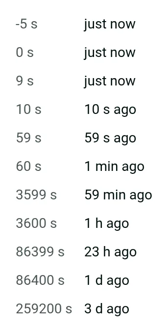

<!-- Written by `npm run docs:pages` from the kit and its examples. Do not edit. -->

# Time

_Components › Status_ · [All topics](../README.md)

How long ago something was, in the kit's one relative-time style: "just now", "12 s ago".

```ts
neatSecondsAgo((Date.now() - lastSeen) / 1000); // "3 min ago"
```

<picture>
<source media="(prefers-color-scheme: dark)" srcset="../images/time/ages.dark.webp">

</picture>

```ts
import { neatSecondsAgo, neatDuration } from '@sima/neat-ui';
```

## Examples

### Ages

The words [`neatSecondsAgo`](../components/time.md#neatsecondsago) says for the ages beside them.

-5 s is a time ahead of now, as a clock that stepped back gives. The rest lie on both sides of each switch of unit.

<picture>
<source media="(prefers-color-scheme: dark)" srcset="../images/time/ages.dark.webp">

</picture>

<details>
<summary>Code</summary>

`1-ages.example.ts`

```ts
import { ChangeDetectionStrategy, Component } from '@angular/core';
import { neatSecondsAgo } from '@sima/neat-ui';
import { NeatDetails } from '@sima/neat-ui/details';

/** Ages in seconds: one ahead of now, then both sides of each switch of unit. */
const AGES = [-5, 0, 9, 10, 59, 60, 3599, 3600, 86_399, 86_400, 259_200];

@Component({
  selector: 'app-ages',
  imports: [NeatDetails],
  changeDetection: ChangeDetectionStrategy.OnPush,
  templateUrl: './1-ages.example.html',
  styleUrl: './ages.example.css',
})
export class Ages {
  protected readonly ages = AGES;
  protected readonly ago = neatSecondsAgo;
}
```

`1-ages.example.html`

```html
<dl neatDetails class="ages">
  @for (age of ages; track age) {
    <dt>{{ age }} s</dt>
    <dd>{{ ago(age) }}</dd>
  }
</dl>
```

`ages.example.css`

```css
/* Both columns are short, so the list takes a narrow column rather than the whole card. */
.ages {
  max-width: 14rem;
}
```

</details>

### Durations

The words [`neatDuration`](../components/time.md#neatduration) says for the lengths of time beside them.

59.9 s is cut to 59 s, as a clock shows it. A negative length and no value at all are a dash.

<details>
<summary>Code</summary>

`2-durations.example.ts`

```ts
import { ChangeDetectionStrategy, Component } from '@angular/core';
import { neatDuration } from '@sima/neat-ui';
import { NeatDetails } from '@sima/neat-ui/details';

/** Lengths in seconds: both sides of each switch of unit, a fraction, and no value. */
const LENGTHS = [0, 59.9, 60, 307, 3599, 3600, 7559, 86_399, 86_400, 273_540, -1, null];

@Component({
  selector: 'app-durations',
  imports: [NeatDetails],
  changeDetection: ChangeDetectionStrategy.OnPush,
  templateUrl: './2-durations.example.html',
  styleUrl: './durations.example.css',
})
export class Durations {
  protected readonly lengths = LENGTHS;
  protected readonly duration = neatDuration;
}
```

`2-durations.example.html`

```html
<dl neatDetails class="durations">
  @for (length of lengths; track $index) {
    <dt>{{ length === null ? 'null' : length + ' s' }}</dt>
    <dd>{{ duration(length) }}</dd>
  }
</dl>
```

`durations.example.css`

```css
/* Both columns are short, so the list takes a narrow column rather than the whole card. */
.durations {
  max-width: 14rem;
}
```

</details>

## API

### `neatSecondsAgo`

Function from `@sima/neat-ui`.

It says "just now" under 10 s, then "12 s ago", "3 min ago", "2 h ago" and "4 d ago". Each is cut to whole units: a minute is 60 whole seconds, an hour 60 minutes.

`seconds` is first rounded to a whole second. A time ahead of now, from a clock that stepped back, reads as "just now".

This is the one place the words and thresholds live. So a page that parses a timestamp, and the charts' readout, cannot say the same age two ways.

For a length of time (an uptime, a track's age), [`neatDuration`](../components/time.md#neatduration) is the kit's style ("5 min 07 s").

```ts
neatSecondsAgo(seconds: number): string
```

### `neatDuration`

Function from `@sima/neat-ui`.

A length of time in the kit's style: "42 s", "5 min 07 s", "2 h 05 min", "3 d 04 h".

```ts
neatDuration(stats.uptime_s); // "2 h 05 min"
```

It says seconds under a minute, then minutes and seconds, hours and minutes, and from 24 h days and hours. The second unit always has two digits, as a clock shows it ("5 min 07 s").

Each unit is cut to whole units, as a clock shows them: 59.9 s is "59 s", and a minute is shown only once it has passed. So a running time counts up as a stopwatch does.

Anything that is not a finite number of at least 0 is "–": `null`, `undefined`, `NaN`, an infinity, a negative number, or a value of another type that came in from JSON. A page can pass a field it has not checked and show the dash, as [`NeatEasedNumber`](../components/motion.md#neateasednumber) does while it has no value.

For how long ago something was, [`neatSecondsAgo`](../components/time.md#neatsecondsago) is the kit's style ("3 min ago").

```ts
neatDuration(seconds: number | null | undefined): string
```
