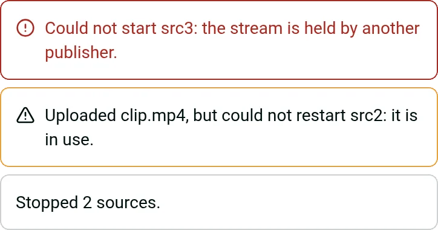
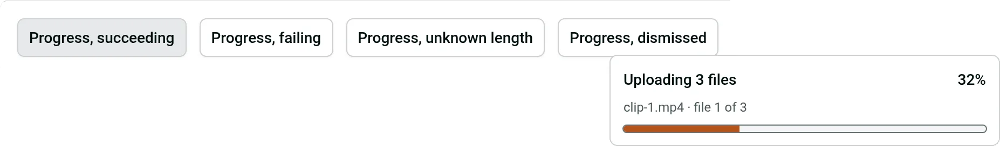

<!-- Written by `npm run docs:pages` from the kit and its examples. Do not edit. -->

# Toast

_Components › Actions_ · [All topics](../README.md)

Short messages the app shows without taking the user's attention from what they are doing:

```ts
this.toasts.error('Could not start src3.');
this.toasts.warning('Uploaded clip.mp4, but could not restart src2.');
this.toasts.status('Stopped 2 sources.');
const upload = this.toasts.progress('Uploading 3 files');
upload.update('clip.mp4 · file 1 of 3', 41);
upload.done('Uploaded 3 files.');
```

<picture>
<source media="(prefers-color-scheme: dark)" srcset="../images/toast/kinds.dark.webp">

</picture>

```ts
import { NeatToasts, NeatToastHost } from '@sima/neat-ui/toast';
```

## Examples

### Kinds

One toast of each short kind. They show in the host the showcase renders once, beside its shell (see the shell topic's last example).

<picture>
<source media="(prefers-color-scheme: dark)" srcset="../images/toast/kinds.dark.webp">

</picture>

<details>
<summary>Code</summary>

`1-kinds.example.ts`

```ts
import { ChangeDetectionStrategy, Component, inject } from '@angular/core';
import { NeatButton } from '@sima/neat-ui';
import { NeatToasts } from '@sima/neat-ui/toast';

@Component({
  selector: 'app-kinds',
  imports: [NeatButton],
  changeDetection: ChangeDetectionStrategy.OnPush,
  template: `
    <div class="showcase-row">
      <button
        neatButton
        type="button"
        variant="outlined"
        (click)="toasts.error('Could not start src3: the stream is held by another publisher.')"
      >
        Error
      </button>
      <button
        neatButton
        type="button"
        variant="outlined"
        (click)="toasts.warning('Uploaded clip.mp4, but could not restart src2: it is in use.')"
      >
        Warning
      </button>
      <button
        neatButton
        type="button"
        variant="outlined"
        (click)="toasts.status('Stopped 2 sources.')"
      >
        Status
      </button>
    </div>
  `,
})
export class Kinds {
  protected readonly toasts = inject(NeatToasts);
}
```

</details>

### Progress

A progress toast for work that takes a while, four ways: succeeding, failing, of unknown length (`null` for the percent), and dismissed halfway, as when a dialog takes the work back. The work is simulated and runs on its own, as an upload does, so leaving the page does not stop the toast from reporting the outcome.

<picture>
<source media="(prefers-color-scheme: dark)" srcset="../images/toast/progress.dark.webp">

</picture>

<details>
<summary>Code</summary>

`2-progress.example.ts`

```ts
import { ChangeDetectionStrategy, Component, inject } from '@angular/core';
import { NeatButton } from '@sima/neat-ui';
import { NeatToasts } from '@sima/neat-ui/toast';

/** How a progress toast ends, as the outcome the button names. */
type Outcome = 'done' | 'fail' | 'unknown' | 'dismiss';

@Component({
  selector: 'app-progress',
  imports: [NeatButton],
  changeDetection: ChangeDetectionStrategy.OnPush,
  template: `
    <div class="showcase-row">
      <button neatButton type="button" variant="outlined" (click)="run('done')">
        Progress, succeeding
      </button>
      <button neatButton type="button" variant="outlined" (click)="run('fail')">
        Progress, failing
      </button>
      <button neatButton type="button" variant="outlined" (click)="run('unknown')">
        Progress, unknown length
      </button>
      <button neatButton type="button" variant="outlined" (click)="run('dismiss')">
        Progress, dismissed
      </button>
    </div>
  `,
})
export class Progress {
  private readonly toasts = inject(NeatToasts);

  /** Reports for a few seconds and then settles; `dismiss` is taken away halfway. */
  protected run(outcome: Outcome): void {
    const toast = this.toasts.progress('Uploading 3 files');
    const known = outcome !== 'unknown';
    let percent = 0;
    const timer = setInterval(() => {
      percent += 8;
      if (outcome === 'dismiss' && percent >= 48) {
        // As when a dialog takes the work back: the toast goes, with no outcome.
        clearInterval(timer);
        toast.dismiss();
        return;
      }
      if (percent < 100) {
        const file = Math.min(3, Math.floor(percent / 34) + 1);
        toast.update(`clip-${file}.mp4 · file ${file} of 3`, known ? percent : null);
        return;
      }
      clearInterval(timer);
      if (outcome === 'fail') toast.fail('Upload failed: no space left on the device.');
      else toast.done('Uploaded 3 files.');
    }, 250);
  }
}
```

</details>

## API

### `NeatToasts`

Service from `@sima/neat-ui/toast`.

An error or warning toast, each led by the icon of its kind, clears after 4.6 seconds and a status toast after 3.2. A progress toast stays until `done` or `fail` turns it into an error or a status, so work that outlives the page or dialog that started it keeps reporting, or until `dismiss` removes it. They show in the `<neat-toast-host>` the app renders once. There is no toast without a host: the app must render one, or nothing is shown.

Toasts do not hold the kiosk toolbar: they are not part of the floating chrome, and they clear on their own.

**Methods**

- **`error`**

  ```ts
  error(message: string): void
  ```

  Reports a failure.

- **`warning`**

  ```ts
  warning(message: string): void
  ```

  Reports something that went partly wrong or needs the user's notice, short of a failure: the upload went through, but a slot using the file could not restart.

- **`status`**

  ```ts
  status(message: string): void
  ```

  Reports what happened: the result of an action.

- **`progress`**

  ```ts
  progress(title: string): NeatProgressToast
  ```

  Starts a toast for work in progress, named by `title`: "Uploading 3 files".

### `NeatToastHost`

Component from `@sima/neat-ui/toast`, selector `neat-toast-host`.

Shows the app's toasts ([`NeatToasts`](../components/toast.md#neattoasts)): render it once, beside the shell, and nowhere else:

```html
<neat-shell …>…</neat-shell>
<neat-toast-host />
```

Not inside the shell: the shell is the kit's primary entry point, which cannot import this one, and an app that shows no toasts should not carry them.

The toasts stack in the bottom-right corner, the newest last, at most three at a time. When more exist, the oldest error, warning and status toasts are hidden first and the oldest progress toasts last (work in progress is what the user is waiting for); a hidden toast shows again if it is still there when the others clear.

What the user sees and what a screen reader announces are two layers. The visible stack is `aria-hidden`. A second overlay, never re-shown and never hidden, holds a visually hidden `aria-live="polite"` region with one entry per toast: the message ("Error: " or "Warning: " in front of an error or a warning), or a progress toast's title. An entry is added when its toast is, so each toast is announced once, as it appears. A progress toast's changing detail and percent are in a nested `aria-live="off"` part: a screen reader finds the current value when it reads the region, but a long upload is not read out every second. The two layers are separate because bringing the stack to the front (below) hides and shows it, which takes a live region out of the accessibility tree and back with its content already in it, and that is not announced.

Both layers are rendered in the CDK overlay layer rather than where the host stands, for two reasons: a modal dialog hides everything outside that layer from assistive technology, which would silence a toast raised by the dialog's own action, and the stack must show above the dialog (as #170's toasts showed above its modals). Overlays stack in the order they were last brought to the front, so each new toast brings the stack to the front again: an error raised by a dialog's own action shows above the dialog, though the host is older. A toast that was on screen before a dialog opened stays under the dialog until it clears or a newer toast arrives.

The stack takes no pointer events: it has nothing to click, and a progress toast that stays for as long as an upload runs must not sit on a dialog's buttons. Clicks pass through to whatever is under a toast; the cost is that toast text cannot be selected.

### `NeatProgressToast`

Interface from `@sima/neat-ui/toast`.

A toast for work that takes a while, as [`NeatToasts.progress`](../components/toast.md#neattoasts) returns it.

**Methods**

- **`update`**

  ```ts
  update(detail: string, percent: number | null): void
  ```

  Shows how far the work is: a line of detail ("clip.mp4 · file 1 of 3") and a percent from 0 to 100, or `null` while it cannot say. Values outside the range are held to it.

- **`done`**

  ```ts
  done(message: string): void
  ```

  The work succeeded: the toast becomes a status toast with this message.

- **`fail`**

  ```ts
  fail(message: string): void
  ```

  The work failed: the toast becomes an error toast with this message.

- **`dismiss`**

  ```ts
  dismiss(): void
  ```

  Removes the toast with no outcome: the work did not end, it is reported elsewhere now (a dialog that took it back). Nothing is announced. After it, and after `done` or `fail`, the handle does nothing.
