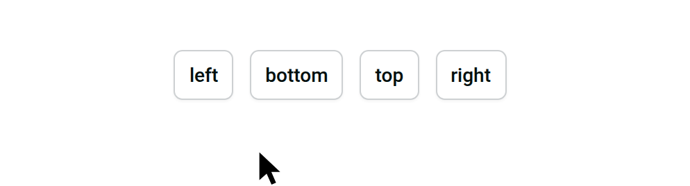

<!-- Written by `npm run docs:pages` from the kit and its examples. Do not edit. -->

# Tooltip

_Components › Actions_ · [All topics](../README.md)

A short text label shown on hover and on keyboard focus.

```html
<button neatButton type="button" variant="text" iconOnly aria-label="View options"
        neatTooltip="View options">
  <neat-icon name="more" />
</button>
```

<picture>
<source media="(prefers-reduced-motion: reduce) and (prefers-color-scheme: dark)" srcset="../images/tooltip/positions.dark.webp">
<source media="(prefers-reduced-motion: reduce)" srcset="../images/tooltip/positions.light.webp">
<source media="(prefers-color-scheme: dark)" srcset="../images/tooltip/positions.dark.animated.webp">

</picture>

```ts
import { NeatTooltip } from '@sima/neat-ui';
```

## Examples

### Positions

A tooltip on each of the four sides of its button; hover a button or focus it with Tab.

<picture>
<source media="(prefers-reduced-motion: reduce) and (prefers-color-scheme: dark)" srcset="../images/tooltip/positions.dark.webp">
<source media="(prefers-reduced-motion: reduce)" srcset="../images/tooltip/positions.light.webp">
<source media="(prefers-color-scheme: dark)" srcset="../images/tooltip/positions.dark.animated.webp">

</picture>

<details>
<summary>Code</summary>

`1-positions.example.ts`

```ts
import { ChangeDetectionStrategy, Component } from '@angular/core';
import { NeatButton, NeatTooltip, type NeatTooltipPosition } from '@sima/neat-ui';

@Component({
  selector: 'app-positions',
  imports: [NeatButton, NeatTooltip],
  changeDetection: ChangeDetectionStrategy.OnPush,
  templateUrl: './1-positions.example.html',
  styleUrl: './positions.example.css',
})
export class Positions {
  /** Vim's h j k l; the outer tips point away from the row, so no tip covers a neighbor. */
  protected readonly positions: readonly NeatTooltipPosition[] = ['left', 'bottom', 'top', 'right'];
}
```

`1-positions.example.html`

```html
<div class="row">
  @for (position of positions; track position) {
    <button
      neatButton
      type="button"
      variant="outlined"
      [neatTooltip]="'Tooltip on the ' + position"
      [neatTooltipPosition]="position"
    >
      {{ position }}
    </button>
  }
</div>
```

`positions.example.css`

```css
/* Centered, so the outer tips have room to open away from the row. */
.row {
  display: flex;
  flex-wrap: wrap;
  align-items: center;
  justify-content: center;
  gap: var(--neat-space-3);
}
```

</details>

## API

### `NeatTooltip`

Directive from `@sima/neat-ui`, selector `[neatTooltip]`.

It shows on mouse or pen hover and on keyboard focus, and hides on leave, blur and Escape. The host carries `aria-describedby` while it is shown.

It never opens on touch, since a tap would trigger the host's action too. So it must not carry anything the host's accessible name does not.

`neatTooltip` takes a string only. Its declared type is brain's (`string | TemplateRef | null`) because a host-directive alias keeps the primitive's input type; templates are not supported.

**Inputs**

- **`neatTooltip`** `string | TemplateRef<void> | null`

  The text to show, which also names the directive: `neatTooltip="Delete"`. A string only; empty shows nothing.

- **`neatTooltipPosition`** `'top' | 'bottom' | 'left' | 'right'`

  The side of the host the tooltip prefers, `top` by default; it goes to another side when it has no room there.

- **`neatTooltipDisabled`** `boolean`

  Turns the tooltip off, for a host that needs none at the moment. An attribute alone means true.

### `NeatTooltipPosition`

Type from `@sima/neat-ui`.

The side of its host a tooltip opens on.

```ts
type NeatTooltipPosition = 'top' | 'right' | 'bottom' | 'left'
```
