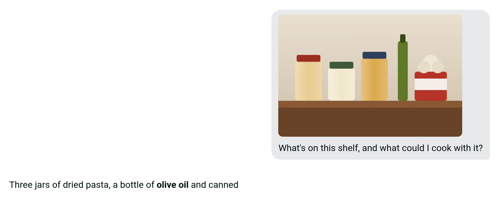
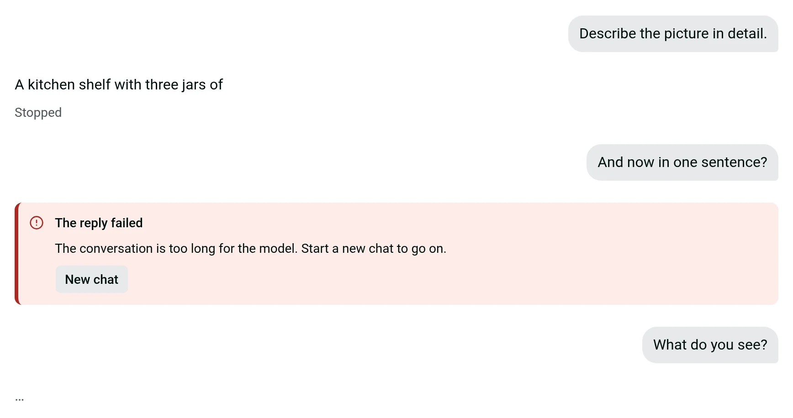

<!-- Written by `npm run docs:pages` from the kit and its examples. Do not edit. -->

# Transcript

_Components › Chat_ · [All topics](../README.md)

A conversation with a model, drawn from the app's messages: the visitor's questions as bubbles on the end side with their pictures, the model's replies as Markdown across the width.

```html
<neat-page scroll="none">
  <neat-chat-transcript [messages]="conversation.messages()" />
  <neat-message-box (send)="conversation.ask($event)" />
</neat-page>
```

<picture>
<source media="(prefers-reduced-motion: reduce) and (prefers-color-scheme: dark)" srcset="../images/transcript/conversation.dark.webp">
<source media="(prefers-reduced-motion: reduce)" srcset="../images/transcript/conversation.light.webp">
<source media="(prefers-color-scheme: dark)" srcset="../images/transcript/conversation.dark.animated.webp">

</picture>

```ts
import { NeatChatTranscript, NeatChatMessageFooter, NeatChatErrorActions } from '@sima/neat-ui/chat';
```

## Examples

### Conversation

A question with a picture and its reply streaming in, as the app writes it: the whole text so far, once per piece. Once it is done, the app's line under it gives the board's figures. The conversation starts again after a pause.

<picture>
<source media="(prefers-reduced-motion: reduce) and (prefers-color-scheme: dark)" srcset="../images/transcript/conversation.dark.webp">
<source media="(prefers-reduced-motion: reduce)" srcset="../images/transcript/conversation.light.webp">
<source media="(prefers-color-scheme: dark)" srcset="../images/transcript/conversation.dark.animated.webp">

</picture>

<details>
<summary>Code</summary>

`1-conversation.example.ts`

```ts
import {
  ChangeDetectionStrategy,
  Component,
  computed,
  DestroyRef,
  inject,
  signal,
} from '@angular/core';
import {
  NeatChatMessageFooter,
  NeatChatTranscript,
  type NeatChatMessage,
} from '@sima/neat-ui/chat';

/** The reply this example streams. */
const REPLY =
  'Three jars of dried pasta, a bottle of **olive oil** and canned tomatoes. Together that is most ' +
  'of a *pasta al pomodoro*: sauté the garlic in the oil, add the tomatoes, and let them simmer ' +
  'while the pasta boils.';

const PIECES = REPLY.match(/\s+|\S+/g) ?? [];

@Component({
  selector: 'app-conversation',
  imports: [NeatChatTranscript, NeatChatMessageFooter],
  changeDetection: ChangeDetectionStrategy.OnPush,
  templateUrl: './1-conversation.example.html',
  styleUrl: './conversation.example.css',
})
export class Conversation {
  private readonly reply = signal<NeatChatMessage>({
    id: 'a1',
    role: 'assistant',
    text: '',
    state: 'waiting',
  });

  protected readonly messages = computed<NeatChatMessage[]>(() => [
    {
      id: 'q1',
      role: 'user',
      text: "What's on this shelf, and what could I cook with it?",
      pictures: [{ id: 'shelf', src: 'examples/shelf.webp', name: 'A kitchen shelf' }],
    },
    this.reply(),
  ]);

  constructor() {
    let tick = 0;
    const timer = setInterval(() => {
      tick++;
      const shown = tick - 10; // a first word after 0.4 s
      if (shown > 0 && shown <= PIECES.length) {
        this.reply.set({
          id: 'a1',
          role: 'assistant',
          text: PIECES.slice(0, shown).join(''),
          state: shown === PIECES.length ? 'done' : 'streaming',
        });
      } else if (shown > PIECES.length + 60) {
        tick = 0;
        this.reply.set({ id: 'a1', role: 'assistant', text: '', state: 'waiting' });
      }
    }, 40);
    inject(DestroyRef).onDestroy(() => clearInterval(timer));
  }
}
```

`1-conversation.example.html`

```html
<neat-chat-transcript [messages]="messages()">
  <ng-template neatChatMessageFooter let-message>
    @if (message.role === 'assistant' && message.state === 'done') {
      <span>first word 0.22 s · 24.6 words/s</span>
    }
  </ng-template>
</neat-chat-transcript>
```

`conversation.example.css`

```css
/* The transcript scrolls itself, so its parent gives it a height. */
:host {
  display: flex;
  flex-direction: column;
  height: 22rem;
}
```

</details>

### States

The other states of a reply: one the visitor stopped, one that failed, with the app's New chat button in its callout, and one still waiting for its first word.

<picture>
<source media="(prefers-color-scheme: dark)" srcset="../images/transcript/states.dark.webp">

</picture>

<details>
<summary>Code</summary>

`2-states.example.ts`

```ts
import { ChangeDetectionStrategy, Component, signal } from '@angular/core';
import { NeatButton } from '@sima/neat-ui';
import { NeatChatErrorActions, NeatChatTranscript, type NeatChatMessage } from '@sima/neat-ui/chat';

/** A conversation that holds every state a reply has. */
const CONVERSATION: NeatChatMessage[] = [
  { id: 'q1', role: 'user', text: 'Describe the picture in detail.' },
  { id: 'a1', role: 'assistant', text: 'A kitchen shelf with three jars of', state: 'stopped' },
  { id: 'q2', role: 'user', text: 'And now in one sentence?' },
  {
    id: 'a2',
    role: 'assistant',
    text: '',
    state: 'error',
    error: 'The conversation is too long for the model. Start a new chat to go on.',
  },
  { id: 'q3', role: 'user', text: 'What do you see?' },
  { id: 'a3', role: 'assistant', text: '', state: 'waiting' },
];

@Component({
  selector: 'app-states',
  imports: [NeatButton, NeatChatErrorActions, NeatChatTranscript],
  changeDetection: ChangeDetectionStrategy.OnPush,
  templateUrl: './2-states.example.html',
  styleUrl: './states.example.css',
})
export class States {
  protected readonly messages = signal<NeatChatMessage[]>(CONVERSATION);

  protected newChat(): void {
    this.messages.set([]);
    setTimeout(() => this.messages.set(CONVERSATION), 1500);
  }
}
```

`2-states.example.html`

```html
<neat-chat-transcript [messages]="messages()">
  <ng-template neatChatErrorActions>
    <button neatButton variant="secondary" size="small" type="button" (click)="newChat()">
      New chat
    </button>
  </ng-template>
</neat-chat-transcript>
```

`states.example.css`

```css
/* The transcript scrolls itself, so its parent gives it a height. */
:host {
  display: flex;
  flex-direction: column;
  height: 36rem;
}
```

</details>

## API

### `NeatChatTranscript`

Component from `@sima/neat-ui/chat`, selector `neat-chat-transcript`.

**The messages are plain data the app owns** ([`NeatChatMessage`](../components/transcript.md#neatchatmessage)). While a reply streams, the app writes its whole text so far, once for each piece that arrives; the transcript shows what is new and keeps what it already drew. A reply is `waiting` (a still "…" until its first word), `streaming` (with a caret at its end), `done`, `stopped` ("Stopped" after its text) or `error` (the message's `error` in a danger callout, with the app's `neatChatErrorActions` buttons). `neatChatMessageFooter` adds the app's own line under each message.

**It scrolls itself**, as the page's one scroll area (put it in `neat-page scroll="none"` with its parent giving it the height): it follows a growing reply (and a picture that loads) while the reader is at the end, stops as soon as they scroll up, and then shows Latest, which goes back to the end and follows again. A question the visitor sends brings it back to the end too.

**For assistive technology** it is a `log` named by `label` that is not live, so a reply is not read token by token, and a tab stop, so it scrolls by keys; once a reply is done, a polite announcement reads "Reply finished:" and its beginning, and "Reply failed:" and why when it fails. Latest leaves the focus on the log.

**Inputs**

- **`messages`** `readonly NeatChatMessage[]`, required

  The conversation, oldest first.

- **`label`** `string`, default `'Conversation'`

  The name of the conversation for assistive technology.

### `NeatChatMessage`

Interface from `@sima/neat-ui/chat`.

One message of a conversation, plain data the app owns: a question or a reply. While a reply streams, the app writes its whole text so far with each piece that arrives (a new object each time, the same `id`); the transcript shows what is new.

**Members**

- **`id`** `string`

  Stable for the message's life: the transcript keeps its elements by it.

- **`role`** `NeatChatRole`

- **`text`** `string`

  A reply's text is Markdown; a question's is shown as written.

- **`pictures`** `readonly NeatChatPicture[]`, optional

- **`state`** `NeatChatState`, optional

  `done` when not given.

- **`error`** `string`, optional

  Why the reply failed, shown while `state` is `error`: the server's message, as it is.

### `NeatChatRole`

Type from `@sima/neat-ui/chat`.

Who wrote a message: the visitor (`user`) or the model (`assistant`), as OpenAI's API says.

```ts
type NeatChatRole = 'user' | 'assistant'
```

### `NeatChatState`

Type from `@sima/neat-ui/chat`.

Where a reply is:

- `waiting`: sent, no word yet;
- `streaming`: its text grows;
- `done`: complete (a message without a state is done);
- `stopped`: cut short by the visitor (Stop), its text as far as it came;
- `error`: it failed, and `error` says why.

```ts
type NeatChatState = 'waiting' | 'streaming' | 'done' | 'stopped' | 'error'
```

### `NeatChatMessageFooter`

Template directive from `@sima/neat-ui/chat`, selector `ng-template[neatChatMessageFooter]`.

The app's line under a message, given the message: a reply's figures ("first word 0.22 s · 24.6 words/s"), how a spoken question was heard. One template for every message; match the message inside it.

```html
<ng-template neatChatMessageFooter let-message>
  @if (figures(message.id); as f) { first word {{ f.firstWord }} s }
</ng-template>
```

**Template context**

- **`$implicit`** `NeatChatMessage`

### `NeatChatErrorActions`

Template directive from `@sima/neat-ui/chat`, selector `ng-template[neatChatErrorActions]`.

The app's buttons in a failed reply's callout, given the message: "New chat" when the conversation outgrew the model, "Try again" for a lost connection.

**Template context**

- **`$implicit`** `NeatChatMessage`
