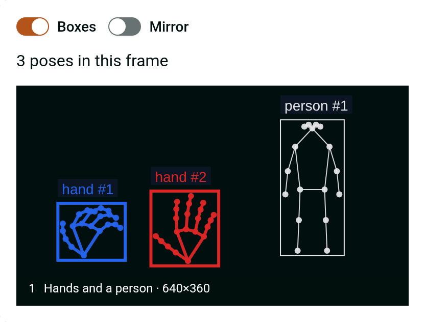
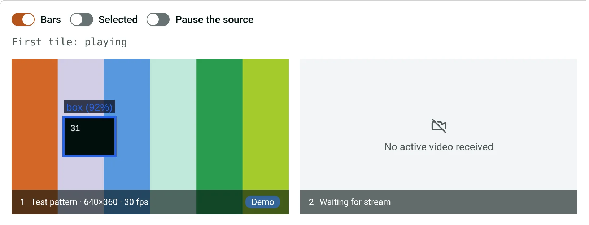

<!-- Written by `npm run docs:pages` from the kit and its examples. Do not edit. -->

# Video tile

_Components › Video_ · [All topics](../README.md)

Plays a source's video, with its metadata drawn over it as overlays.

```html
<neat-video-tile [source]="source" label="1" status="640×360 · 30 fps" />
```

<picture>
<source media="(prefers-reduced-motion: reduce) and (prefers-color-scheme: dark)" srcset="../images/video-tile/poses.dark.webp">
<source media="(prefers-reduced-motion: reduce)" srcset="../images/video-tile/poses.light.webp">
<source media="(prefers-color-scheme: dark)" srcset="../images/video-tile/poses.dark.animated.webp">

</picture>

```ts
import { NeatVideoTile, NEAT_OVERLAY_DEFAULTS, NEAT_OVERLAY_STYLE_FALLBACK_COLOR } from '@sima/neat-ui/video';
```

## Examples

### Test pattern tiles

The first tile plays a canvas test pattern with a detection every other frame, which the tile holds in between. Pause the source and the tile goes stopped a moment later, which the readout says. The second has no stream, so it is empty. Bars shows and hides the bar of both.

<picture>
<source media="(prefers-color-scheme: dark)" srcset="../images/video-tile/test-pattern-tiles.dark.webp">

</picture>

<details>
<summary>Code</summary>

`1-test-pattern-tiles.example.ts`

```ts
import {
  afterNextRender,
  ChangeDetectionStrategy,
  Component,
  computed,
  DestroyRef,
  DOCUMENT,
  inject,
  signal,
} from '@angular/core';
import { NeatSwitch } from '@sima/neat-ui/switch';
import { type NeatTileState, NeatVideoTile } from '@sima/neat-ui/video';
import { TestPatternSource } from './test-pattern-source';

@Component({
  selector: 'app-test-pattern-tiles',
  imports: [NeatSwitch, NeatVideoTile],
  changeDetection: ChangeDetectionStrategy.OnPush,
  templateUrl: './1-test-pattern-tiles.example.html',
  styleUrl: './test-pattern-tiles.example.css',
})
export class TestPatternTiles {
  protected readonly testPattern = new TestPatternSource();
  protected readonly bars = signal(true);
  protected readonly selected = signal(false);
  protected readonly state = signal<NeatTileState>('empty');
  protected readonly summary = computed(() => `First tile: ${this.state()}`);

  constructor() {
    const document = inject(DOCUMENT);
    afterNextRender(() => this.testPattern.start(document));
    inject(DestroyRef).onDestroy(() => this.testPattern.stop());
  }
}
```

`1-test-pattern-tiles.example.html`

```html
<div class="showcase-row">
  <button neatSwitch [(checked)]="bars">Bars</button>
  <button neatSwitch [(checked)]="selected">Selected</button>
  <button neatSwitch (checkedChange)="testPattern.setPaused($event)">Pause the source</button>
</div>
<p class="showcase-code showcase-muted" aria-live="polite">{{ summary() }}</p>
<div class="tiles">
  <div class="cell">
    <neat-video-tile
      [source]="testPattern"
      label="1"
      status="Test pattern · 640×360 · 30 fps"
      [bars]="bars()"
      [selected]="selected()"
      (stateChange)="state.set($event)"
    >
      <span neatTileChip class="chip">Demo</span>
    </neat-video-tile>
  </div>
  <div class="cell">
    <neat-video-tile label="2" status="Waiting for stream" [bars]="bars()" />
  </div>
</div>
```

`test-pattern-source.ts`

```ts
import { SIMA_PALETTE } from '@sima/neat-ui';
import { CanvasSource, HEIGHT, WIDTH } from './canvas-source';

const BAR_COLORS = [
  SIMA_PALETTE.orange,
  SIMA_PALETTE.purple,
  SIMA_PALETTE.blue,
  SIMA_PALETTE.mint,
  SIMA_PALETTE.green,
  SIMA_PALETTE.lime,
];
const BOX = { width: 120, height: 90 };
/** Detections come every other frame, as from a model slower than the video; held between. */
const DETECTION_EVERY = 2;

/**
 * A canvas test pattern, with object-detection metadata for the box moving across it: one type,
 * as the tile matches a canvas stream's metadata by arrival. Pausing stops painting, so the stream
 * presents no frames and the tile goes stopped.
 */
export class TestPatternSource extends CanvasSource {
  private frame = 0;
  private paused = false;

  setPaused(paused: boolean): void {
    this.paused = paused;
  }

  protected paint(ctx: CanvasRenderingContext2D): void {
    if (this.paused) return;
    const barWidth = WIDTH / BAR_COLORS.length;
    BAR_COLORS.forEach((color, i) => {
      ctx.fillStyle = color;
      ctx.fillRect(i * barWidth, 0, barWidth, HEIGHT);
    });

    // The box bounces between the edges, four pixels per frame.
    const travel = WIDTH - BOX.width;
    const step = (this.frame * 4) % (2 * travel);
    const x = step < travel ? step : 2 * travel - step;
    const y = (HEIGHT - BOX.height) / 2;
    ctx.fillStyle = SIMA_PALETTE.text;
    ctx.fillRect(x, y, BOX.width, BOX.height);
    ctx.fillStyle = SIMA_PALETTE.white;
    ctx.font = '500 20px sans-serif';
    ctx.fillText(String(this.frame), x + 12, y + 32);

    if (this.frame % DETECTION_EVERY === 0) {
      this.send({
        type: 'object-detection',
        data: {
          objects: [{ label: 'box', confidence: 0.92, bbox: [x, y, BOX.width, BOX.height] }],
        },
      });
    }
    this.frame += 1;
  }
}
```

`canvas-source.ts`

```ts
import { signal } from '@angular/core';
import type { NeatMetadataMessage, NeatTileSource } from '@sima/neat-ui/video';

export const WIDTH = 640;
export const HEIGHT = 360;
export const FRAMES_PER_SECOND = 30;

/**
 * What the showcase's sources share, so a tile plays without vf: a canvas streamed with
 * `captureStream()`, painted 30 times a second, and the metadata listeners. Each source paints a
 * frame and sends the metadata that describes it. A canvas stream has no RTP timestamps, so the
 * tile matches metadata by arrival, which takes only the latest message: hence one type a source.
 */
export abstract class CanvasSource implements NeatTileSource {
  readonly stream = signal<MediaStream | null>(null);

  private readonly listeners = new Set<(text: string, receivedAt: number) => void>();
  private animation = 0;
  private lastPaintAt = 0;

  onMetadata(listener: (text: string, receivedAt: number) => void): () => void {
    this.listeners.add(listener);
    return () => this.listeners.delete(listener);
  }

  /** Starts the stream; does nothing where canvases cannot be streamed (as in unit tests). */
  start(document: Document): void {
    const canvas = document.createElement('canvas');
    if (typeof canvas.captureStream !== 'function') return;
    canvas.width = WIDTH;
    canvas.height = HEIGHT;
    const context = canvas.getContext('2d');
    if (context === null) return;
    this.stream.set(canvas.captureStream(FRAMES_PER_SECOND));
    const loop = (now: number) => {
      this.animation = requestAnimationFrame(loop);
      if (now - this.lastPaintAt < 1000 / FRAMES_PER_SECOND) return;
      this.lastPaintAt = now;
      this.paint(context);
    };
    this.animation = requestAnimationFrame(loop);
  }

  stop(): void {
    cancelAnimationFrame(this.animation);
    for (const track of this.stream()?.getTracks() ?? []) track.stop();
    this.stream.set(null);
    this.listeners.clear();
  }

  /** Paints the next frame on `ctx` and sends its metadata. Painting nothing presents no frame. */
  protected abstract paint(ctx: CanvasRenderingContext2D): void;

  protected send(message: NeatMetadataMessage): void {
    const text = JSON.stringify(message);
    const receivedAt = performance.now();
    for (const listener of this.listeners) listener(text, receivedAt);
  }
}
```

`test-pattern-tiles.example.css`

```css
:host {
  display: flex;
  flex-direction: column;
  gap: var(--neat-space-3);
}

.tiles {
  display: grid;
  grid-template-columns: repeat(auto-fill, minmax(16rem, 24rem));
  gap: var(--neat-space-4);
}

/* A tile fills its cell, so the cell gives it a size: a 16:9 box as wide as the grid column. */
.cell {
  aspect-ratio: 16 / 9;
}

.chip {
  padding: 0 var(--neat-space-2);
  border-radius: var(--radius);
  background: var(--info);
  color: var(--info-foreground);
}
```

</details>

### Poses

Two hands and a person in one `pose-estimation` message. A hand draws as MediaPipe's 21 landmarks and links, and a person as COCO's keypoints.

The `objects` rows style a pose by its label. Here the person is a thin light gray, and the hands keep the color of their ids.

Try the switches. Boxes shows and hides the box and label plate around each pose. Mirror flips the picture and the poses, not their labels.

The line under the switches is fed by the tile's `frameListener`. It gets each frame's matched messages outside Angular, so it writes its signal only when the count changes.

<picture>
<source media="(prefers-reduced-motion: reduce) and (prefers-color-scheme: dark)" srcset="../images/video-tile/poses.dark.webp">
<source media="(prefers-reduced-motion: reduce)" srcset="../images/video-tile/poses.light.webp">
<source media="(prefers-color-scheme: dark)" srcset="../images/video-tile/poses.dark.animated.webp">

</picture>

<details>
<summary>Code</summary>

`2-poses.example.ts`

```ts
import {
  afterNextRender,
  ChangeDetectionStrategy,
  Component,
  computed,
  DestroyRef,
  DOCUMENT,
  inject,
  signal,
} from '@angular/core';
import { SIMA_PALETTE } from '@sima/neat-ui';
import { NeatSwitch } from '@sima/neat-ui/switch';
import {
  NEAT_OVERLAY_DEFAULTS,
  type NeatOverlaySettings,
  type NeatTileFrame,
  NeatVideoTile,
} from '@sima/neat-ui/video';
import { PoseSource } from './pose-source';

@Component({
  selector: 'app-poses',
  imports: [NeatSwitch, NeatVideoTile],
  changeDetection: ChangeDetectionStrategy.OnPush,
  templateUrl: './2-poses.example.html',
  styleUrl: './test-pattern-tiles.example.css',
})
export class Poses {
  protected readonly poses = new PoseSource();
  protected readonly boxes = signal(true);
  protected readonly mirror = signal(false);
  protected readonly poseCount = signal(0);
  protected readonly countPoses = ({ messages }: NeatTileFrame): void => {
    const found = messages.find(({ message }) => message.type === 'pose-estimation');
    const poses = (found?.message.data as { poses?: readonly unknown[] } | undefined)?.poses;
    this.poseCount.set(poses?.length ?? 0);
  };
  protected readonly settings = computed<NeatOverlaySettings>(() => ({
    ...NEAT_OVERLAY_DEFAULTS,
    types: {
      ...NEAT_OVERLAY_DEFAULTS.types,
      'pose-estimation': {
        ...NEAT_OVERLAY_DEFAULTS.types['pose-estimation'],
        showBoxes: this.boxes(),
        objects: [{ label: 'person', color: SIMA_PALETTE.backgroundAlt, style: 'solid', width: 1 }],
      },
    },
  }));

  constructor() {
    const document = inject(DOCUMENT);
    afterNextRender(() => this.poses.start(document));
    inject(DestroyRef).onDestroy(() => this.poses.stop());
  }
}
```

`2-poses.example.html`

```html
<div class="showcase-row">
  <button neatSwitch [(checked)]="boxes">Boxes</button>
  <button neatSwitch [(checked)]="mirror">Mirror</button>
</div>
<p>{{ poseCount() }} {{ poseCount() === 1 ? 'pose' : 'poses' }} in this frame</p>
<div class="tiles">
  <div class="cell">
    <neat-video-tile
      [source]="poses"
      label="1"
      status="Hands and a person · 640×360"
      [settings]="settings()"
      [mirror]="mirror()"
      [frameListener]="countPoses"
    />
  </div>
</div>
```

`pose-source.ts`

```ts
import { SIMA_PALETTE } from '@sima/neat-ui';
import type { NeatMetadataMessage } from '@sima/neat-ui/video';
import { CanvasSource, FRAMES_PER_SECOND, HEIGHT, WIDTH } from './canvas-source';

/** MediaPipe's hand landmarks in snake case, wrist first, then the thumb and the four fingers. */
export const HAND_LANDMARKS: readonly string[] = [
  'wrist',
  ...['thumb', 'index_finger', 'middle_finger', 'ring_finger', 'pinky'].flatMap((finger) =>
    (finger === 'thumb' ? ['cmc', 'mcp', 'ip', 'tip'] : ['mcp', 'pip', 'dip', 'tip']).map(
      (joint) => `${finger}_${joint}`,
    ),
  ),
];

/** COCO's body keypoints as `[name, dx, dy]` from the person's nose, in video pixels. */
const PERSON_POINTS: readonly (readonly [string, number, number])[] = [
  ['nose', 0, 0],
  ['left_eye', -6, -6],
  ['right_eye', 6, -6],
  ['left_ear', -13, -3],
  ['right_ear', 13, -3],
  ['left_shoulder', -28, 30],
  ['right_shoulder', 28, 30],
  ['left_elbow', -40, 70],
  ['right_elbow', 40, 70],
  ['left_wrist', -44, 108],
  ['right_wrist', 44, 108],
  ['left_hip', -20, 100],
  ['right_hip', 20, 100],
  ['left_knee', -22, 150],
  ['right_knee', 22, 150],
  ['left_ankle', -24, 200],
  ['right_ankle', 24, 200],
];

/** Each finger's knuckle on the palm, and the direction it points, in degrees from straight up. */
const FINGERS = [
  { base: [-20, -14], angle: -55, lengths: [16, 14, 12] },
  { base: [-18, -48], angle: -8, lengths: [22, 15, 12] },
  { base: [-3, -52], angle: 0, lengths: [25, 17, 13] },
  { base: [12, -48], angle: 7, lengths: [22, 15, 12] },
  { base: [26, -40], angle: 16, lengths: [17, 12, 10] },
] as const;

/** One MediaPipe hand with its wrist at (x, y); `curl` bends the fingers, 0 straight to 1 fist. */
export function handPose(id: string, x: number, y: number, curl: number): unknown {
  const keypoints = [{ name: 'wrist', x, y, z: 0, confidence: 0.97 }];
  FINGERS.forEach((finger, f) => {
    let [px, py] = [x + finger.base[0], y + finger.base[1]];
    let angle = finger.angle;
    // The thumb starts at its CMC joint on the palm; the other fingers at their MCP knuckle.
    const joints = f === 0 ? ['cmc', 'mcp', 'ip', 'tip'] : ['mcp', 'pip', 'dip', 'tip'];
    const name = ['thumb', 'index_finger', 'middle_finger', 'ring_finger', 'pinky'][f];
    joints.forEach((joint, j) => {
      if (j > 0) {
        angle += curl * 38 * (f === 0 ? 0.5 : 1);
        const rad = (angle * Math.PI) / 180;
        px += Math.sin(rad) * finger.lengths[j - 1];
        py -= Math.cos(rad) * finger.lengths[j - 1];
      }
      keypoints.push({ name: `${name}_${joint}`, x: px, y: py, z: -0.01 * j, confidence: 0.95 });
    });
  });
  return { id, label: 'hand', keypoints };
}

export function personPose(id: string, x: number, y: number): unknown {
  return {
    id,
    label: 'person',
    keypoints: PERSON_POINTS.map(([name, dx, dy]) => ({
      name,
      x: x + dx,
      y: y + dy,
      confidence: 0.9,
    })),
  };
}

/** The pose message for animation frame `frame`: two hands that open and close, and a person. */
export function poseMessage(frame: number): NeatMetadataMessage {
  const t = frame / FRAMES_PER_SECOND;
  const curl = (phase: number) => 0.5 + 0.5 * Math.sin(t * 2 + phase);
  return {
    type: 'pose-estimation',
    data: {
      poses: [
        personPose('1', 470 + 20 * Math.sin(t * 0.7), 70),
        handPose('1', 110, 270 + 8 * Math.sin(t * 1.3), curl(0)),
        handPose('2', 280, 280 + 8 * Math.sin(t * 1.1 + 1), curl(2)),
      ],
    },
  };
}

/** A dark canvas stream with, for each frame, two hands and a person moving over it. */
export class PoseSource extends CanvasSource {
  private frame = 0;

  protected paint(ctx: CanvasRenderingContext2D): void {
    ctx.fillStyle = SIMA_PALETTE.text;
    ctx.fillRect(0, 0, WIDTH, HEIGHT);
    this.send(poseMessage(this.frame));
    this.frame += 1;
  }
}
```

`canvas-source.ts`

```ts
import { signal } from '@angular/core';
import type { NeatMetadataMessage, NeatTileSource } from '@sima/neat-ui/video';

export const WIDTH = 640;
export const HEIGHT = 360;
export const FRAMES_PER_SECOND = 30;

/**
 * What the showcase's sources share, so a tile plays without vf: a canvas streamed with
 * `captureStream()`, painted 30 times a second, and the metadata listeners. Each source paints a
 * frame and sends the metadata that describes it. A canvas stream has no RTP timestamps, so the
 * tile matches metadata by arrival, which takes only the latest message: hence one type a source.
 */
export abstract class CanvasSource implements NeatTileSource {
  readonly stream = signal<MediaStream | null>(null);

  private readonly listeners = new Set<(text: string, receivedAt: number) => void>();
  private animation = 0;
  private lastPaintAt = 0;

  onMetadata(listener: (text: string, receivedAt: number) => void): () => void {
    this.listeners.add(listener);
    return () => this.listeners.delete(listener);
  }

  /** Starts the stream; does nothing where canvases cannot be streamed (as in unit tests). */
  start(document: Document): void {
    const canvas = document.createElement('canvas');
    if (typeof canvas.captureStream !== 'function') return;
    canvas.width = WIDTH;
    canvas.height = HEIGHT;
    const context = canvas.getContext('2d');
    if (context === null) return;
    this.stream.set(canvas.captureStream(FRAMES_PER_SECOND));
    const loop = (now: number) => {
      this.animation = requestAnimationFrame(loop);
      if (now - this.lastPaintAt < 1000 / FRAMES_PER_SECOND) return;
      this.lastPaintAt = now;
      this.paint(context);
    };
    this.animation = requestAnimationFrame(loop);
  }

  stop(): void {
    cancelAnimationFrame(this.animation);
    for (const track of this.stream()?.getTracks() ?? []) track.stop();
    this.stream.set(null);
    this.listeners.clear();
  }

  /** Paints the next frame on `ctx` and sends its metadata. Painting nothing presents no frame. */
  protected abstract paint(ctx: CanvasRenderingContext2D): void;

  protected send(message: NeatMetadataMessage): void {
    const text = JSON.stringify(message);
    const receivedAt = performance.now();
    for (const listener of this.listeners) listener(text, receivedAt);
  }
}
```

`test-pattern-tiles.example.css`

```css
:host {
  display: flex;
  flex-direction: column;
  gap: var(--neat-space-3);
}

.tiles {
  display: grid;
  grid-template-columns: repeat(auto-fill, minmax(16rem, 24rem));
  gap: var(--neat-space-4);
}

/* A tile fills its cell, so the cell gives it a size: a 16:9 box as wide as the grid column. */
.cell {
  aspect-ratio: 16 / 9;
}

.chip {
  padding: 0 var(--neat-space-2);
  border-radius: var(--radius);
  background: var(--info);
  color: var(--info-foreground);
}
```

</details>

### Notice

Two tiles without bars, as a page with one large video shows them, each saying its trouble with `notice`. The first plays the test pattern. Turn on Inference stopped and its notice shows as a warning chip in the picture's corner. Pause the source and the notice moves to the middle once the tile has stopped. The second has no stream and says "No signal".

<details>
<summary>Code</summary>

`3-notice.example.ts`

```ts
import {
  afterNextRender,
  ChangeDetectionStrategy,
  Component,
  computed,
  DestroyRef,
  DOCUMENT,
  inject,
  signal,
} from '@angular/core';
import { NeatSwitch } from '@sima/neat-ui/switch';
import { NeatVideoTile } from '@sima/neat-ui/video';
import { TestPatternSource } from './test-pattern-source';

@Component({
  selector: 'app-notice',
  imports: [NeatSwitch, NeatVideoTile],
  changeDetection: ChangeDetectionStrategy.OnPush,
  templateUrl: './3-notice.example.html',
  styleUrl: './test-pattern-tiles.example.css',
})
export class Notice {
  protected readonly testPattern = new TestPatternSource();
  protected readonly inferenceStopped = signal(false);
  /** What keeps the first tile from showing as it should; null while all is well. */
  protected readonly trouble = computed(() =>
    this.inferenceStopped() ? 'Inference stopped' : null,
  );

  constructor() {
    const document = inject(DOCUMENT);
    afterNextRender(() => this.testPattern.start(document));
    inject(DestroyRef).onDestroy(() => this.testPattern.stop());
  }
}
```

`3-notice.example.html`

```html
<div class="showcase-row">
  <button neatSwitch [(checked)]="inferenceStopped">Inference stopped</button>
  <button neatSwitch (checkedChange)="testPattern.setPaused($event)">Pause the source</button>
</div>
<div class="tiles">
  <div class="cell">
    <neat-video-tile [source]="testPattern" [bars]="false" [notice]="trouble()" />
  </div>
  <div class="cell">
    <neat-video-tile [bars]="false" notice="No signal" />
  </div>
</div>
```

`test-pattern-source.ts`

```ts
import { SIMA_PALETTE } from '@sima/neat-ui';
import { CanvasSource, HEIGHT, WIDTH } from './canvas-source';

const BAR_COLORS = [
  SIMA_PALETTE.orange,
  SIMA_PALETTE.purple,
  SIMA_PALETTE.blue,
  SIMA_PALETTE.mint,
  SIMA_PALETTE.green,
  SIMA_PALETTE.lime,
];
const BOX = { width: 120, height: 90 };
/** Detections come every other frame, as from a model slower than the video; held between. */
const DETECTION_EVERY = 2;

/**
 * A canvas test pattern, with object-detection metadata for the box moving across it: one type,
 * as the tile matches a canvas stream's metadata by arrival. Pausing stops painting, so the stream
 * presents no frames and the tile goes stopped.
 */
export class TestPatternSource extends CanvasSource {
  private frame = 0;
  private paused = false;

  setPaused(paused: boolean): void {
    this.paused = paused;
  }

  protected paint(ctx: CanvasRenderingContext2D): void {
    if (this.paused) return;
    const barWidth = WIDTH / BAR_COLORS.length;
    BAR_COLORS.forEach((color, i) => {
      ctx.fillStyle = color;
      ctx.fillRect(i * barWidth, 0, barWidth, HEIGHT);
    });

    // The box bounces between the edges, four pixels per frame.
    const travel = WIDTH - BOX.width;
    const step = (this.frame * 4) % (2 * travel);
    const x = step < travel ? step : 2 * travel - step;
    const y = (HEIGHT - BOX.height) / 2;
    ctx.fillStyle = SIMA_PALETTE.text;
    ctx.fillRect(x, y, BOX.width, BOX.height);
    ctx.fillStyle = SIMA_PALETTE.white;
    ctx.font = '500 20px sans-serif';
    ctx.fillText(String(this.frame), x + 12, y + 32);

    if (this.frame % DETECTION_EVERY === 0) {
      this.send({
        type: 'object-detection',
        data: {
          objects: [{ label: 'box', confidence: 0.92, bbox: [x, y, BOX.width, BOX.height] }],
        },
      });
    }
    this.frame += 1;
  }
}
```

`canvas-source.ts`

```ts
import { signal } from '@angular/core';
import type { NeatMetadataMessage, NeatTileSource } from '@sima/neat-ui/video';

export const WIDTH = 640;
export const HEIGHT = 360;
export const FRAMES_PER_SECOND = 30;

/**
 * What the showcase's sources share, so a tile plays without vf: a canvas streamed with
 * `captureStream()`, painted 30 times a second, and the metadata listeners. Each source paints a
 * frame and sends the metadata that describes it. A canvas stream has no RTP timestamps, so the
 * tile matches metadata by arrival, which takes only the latest message: hence one type a source.
 */
export abstract class CanvasSource implements NeatTileSource {
  readonly stream = signal<MediaStream | null>(null);

  private readonly listeners = new Set<(text: string, receivedAt: number) => void>();
  private animation = 0;
  private lastPaintAt = 0;

  onMetadata(listener: (text: string, receivedAt: number) => void): () => void {
    this.listeners.add(listener);
    return () => this.listeners.delete(listener);
  }

  /** Starts the stream; does nothing where canvases cannot be streamed (as in unit tests). */
  start(document: Document): void {
    const canvas = document.createElement('canvas');
    if (typeof canvas.captureStream !== 'function') return;
    canvas.width = WIDTH;
    canvas.height = HEIGHT;
    const context = canvas.getContext('2d');
    if (context === null) return;
    this.stream.set(canvas.captureStream(FRAMES_PER_SECOND));
    const loop = (now: number) => {
      this.animation = requestAnimationFrame(loop);
      if (now - this.lastPaintAt < 1000 / FRAMES_PER_SECOND) return;
      this.lastPaintAt = now;
      this.paint(context);
    };
    this.animation = requestAnimationFrame(loop);
  }

  stop(): void {
    cancelAnimationFrame(this.animation);
    for (const track of this.stream()?.getTracks() ?? []) track.stop();
    this.stream.set(null);
    this.listeners.clear();
  }

  /** Paints the next frame on `ctx` and sends its metadata. Painting nothing presents no frame. */
  protected abstract paint(ctx: CanvasRenderingContext2D): void;

  protected send(message: NeatMetadataMessage): void {
    const text = JSON.stringify(message);
    const receivedAt = performance.now();
    for (const listener of this.listeners) listener(text, receivedAt);
  }
}
```

`test-pattern-tiles.example.css`

```css
:host {
  display: flex;
  flex-direction: column;
  gap: var(--neat-space-3);
}

.tiles {
  display: grid;
  grid-template-columns: repeat(auto-fill, minmax(16rem, 24rem));
  gap: var(--neat-space-4);
}

/* A tile fills its cell, so the cell gives it a size: a 16:9 box as wide as the grid column. */
.cell {
  aspect-ratio: 16 / 9;
}

.chip {
  padding: 0 var(--neat-space-2);
  border-radius: var(--radius);
  background: var(--info);
  color: var(--info-foreground);
}
```

</details>

### Track colors

A list beside the tile names the tracks on screen, each with a swatch in its color on the video.

The tile's `colorOf` gives the color its overlay draws an item in: here a track, by its id. The template calls it. It reads signals, so a swatch shows as soon as the tile has drawn its track.

The list comes from the tile's `frameListener`, so it follows the picture. It writes its signal only when the tracks change. Watch a vehicle leave on the right: it comes back on the left as a new track, in a color of its own.

<details>
<summary>Code</summary>

`4-track-colors.example.ts`

```ts
import {
  afterNextRender,
  ChangeDetectionStrategy,
  Component,
  DestroyRef,
  DOCUMENT,
  inject,
  signal,
} from '@angular/core';
import { NeatNote, NeatSwatch } from '@sima/neat-ui';
import { NeatCard } from '@sima/neat-ui/card';
import { NeatTable } from '@sima/neat-ui/table';
import { type NeatTileFrame, NeatVideoTile } from '@sima/neat-ui/video';
import { TrackSource } from './track-source';

/** A row of the list: a track on screen. */
interface Track {
  readonly id: number;
  readonly label: string;
}

function sameTracks(a: readonly Track[], b: readonly Track[]): boolean {
  return a.length === b.length && a.every((track, i) => track.id === b[i].id);
}

@Component({
  selector: 'app-track-colors',
  imports: [NeatCard, NeatNote, NeatSwatch, NeatTable, NeatVideoTile],
  changeDetection: ChangeDetectionStrategy.OnPush,
  templateUrl: './4-track-colors.example.html',
  styleUrl: './track-colors.example.css',
})
export class TrackColors {
  protected readonly road = new TrackSource();
  protected readonly tracks = signal<readonly Track[]>([], { equal: sameTracks });
  protected readonly listTracks = ({ messages }: NeatTileFrame): void => {
    const found = messages.find(({ message }) => message.type === 'tracking');
    const tracks = (found?.message.data as { tracks?: readonly Track[] } | undefined)?.tracks;
    const rows = (tracks ?? []).map(({ id, label }) => ({ id, label }));
    this.tracks.set(rows.sort((a, b) => a.id - b.id));
  };

  constructor() {
    const document = inject(DOCUMENT);
    afterNextRender(() => this.road.start(document));
    inject(DestroyRef).onDestroy(() => this.road.stop());
  }
}
```

`4-track-colors.example.html`

```html
<div class="track-colors">
  <div class="cell">
    <neat-video-tile
      #tile
      [source]="road"
      label="1"
      status="Road · 640×360"
      [frameListener]="listTracks"
    />
  </div>
  <neat-card title="Tracks">
    @if (tracks().length === 0) {
      <p neatNote>Nothing tracked in this frame.</p>
    } @else {
      <table neatTable aria-label="Tracks on screen">
        <thead>
          <tr>
            <th scope="col">Track</th>
            <th scope="col">Object</th>
          </tr>
        </thead>
        <tbody>
          @for (track of tracks(); track track.id) {
            <tr>
              <td>
                <span class="track">
                  @if (tile.colorOf('tracking', track); as color) {
                    <neat-swatch [color]="color" />
                  }
                  #{{ track.id }}
                </span>
              </td>
              <td>{{ track.label }}</td>
            </tr>
          }
        </tbody>
      </table>
    }
  </neat-card>
</div>
```

`track-source.ts`

```ts
import { SIMA_PALETTE } from '@sima/neat-ui';
import { CanvasSource, HEIGHT, WIDTH } from './canvas-source';

/** The vehicles on the road, each in its lane, pixels per frame, and size. */
const VEHICLES = [
  { label: 'car', lane: 0, speed: 3, width: 90, height: 50, start: 120 },
  { label: 'truck', lane: 1, speed: 2, width: 150, height: 70, start: 260 },
  { label: 'car', lane: 0, speed: 3, width: 80, height: 46, start: 380 },
  { label: 'car', lane: 1, speed: 2, width: 90, height: 50, start: 560 },
] as const;
const LANES = [120, 250];
/** How far a vehicle drives before it enters again, as a new track. */
const LAP = WIDTH + 200;

/** A track in a `tracking` message: its id, label and box in video pixels. */
export interface RoadTrack {
  readonly id: number;
  readonly label: string;
  readonly confidence: number;
  readonly bbox: readonly [number, number, number, number];
}

/**
 * The tracks of frame `frame`: four vehicles driving left to right in two lanes. Each time one
 * enters again from the left it is a new track, with the next id.
 */
export function roadTracks(frame: number): readonly RoadTrack[] {
  return VEHICLES.map((vehicle, i): RoadTrack => {
    const driven = vehicle.start + frame * vehicle.speed;
    const lap = Math.floor(driven / LAP);
    const x = (driven % LAP) - vehicle.width;
    const y = LANES[vehicle.lane] - vehicle.height / 2;
    return {
      id: 1 + i + lap * VEHICLES.length,
      label: vehicle.label,
      confidence: 0.9,
      bbox: [x, y, vehicle.width, vehicle.height],
    };
  }).filter(({ bbox: [x, , width] }) => x + width > 0 && x < WIDTH);
}

/** A dark road with vehicles driving across it, and a `tracking` message for each frame. */
export class TrackSource extends CanvasSource {
  private frame = 0;

  protected paint(ctx: CanvasRenderingContext2D): void {
    ctx.fillStyle = SIMA_PALETTE.text;
    ctx.fillRect(0, 0, WIDTH, HEIGHT);
    const tracks = roadTracks(this.frame);
    ctx.fillStyle = SIMA_PALETTE.backgroundAlt;
    for (const { bbox } of tracks) ctx.fillRect(...bbox);
    this.send({ type: 'tracking', data: { tracks } });
    this.frame += 1;
  }
}
```

`canvas-source.ts`

```ts
import { signal } from '@angular/core';
import type { NeatMetadataMessage, NeatTileSource } from '@sima/neat-ui/video';

export const WIDTH = 640;
export const HEIGHT = 360;
export const FRAMES_PER_SECOND = 30;

/**
 * What the showcase's sources share, so a tile plays without vf: a canvas streamed with
 * `captureStream()`, painted 30 times a second, and the metadata listeners. Each source paints a
 * frame and sends the metadata that describes it. A canvas stream has no RTP timestamps, so the
 * tile matches metadata by arrival, which takes only the latest message: hence one type a source.
 */
export abstract class CanvasSource implements NeatTileSource {
  readonly stream = signal<MediaStream | null>(null);

  private readonly listeners = new Set<(text: string, receivedAt: number) => void>();
  private animation = 0;
  private lastPaintAt = 0;

  onMetadata(listener: (text: string, receivedAt: number) => void): () => void {
    this.listeners.add(listener);
    return () => this.listeners.delete(listener);
  }

  /** Starts the stream; does nothing where canvases cannot be streamed (as in unit tests). */
  start(document: Document): void {
    const canvas = document.createElement('canvas');
    if (typeof canvas.captureStream !== 'function') return;
    canvas.width = WIDTH;
    canvas.height = HEIGHT;
    const context = canvas.getContext('2d');
    if (context === null) return;
    this.stream.set(canvas.captureStream(FRAMES_PER_SECOND));
    const loop = (now: number) => {
      this.animation = requestAnimationFrame(loop);
      if (now - this.lastPaintAt < 1000 / FRAMES_PER_SECOND) return;
      this.lastPaintAt = now;
      this.paint(context);
    };
    this.animation = requestAnimationFrame(loop);
  }

  stop(): void {
    cancelAnimationFrame(this.animation);
    for (const track of this.stream()?.getTracks() ?? []) track.stop();
    this.stream.set(null);
    this.listeners.clear();
  }

  /** Paints the next frame on `ctx` and sends its metadata. Painting nothing presents no frame. */
  protected abstract paint(ctx: CanvasRenderingContext2D): void;

  protected send(message: NeatMetadataMessage): void {
    const text = JSON.stringify(message);
    const receivedAt = performance.now();
    for (const listener of this.listeners) listener(text, receivedAt);
  }
}
```

`track-colors.example.css`

```css
/* The tile and the list side by side, the list below the tile where they do not fit. */
.track-colors {
  display: grid;
  grid-template-columns: repeat(auto-fit, minmax(16rem, 1fr));
  gap: var(--neat-space-4);
  align-items: start;
}

/* A tile fills its cell, so the cell gives it a size: a 16:9 box as wide as the grid column. */
.cell {
  aspect-ratio: 16 / 9;
}

/* A track's swatch before its id, as in a legend. */
.track {
  display: inline-flex;
  align-items: center;
  gap: var(--neat-space-2);
}
```

</details>

## API

### `NeatVideoTile`

Component from `@sima/neat-ui/video`, selector `neat-video-tile`.

Each frame is drawn with the metadata that describes it. The tile fills the box it is given.

With `bars` on, a bar along the bottom shows `label`, `status` and the chips projected with `neatTileChip`, and a tile without video says so. With `bars` off it is only video and overlay.

`notice` says what keeps the stream from showing as it should, with or without bars:

```html
<neat-video-tile [source]="source" [bars]="false" [notice]="trouble()" />
```

Without video it is centered over the tile, in place of the no-video note. While video plays it is a status chip in the picture's top-right corner.

Content projected with `neatTileOverlay` fills a layer over the tile, above the overlay canvas and below the bar. `videoBox` says where the image is inside it, and `barHeight` how tall the bar is.

Without video, the layer stays above what covers the image and below the no-video note, which lets pointer input through. The layer itself catches no pointer input, so the video under it keeps its hits. Its content takes them only where it sets `pointer-events: auto`.

The frame loop runs outside Angular and touches no signal. Per frame, it matches the queued metadata to the presented frame, holds a type that is missing for a moment, and draws. The component sees a state change and, at most once a second, `frameStats`. Inputs the loop needs are copied into fields when they change, so a frame never reads an input or resolves settings.

**Inputs**

- **`source`** `NeatTileSource | null`, default `null`

  Where the video and its metadata come from; `null` (the default) leaves the tile `empty`. Give it the channel's source once it has one: the tile plays its stream and draws its metadata.

- **`settings`** `NeatOverlaySettings`, default `NEAT_OVERLAY_DEFAULTS`

  The channel's resolved overlay settings; a new object for each change.

- **`retentionMs`** `number`, default `0`

  How long metadata waits for its frame, in milliseconds; 0 waits indefinitely.

- **`channel`** `number`, default `0`

  The number overlay warnings name the tile by, such as the app's channel.

- **`label`** `string`, default `''`

  The bar's left text, such as the channel number.

- **`status`** `string | null`, default `null`

  The bar's status text.

- **`bars`** `boolean`, default `true`

  Whether the bar along the bottom (`label`, `status`, chips) and the no-video note show. A `notice` shows either way.

- **`notice`** `string | null`, default `null`

  What keeps the stream from showing as it should, in words, or null (the default) while all is well: a failure, a server out of reach, a stream being waited for.

  Without video, the tile says it centered over itself, on the scrim, in place of the no-video note. It does so with or without `bars`, so a tile without bars can say "No signal".

  While video plays, it is a status chip of `noticeTone` in the picture's top-right corner, where it covers little of the picture. It sits above the `neatTileOverlay` layer and lets pointer input through. The tile does not announce it: say a change that matters in the page's text as well, such as a callout.

- **`noticeTone`** `NeatTone`, default `'warning'`

  The tone of the notice's chip while video plays: `warning` by default, since a notice says that something is not as it should be. Without video the notice is on the scrim, where its words say it.

- **`selected`** `boolean`, default `false`

  Draws the kit's focus ring around the tile, for the tile the app has chosen.

- **`mirror`** `boolean`, default `false`

  Shows the picture as in a mirror, for a selfie view.

  The video and every overlay flip horizontally, while overlay text, such as labels and plates, still reads left to right. The bar, the no-video note and the `neatTileOverlay` layer are not flipped. Content projected there reads the app's own `mirror` value to follow. `videoBox` is the same with and without it. The region-of-interest editor does not follow `mirror`: it works in the unflipped picture.

- **`frameListener`** `NeatTileFrameListener | null`, default `null`

  Called once for each presented frame, with what the overlay drew ([`NeatTileFrame`](../components/video-tile.md#neattileframe)).

  It is for an app that acts on a frame's metadata in step with the picture, such as counting poses. It runs outside Angular. A listener that throws is logged once per tile, and the frames keep drawing.

**Outputs**

- **`stateChange`** `NeatTileState`

  The tile's state each time it changes: `empty`, `playing` or `stopped`.

- **`frameStats`** `NeatFrameStats`

  The frame-sync counters, once a second while there is a stream.

**Properties**

- **`videoBox`** `Signal<NeatVideoBox | null>`

  Where the shown image sits in the tile.

  It is non-null only while the tile is `playing` and the video and the tile have a size. Before the first frame, the surface covers the video. Once the stream is `stopped`, the frozen frame is blurred and scaled up. So no box describes either.

  It is a signal, for overlays that follow the image. It is written only when the tile's state or the tile's or the video's size changes, never per frame. An unchanged box does not notify.

- **`barHeight`** `Signal<number>`

  The height in CSS pixels of the bar along the bottom as laid out, 0 while `bars` is off. For content projected with `neatTileOverlay` that keeps clear of the bar without copying its styling. It changes only when the bar's size does, never per frame.

**Methods**

- **`colorOf`**

  ```ts
  colorOf(type: NeatOverlayType, item: NeatOverlayIdentity): string | null
  ```

  The color the overlay draws `item` of `type` in, for a swatch beside the video; null while it has none.

  ```html
  <neat-video-tile #tile [source]="source" />
  @for (track of tracks(); track track.id) {
    @if (tile.colorOf('tracking', track); as color) {
      <neat-swatch [color]="color" />
    }
    #{{ track.id }}
  }
  ```

  It follows the overlay's own rule. A track goes by its id. A detection, a segment or a classification goes by its label's style row, else its class. A pose goes by its label's style row, else its id.

  A class has one color on every tile of the page, and in the bird's-eye view. A track's and a pose's color belong to this tile.

  It is null for an item the overlay has not drawn yet, and for one it has forgotten. A track gone for about 5 s may give its color to another, and a stopped stream forgets its tracks. A style row's color it gives at once.

  It reads signals, so a template or a `computed` that calls it updates when a color is given or taken back, and when `settings` change. Asking records no draw, so it keeps no color alive.

- **`snapshot`**

  ```ts
  snapshot(): NeatMetadataSnapshot
  ```

  The metadata queue's counters and lateness window, for the app's lateness notice.

- **`resetLatenessWindow`**

  ```ts
  resetLatenessWindow(): void
  ```

  Forgets the lateness measured so far, as after the app changes the video sync buffer: what was measured belongs to the old buffer. The cumulative counters stay.

### `NeatVideoBox`

Interface from `@sima/neat-ui/video`.

Where the shown image sits inside the tile, in CSS pixels from the tile's top-left corner.

It is the video without the letterbox bars that `object-fit: contain` leaves around it.

**Members**

- **`x`** `number`

- **`y`** `number`

- **`width`** `number`

- **`height`** `number`

### `NeatTileFrame`

Interface from `@sima/neat-ui/video`.

What the overlay drew for one presented frame.

It holds the messages matched to the frame. It also holds the ones held over from an earlier frame because this frame had none of their type, marked `held`.

**Members**

- **`now`** `number`

  When the frame was presented, on the `performance.now()` clock.

- **`messages`** `readonly { readonly message: NeatMetadataMessage; readonly held: boolean }[]`

  One message per type at most; empty when nothing matched and nothing is held.

### `NeatTileFrameListener`

Type from `@sima/neat-ui/video`.

Called once for each frame the tile presents, after the overlay is drawn, outside Angular.

It runs up to the video's frame rate. So it must be cheap, and should not touch Angular state per call: write a signal at most when its value changes.

```ts
type NeatTileFrameListener = (frame: NeatTileFrame) => void
```

### `NeatTileSource`

Interface from `@sima/neat-ui/video`.

Where a `neat-video-tile` gets its video and metadata. The tile knows nothing about how they arrive (WebRTC, a file, a canvas); the app implements this for its transport.

**Members**

- **`stream`** `Signal<MediaStream | null>`

  The channel's video, or null while connecting or when it has none.

**Methods**

- **`onMetadata`**

  ```ts
  onMetadata(listener: (text: string, receivedAt: number) => void): () => void
  ```

  Registers a listener for raw metadata text; returns the unsubscribe function. `receivedAt` is on the `performance.now()` clock, the one presented frames are timed with.

### `NeatTileState`

Type from `@sima/neat-ui/video`.

Where the tile's stream is: `empty`, `playing` or `stopped`.

It is `empty` until the stream presents its first frame, and `playing` while frames arrive. It is `stopped` once none has arrived for the stale timeout, about 1.8 s. It plays again when frames return.

```ts
type NeatTileState = 'empty' | 'playing' | 'stopped'
```

### `NeatFrameStats`

Interface from `@sima/neat-ui/video`.

The tile's frame-sync counters and video state, as the app reports them (the `synchronization` and `video` groups of vf's browser egress report). Counters are cumulative for the current stream. Every count and pixel size is a whole number: vf parses them as integers and drops a report with a fraction in one.

**Members**

- **`timestampedPending`** `number`

- **`arrivalPending`** `number`

- **`recentLatenessMedianMs`** `number | null`

- **`recentLatenessMaxMs`** `number | null`

- **`metadataMessagesPerSecond`** `number`

  Valid metadata messages received in the last second.

- **`video`** ``{ /** `HTMLMediaElement.readyState`, 0 to 4. */ readyState: number; paused: boolean; /** Seconds, fractional. */ currentTime: number; videoWidth: number; videoHeight: number; /** Whole milliseconds since the stream's last presented frame; null before its first. */ lastFrameAgeMs: number | null; /** Whether the tile is `playing`. */ active: boolean; }``

  The video element when the stats were taken.

### `NeatOverlaySettings`

Interface from `@sima/neat-ui/video`.

The resolved overlay settings for one channel. The app resolves them once per change (defaults, global values, the channel's own values); drawing reads them every frame and never parses or validates them.

**Members**

- **`general`** `{ /** Line width in CSS pixels for every overlay line a class row does not override. */ readonly lineWidth: number; /** Draw the ROI polygons under the detection, segmentation and tracking overlays. */ readonly showRoi: boolean; /** Hide detections, segments and tracks whose box center falls outside the ROI. */ readonly applyRoiFiltering: boolean; }`

- **`types`** ``{ readonly 'object-detection': { readonly visible: boolean; /** 0..1; an object without a confidence always passes. */ readonly confidenceThreshold: number; readonly objects: readonly NeatOverlayClassStyle[]; }; readonly segmentation: { readonly visible: boolean; /** 0..1; a segment without a confidence counts as fully confident. */ readonly confidenceThreshold: number; /** 0..1, the alpha of mask fills. */ readonly maskOpacity: number; readonly objects: readonly NeatOverlayClassStyle[]; }; readonly tracking: { readonly visible: boolean; readonly confidenceThreshold: number; readonly history: { /** Draw each track's recent center positions as a trail. */ readonly enabled: boolean; /** Positions kept per track. */ readonly trailLength: number; /** How long the trail of a track that left the frame stays, in milliseconds. */ readonly lostTrackTtlMs: number; }; }; readonly 'pose-estimation': { readonly visible: boolean; /** Dots on the joints. */ readonly showKeypoints: boolean; /** Joint names next to the dots. */ readonly showKeypointLabels: boolean; /** The box and label plate around each pose. */ readonly showBoxes: boolean; /** * Color, line and width by the pose's label (`person`, `hand`); a pose without a row keeps * its identity color. */ readonly objects: readonly NeatOverlayClassStyle[]; }; readonly classification: { readonly visible: boolean }; }``

- **`roi`** `readonly NeatRoiPolygon[]`

### `NeatOverlayType`

Type from `@sima/neat-ui/video`.

An overlay type the tile draws, as a metadata message's `type` names it.

```ts
type NeatOverlayType = keyof NeatOverlaySettings['types']
```

### `NeatOverlayIdentity`

Interface from `@sima/neat-ui/video`.

An item of an overlay's message, by what its color goes by: its `id` and its `label`.

A track, a detection or a pose from the message fits as it is. So does an app's own row with the same fields, such as `{ id: 7 }` for a track or `{ label: 'car' }` for a detection.

**Members**

- **`id`** `unknown`, optional

  The track's or the pose's id.

- **`label`** `unknown`, optional

  The class label of a detection, a segment or a classification; a pose's label (`hand`).

### `NeatOverlayClassStyle`

Interface from `@sima/neat-ui/video`.

A class style row: overlays whose label equals `label` draw in `color` with this line. The row labeled `default` applies to every label without a row of its own.

**Members**

- **`label`** `string`

- **`color`** `string`

- **`style`** `NeatOverlayLineStyle`

- **`width`** `1 | 3`

  Line width in CSS pixels: thin (1) or thick (3). It overrides `general.lineWidth`.

### `NeatOverlayLineStyle`

Type from `@sima/neat-ui/video`.

How a class's boxes and outlines are stroked.

```ts
type NeatOverlayLineStyle = 'solid' | 'dashed' | 'dotted'
```

### `NEAT_OVERLAY_DEFAULTS`

Constant from `@sima/neat-ui/video`.

The settings a channel draws with when nothing is stored.

```ts
const NEAT_OVERLAY_DEFAULTS: NeatOverlaySettings
```

### `NEAT_OVERLAY_STYLE_FALLBACK_COLOR`

Constant from `@sima/neat-ui/video`.

The color a class style row resolves to when its stored color is missing or not a string.

```ts
const NEAT_OVERLAY_STYLE_FALLBACK_COLOR: "#00ff00"
```
