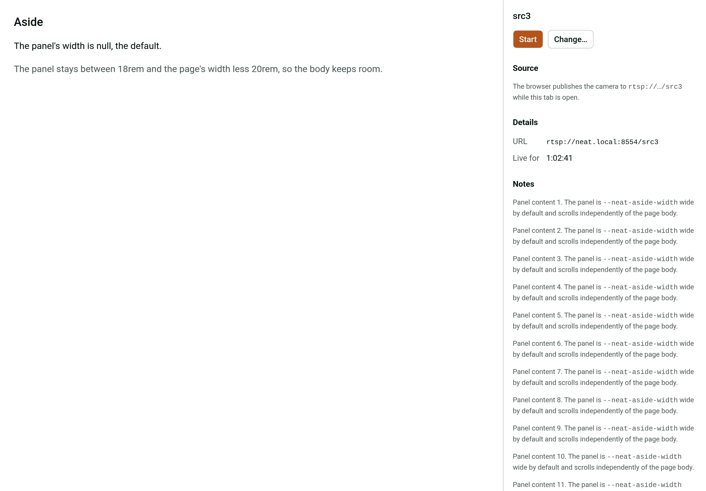

<!-- Written by `npm run docs:pages` from the kit and its examples. Do not edit. -->

# Aside

_Layout_ · [All topics](../README.md)

The column of an aside's content: its parts stacked one gap apart.

```html
<section neatPageAside neatAsidePanel>
  <h2 neatAsideTitle>Inspector</h2>
  <p>…</p>
</section>
```

<picture>
<source media="(prefers-color-scheme: dark)" srcset="../images/aside/source-panel.dark.webp">

</picture>

```ts
import { NeatAsidePanel, NeatAsideHeading, NeatAsideTitle, NeatAsideActions, NeatAsideToggle, neatAsideOpen, NeatCode } from '@sima/neat-ui';
```

## Examples

### Source panel

A page's aside as an inspector, which the toggle in the top bar opens and closes.

The panel is a column of a title, actions, headings, notes and details. The body narrows beside it, and each scrolls on its own.

`[(asideWidth)]` is the panel's width, which the page only exposes. Here the text below shows it, and the toolbar's button resets it to the default. Try dragging the line on the panel's left edge, or focus it and use the arrow keys, Home and End.

_This example needs a page of its own: it runs in the showcase._

<picture>
<source media="(prefers-color-scheme: dark)" srcset="../images/aside/source-panel.dark.webp">

</picture>

<details>
<summary>Code</summary>

`1-source-panel.example.ts`

```ts
import { ChangeDetectionStrategy, Component, signal } from '@angular/core';
import {
  NeatAsideActions,
  NeatAsideHeading,
  NeatAsidePanel,
  NeatAsideTitle,
  NeatAsideToggle,
  NeatButton,
  NeatCode,
  NeatNote,
  NeatPage,
  NeatPageToolbar,
} from '@sima/neat-ui';
import { NeatDetails } from '@sima/neat-ui/details';

@Component({
  selector: 'app-source-panel',
  imports: [
    NeatAsideActions,
    NeatAsideHeading,
    NeatAsidePanel,
    NeatAsideTitle,
    NeatAsideToggle,
    NeatButton,
    NeatCode,
    NeatDetails,
    NeatNote,
    NeatPage,
    NeatPageToolbar,
  ],
  changeDetection: ChangeDetectionStrategy.OnPush,
  templateUrl: './1-source-panel.example.html',
})
export class SourcePanel {
  protected readonly asideOpen = signal(true);
  protected readonly asideWidth = signal<number | null>(null);
  protected readonly notes = Array.from({ length: 30 }, (_, index) => index + 1);
}
```

`1-source-panel.example.html`

```html
<div *neatPageToolbar>
  <button
    neatButton
    type="button"
    variant="text"
    size="small"
    [attr.aria-disabled]="asideWidth() === null || null"
    (click)="asideWidth.set(null)"
  >
    Reset panel width
  </button>
</div>
<!-- Declared beside the toolbar, not in it: the shell draws it at the top bar's right edge. -->
<neat-aside-toggle [(open)]="asideOpen" />

<neat-page [aside]="asideOpen() ? 'open' : 'closed'" [(asideWidth)]="asideWidth">
  <div class="showcase-page">
    <section class="showcase-section">
      <h2>Aside</h2>
      <p>The panel's width is {{ asideWidth() ?? 'null, the default' }}.</p>
      <p class="showcase-muted">
        The panel stays between 18rem and the page's width less 20rem, so the body keeps room.
      </p>
    </section>
  </div>

  <section neatPageAside neatAsidePanel>
    <h2 neatAsideTitle>src3</h2>
    <div neatAsideActions>
      <button neatButton type="button" size="small">Start</button>
      <button neatButton type="button" variant="outlined" size="small">Change…</button>
    </div>
    <h3 neatAsideHeading>Source</h3>
    <p neatNote>
      The browser publishes the camera to <code neatCode>rtsp://…/src3</code> while this tab is
      open.
    </p>
    <h3 neatAsideHeading>Details</h3>
    <dl neatDetails>
      <dt>URL</dt>
      <dd><code neatCode>rtsp://neat.local:8554/src3</code></dd>
      <dt>Live for</dt>
      <dd>1:02:41</dd>
    </dl>
    <h3 neatAsideHeading>Notes</h3>
    @for (item of notes; track item) {
      <p neatNote>
        Panel content {{ item }}. The panel is <code neatCode>--neat-aside-width</code> wide by
        default and scrolls independently of the page body.
      </p>
    }
  </section>
</neat-page>
```

</details>

### Remembered panel

A panel whose state is remembered.

[`neatAsideOpen`](../layout/aside.md#neatasideopen) takes the remembered choice and the way to write it, here a stored signal. On a wide screen the panel is the remembered choice. On a narrow one it floats over the page and starts closed. What is opened or closed there is not remembered, so a phone never overwrites the choice made on a wide screen.

_This example needs a page of its own: it runs in the showcase._

<details>
<summary>Code</summary>

`2-remembered-panel.example.ts`

```ts
import { ChangeDetectionStrategy, Component } from '@angular/core';
import {
  NeatAsidePanel,
  neatAsideOpen,
  NeatAsideTitle,
  NeatAsideToggle,
  NeatPage,
  neatStoredSignal,
} from '@sima/neat-ui';

@Component({
  selector: 'app-remembered-panel',
  imports: [NeatAsidePanel, NeatAsideTitle, NeatAsideToggle, NeatPage],
  changeDetection: ChangeDetectionStrategy.OnPush,
  templateUrl: './2-remembered-panel.example.html',
})
export class RememberedPanel {
  private readonly remembered = neatStoredSignal('neat-ui-showcase:remembered-panel', true, (v) =>
    typeof v === 'boolean' ? v : undefined,
  );
  protected readonly aside = neatAsideOpen(this.remembered, (open) => this.remembered.set(open));
}
```

`2-remembered-panel.example.html`

```html
<neat-aside-toggle [open]="aside.open()" (openChange)="aside.set($event)" />

<neat-page [aside]="aside.open() ? 'open' : 'closed'">
  <div class="showcase-page">
    <section class="showcase-section">
      <h2>Remembered panel</h2>
      <p>
        Close the panel, leave and come back: it stays closed. Make the window narrow and it opens
        only when asked.
      </p>
    </section>
  </div>
  <section neatPageAside neatAsidePanel>
    <h2 neatAsideTitle>Inspector</h2>
    <p>The state is in local storage, under one key.</p>
  </section>
</neat-page>
```

</details>

## API

### `NeatAsidePanel`

Directive from `@sima/neat-ui`, selector `[neatAsidePanel]`.

Put it on the element marked `neatPageAside`, or on that element's root inside. The gap is `--neat-space-3`. The aside gives the column its width, inset and scrolling.

### `NeatAsideHeading`

Directive from `@sima/neat-ui`, selector `[neatAsideHeading]`.

The heading of a section of the panel.

```html
<h3 neatAsideHeading>Source</h3>
```

It sits nearer to the section it names than to the one before, with a gap above it on top of the panel's. As the panel's first part, it has no such gap.

### `NeatAsideTitle`

Directive from `@sima/neat-ui`, selector `[neatAsideTitle]`.

What the panel is about, as its first line: `<h2 neatAsideTitle>src3</h2>`.

### `NeatAsideActions`

Directive from `@sima/neat-ui`, selector `[neatAsideActions]`.

A row of the panel's buttons, which wraps when the panel is narrow.

### `NeatAsideToggle`

Component from `@sima/neat-ui`, selector `neat-aside-toggle`.

The button that opens and closes the page's aside, at the right edge of the top bar.

```html
<div *neatPageToolbar>…</div>
<neat-aside-toggle [(open)]="asideOpen" />
<neat-page [aside]="asideOpen() ? 'open' : 'closed'">…</neat-page>
```

The shell draws it after the kiosk button, above the panel. On a narrow screen it is the last item of the top bar's first row. In kiosk mode it floats with the page's tools, after them.

The page declares it anywhere in its template except inside `*neatPageToolbar`, which throws in dev mode. The toggle has a place of its own, and the shell re-creates the toolbar's view. It renders nothing where it is declared. Its button, a template of its own, goes to the shell while the page exists, as the page toolbar does. One toggle at a time: a second throws in dev mode.

It has one look on every page: the top bar's edge control, as the kiosk button beside it. That is a large, round, text, icon-only `neatButton`, with the `side-panel` icon. The `info` icon is left for an information action. Its pressed state is the panel's.

`label` names it and is its tooltip: "Side panel" unless the page says otherwise. `open` is a model the page owns, so the page decides where it is remembered. The toggle only flips it.

`focus()` puts the focus on the button. It is for a page whose panel closes from inside, by Escape or a close button, and must not leave the focus on nothing.

**Inputs**

- **`label`** `string`, default `'Side panel'`

  The button's name and tooltip.

**Models (two-way)**

- **`open`** `boolean`, default `false`

  Whether the page's aside is open.

**Methods**

- **`focus`**

  ```ts
  focus(): void
  ```

  Puts the focus on the button.

### `NeatAsideOpen`

Interface from `@sima/neat-ui`.

The state of a page's aside, as [`neatAsideOpen`](../layout/aside.md#neatasideopen) keeps it.

**Members**

- **`open`** `Signal<boolean>`

  Whether the panel is open now: bind it to the page's `aside` and the toggle's `open`.

**Methods**

- **`set`**

  ```ts
  set(open: boolean): void
  ```

  Opens or closes the panel; the toggle's `(openChange)` and the page's own openings go here.

### `neatAsideOpen`

Function from `@sima/neat-ui`.

The open state of a page's aside, for a page that remembers the choice.

```ts
readonly aside = neatAsideOpen(this.stored, (open) => this.stored.set(open));
```

`remembered` is the choice, and `remember` writes it where the page keeps it, such as local storage. Call it in an injection context.

On a wide screen, the panel is the remembered choice, and `set` remembers. On a narrow screen, the panel floats over the page and starts closed, whatever was remembered. `set` then changes a transient flag only: a phone's opening and closing must not overwrite the choice made on a wide screen.

The flag resets to closed whenever `narrow` changes. So each time the viewport becomes narrow the panel starts closed, and going wide shows the remembered choice again.

```ts
neatAsideOpen(remembered: Signal<boolean>, remember: (open: boolean) => void): NeatAsideOpen
```

### `NeatCode`

Directive from `@sima/neat-ui`, selector `code[neatCode]`.

A URL, a path or a name in running text: `<code neatCode>rtsp://…/src3</code>`. Monospace runs wide, so it is the kit's small size, and it has no spaces to break at, so it wraps anywhere.
