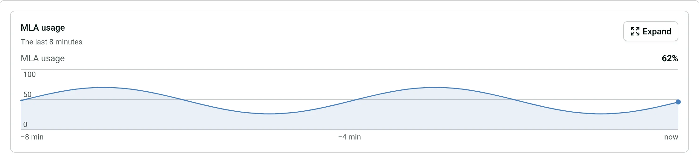

<!-- Written by `npm run docs:pages` from the kit and its examples. Do not edit. -->

# Expand

_Layout_ · [All topics](../README.md)

Shows its host over the whole browser window, or over a part of the page, and puts it back: a video tile, a card or a 3D view, made large for a closer look.

```html
<neat-card title="Detections" neatExpand #expand="neatExpand">
  <button neatButton neatCardActions type="button" (click)="expand.toggle()">
    {{ expand.expanded() ? 'Close' : 'Expand' }}
  </button>
  …
</neat-card>
```

<picture>
<source media="(prefers-color-scheme: dark)" srcset="../images/expand/expanding-a-card.dark.webp">

</picture>

```ts
import { NeatExpand } from '@sima/neat-ui';
```

## Examples

### Expanding a card

A card shown over the whole window from the button in its header, and put back from the same button. Its chart takes the window's height.

Press Expand, then Close or Escape. The button sits inside the card, which covers the page while expanded.

<picture>
<source media="(prefers-color-scheme: dark)" srcset="../images/expand/expanding-a-card.dark.webp">

</picture>

<details>
<summary>Code</summary>

`1-expanding-a-card.example.ts`

```ts
import { ChangeDetectionStrategy, Component } from '@angular/core';
import { NeatButton, NeatExpand, NeatIcon } from '@sima/neat-ui';
import { NeatCard } from '@sima/neat-ui/card';
import { NeatTimeChart } from '@sima/neat-ui/charts';
import { MLA_USAGE, percent, TIMES } from './data';

@Component({
  selector: 'app-expanding-a-card',
  imports: [NeatButton, NeatCard, NeatExpand, NeatIcon, NeatTimeChart],
  changeDetection: ChangeDetectionStrategy.OnPush,
  templateUrl: './1-expanding-a-card.example.html',
  styleUrl: './expanding-a-card.example.css',
})
export class ExpandingACard {
  protected readonly usage = MLA_USAGE;
  protected readonly times = TIMES;
  protected readonly percent = percent;
}
```

`1-expanding-a-card.example.html`

```html
<neat-card title="MLA usage" subtitle="The last 8 minutes" neatExpand #expand="neatExpand">
  <button
    neatButton
    neatCardActions
    type="button"
    variant="outlined"
    size="small"
    (click)="expand.toggle()"
  >
    <neat-icon [name]="expand.expanded() ? 'close' : 'expand-window'" [size]="16" />
    {{ expand.expanded() ? 'Close' : 'Expand' }}
  </button>
  <neat-time-chart
    label="MLA usage"
    headline="62%"
    size="fill"
    [series]="usage"
    [times]="times"
    [domain]="[0, 100]"
    [format]="percent"
  />
</neat-card>
```

`data.ts`

```ts
import type { NeatChartFormat, NeatSeries } from '@sima/neat-ui/charts';

/**
 * Eight minutes of MLA usage, a sample every four seconds, ending at a fixed instant so the demo
 * stands still.
 */
const SAMPLES = 120;

export const TIMES: readonly number[] = Array.from(
  { length: SAMPLES },
  (_, index) => Date.UTC(2026, 9, 24, 12, 0, 0) + index * 4000,
);

export const MLA_USAGE: readonly NeatSeries[] = [
  {
    key: 'mla',
    label: 'MLA',
    values: Array.from({ length: SAMPLES }, (_, index) =>
      Number((48 + 22 * Math.sin((index / SAMPLES) * 4 * Math.PI)).toFixed(1)),
    ),
  },
];

export const percent: NeatChartFormat = (value) => `${value.toFixed(0)}%`;
```

`expanding-a-card.example.css`

```css
/* The chart takes the height the card's content has: its medium plot in place, the window's expanded. */
neat-time-chart {
  height: 100%;
}
```

</details>

### Covering a region

A card that covers the region the choice above it names: the whole window, the shell's content area, the page's body, or the board card around it. Over the content area the rail and the top bar stay; over the body the side panel stays beside it.

Pick a region, then press Expand. Open the side panel, resize the window, or scroll the page while it is expanded: the card follows its region.

<details>
<summary>Code</summary>

`2-covering-a-region.example.ts`

```ts
import {
  ChangeDetectionStrategy,
  Component,
  computed,
  ElementRef,
  signal,
  viewChild,
} from '@angular/core';
import { NeatButton, NeatExpand, type NeatExpandRegion, NeatIcon } from '@sima/neat-ui';
import { NeatCard } from '@sima/neat-ui/card';
import { NeatTimeChart } from '@sima/neat-ui/charts';
import { NeatSegmented, type NeatSegmentedOption } from '@sima/neat-ui/segmented';
import { MLA_USAGE, percent, TIMES } from './data';

/** What the choice names: a region of the kit's, or the board card around the chart. */
type Cover = Exclude<NeatExpandRegion, HTMLElement> | 'card';

@Component({
  selector: 'app-covering-a-region',
  imports: [NeatButton, NeatCard, NeatExpand, NeatIcon, NeatSegmented, NeatTimeChart],
  changeDetection: ChangeDetectionStrategy.OnPush,
  templateUrl: './2-covering-a-region.example.html',
  styleUrl: './covering-a-region.example.css',
})
export class CoveringARegion {
  protected readonly usage = MLA_USAGE;
  protected readonly times = TIMES;
  protected readonly percent = percent;
  protected readonly cover = signal<Cover>('body');
  protected readonly covers: readonly NeatSegmentedOption<Cover>[] = [
    { value: 'window', label: 'Window' },
    { value: 'content', label: 'Content area' },
    { value: 'body', label: 'Page body' },
    { value: 'card', label: 'Card' },
  ];
  /** The board card's element: a region the app names is an element, not a component. */
  private readonly board = viewChild.required('board', { read: ElementRef<HTMLElement> });
  protected readonly region = computed<NeatExpandRegion>(() => {
    const cover = this.cover();
    return cover === 'card' ? this.board().nativeElement : cover;
  });
}
```

`2-covering-a-region.example.html`

```html
<neat-segmented label="Cover" [options]="covers" [(value)]="cover" />
<neat-card class="board" title="Board" subtitle="DevKit, 192.168.100.2" #board>
  <neat-card title="MLA usage" neatExpand #expand="neatExpand" [region]="region()">
    <button
      neatButton
      neatCardActions
      type="button"
      variant="outlined"
      size="small"
      (click)="expand.toggle()"
    >
      <neat-icon [name]="expand.expanded() ? 'close' : 'expand-window'" [size]="16" />
      {{ expand.expanded() ? 'Close' : 'Expand' }}
    </button>
    <neat-time-chart
      label="MLA usage"
      headline="62%"
      size="fill"
      [series]="usage"
      [times]="times"
      [domain]="[0, 100]"
      [format]="percent"
    />
  </neat-card>
</neat-card>
```

`data.ts`

```ts
import type { NeatChartFormat, NeatSeries } from '@sima/neat-ui/charts';

/**
 * Eight minutes of MLA usage, a sample every four seconds, ending at a fixed instant so the demo
 * stands still.
 */
const SAMPLES = 120;

export const TIMES: readonly number[] = Array.from(
  { length: SAMPLES },
  (_, index) => Date.UTC(2026, 9, 24, 12, 0, 0) + index * 4000,
);

export const MLA_USAGE: readonly NeatSeries[] = [
  {
    key: 'mla',
    label: 'MLA',
    values: Array.from({ length: SAMPLES }, (_, index) =>
      Number((48 + 22 * Math.sin((index / SAMPLES) * 4 * Math.PI)).toFixed(1)),
    ),
  },
];

export const percent: NeatChartFormat = (value) => `${value.toFixed(0)}%`;
```

`covering-a-region.example.css`

```css
:host {
  display: grid;
  gap: var(--neat-space-4);
  justify-items: start;
}

/*
 * The board has a height of its own: the chart card it holds leaves its place while expanded, and
 * a board sized by it would shrink under it.
 */
.board {
  justify-self: stretch;
  height: 22rem;
}

/* The chart takes the height the card's content has: its medium plot in place, the region's expanded. */
neat-time-chart {
  height: 100%;
}
```

</details>

## API

### `NeatExpand`

Directive from `@sima/neat-ui`, selector `[neatExpand]`, exported as `neatExpand`.

It is the same element, not a copy, so what it shows keeps running: a video plays on, and a chart or a canvas takes the new size as it would any other. It covers the window, not the screen: the browser's own full screen is not used.

Put the button that closes it inside the host. The host covers the page, so a button outside it is covered too. Escape closes it as well.

**What it covers.** `region` (a [`NeatExpandRegion`](../layout/expand.md#neatexpandregion)) says what the host covers while expanded:

- `window` (the default): the whole browser window.
- `content`: the shell's content area. The rail and the top bar stay in view and usable, so a rail item still navigates, and the page goes with its host. The page's aside is covered.
- `body`: the page's body. The aside and the page nav stay beside it.
- an element of the app's, such as a card around the host: that element's box.

```html
<neat-video-tile [source]="camera" label="Camera 1" expandControl region="body" />
```

The host follows its region as it moves or resizes: a resized window, an aside that opens, a box that scrolls it, a rail that moves it. In kiosk mode the content area and the body are what shows of them, so `content` is the whole window there. Outside a `neat-shell`, `content` covers the window, and outside a `neat-page`, `body` does. An element that is the host or inside it covers the window too. Each is said once in dev mode.

An element the app names must show while the host covers it. It closes the host when it leaves the page or shows nothing: `display: none`, or no width or no height. `visibility: hidden` leaves its box, so the host stays. The host does not open over an element that shows nothing.

An element that holds the host and takes its size from it shrinks when the host leaves its place. Give such an element a size of its own, such as a grid cell's.

How it looks:

- The host fills its region, edge to edge: the window with no rounded corners, an element with that element's. It is lifted into the browser's top layer (the Popover API), so no container of the page clips it or paints over it.
- Its own fill, padding and text color stay. A host without a fill or a text color takes the page's.
- Content taller than its region scrolls inside the host.

The keyboard, in every region:

- Opening moves the focus into the host when it is outside, such as on a button that opened it from elsewhere.
- Tab and Shift+Tab go round the host's controls, never to the covered page.
- Over a region, the rail, the top bar or an aside beside it stay usable. The focus can go there, but never to a control the host covers: it goes into the host instead.
- Escape closes it, unless a control inside handled the key first, such as an open select.
- Closing puts the focus back where it was before opening, when it was inside the host. So does the host going from the page while expanded, when that place is still in it.

Overlays opened from inside it, such as a tooltip, a popover, a select's list or a dialog, show above it. A toast shown while it is open does too.

`expanded` is a model, so the app can open it from its own state and follow it: `[(expanded)]="large"`.

**Inputs**

- **`region`** `NeatExpandRegion`, default `'window'`

  What the host covers while expanded: `window` (the default), `content` (the shell's content area), `body` (the page's body) or an element of the app's. It may change while expanded.

**Models (two-way)**

- **`expanded`** `boolean`, default `false`

  Whether the host is shown over its region.

**Methods**

- **`open`**

  ```ts
  open(): void
  ```

  Shows the host over its region.

- **`close`**

  ```ts
  close(): void
  ```

  Puts the host back in its place on the page.

- **`toggle`**

  ```ts
  toggle(): void
  ```

  Opens the host when it is in its place, and closes it when it is open.

### `NeatExpandRegion`

Type from `@sima/neat-ui`.

What an expanded element covers ([`NeatExpand`](../layout/expand.md#neatexpand)'s `region`):

- `window`: the whole browser window.
- `content`: the shell's content area, below the top bar and beside the rail, with the page's aside under it.
- `body`: the page's body, beside its aside and its page nav.
- an element: that element's box, such as a card around the element.

```ts
type NeatExpandRegion = 'window' | 'content' | 'body' | HTMLElement
```
