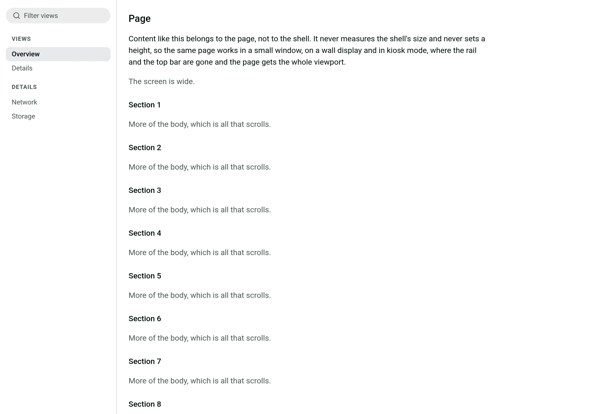
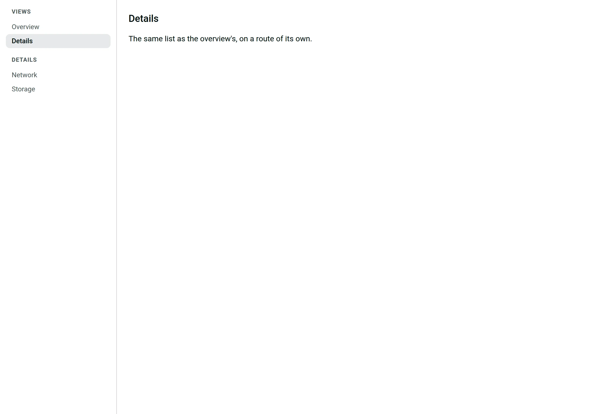
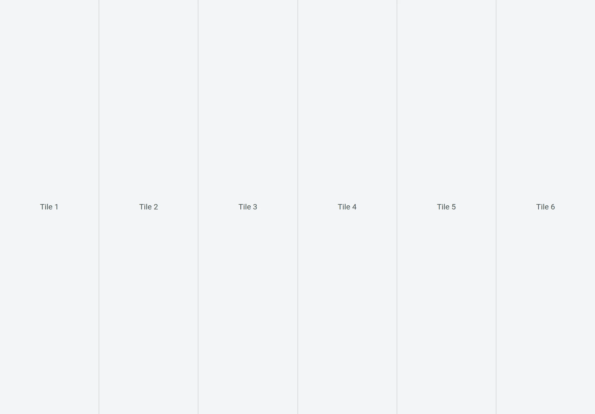

<!-- Written by `npm run docs:pages` from the kit and its examples. Do not edit. -->

# Page

_Layout_ · [All topics](../README.md)

A page in the shell's content area: it fills the area and owns at most one scroll context.

```html
<neat-page>
  <app-recordings />
</neat-page>
```

<picture>
<source media="(prefers-color-scheme: dark)" srcset="../images/page/overview.dark.webp">

</picture>

```ts
import { NeatPage, NeatPageNav, NeatPageToolbar, NeatViewport } from '@sima/neat-ui';
```

## Examples

### Overview

A page that fills the shell's content area and owns the one scroll context below it. It is longer than any screen on purpose: the shell, the top bar and the rail stay put while only the body scrolls. Its tools are in the top bar (`*neatPageToolbar`), where in kiosk mode they float beside the exit control, and its page nav (`nav[neatPageNav]`) links its views: a column of its own beside the body that stays put while the body scrolls, with a filter over its links at the top (a long list wants one; this short one has it to show it). Make the window narrow to see the list fold into a section above the body.

_This example needs a page of its own: it runs in the showcase._

<picture>
<source media="(prefers-color-scheme: dark)" srcset="../images/page/overview.dark.webp">

</picture>

<details>
<summary>Code</summary>

`1-overview.example.ts`

```ts
import { ChangeDetectionStrategy, Component, computed, inject, signal } from '@angular/core';
import {
  NeatButton,
  NeatPage,
  NeatPageNav,
  type NeatPageNavGroup,
  NeatPageToolbar,
  NeatViewport,
} from '@sima/neat-ui';

const PAGE_NAV: readonly NeatPageNavGroup[] = [
  {
    label: 'Views',
    items: [
      { label: 'Overview', path: '/demo/page/overview' },
      { label: 'Details', path: '/demo/page/details' },
    ],
  },
  {
    label: 'Details',
    items: [
      { label: 'Network', path: '/demo/page/details/network' },
      { label: 'Storage', path: '/demo/page/details/storage' },
    ],
  },
];

@Component({
  selector: 'app-overview',
  imports: [NeatButton, NeatPage, NeatPageNav, NeatPageToolbar],
  changeDetection: ChangeDetectionStrategy.OnPush,
  template: `
    <div *neatPageToolbar>
      <button neatButton type="button" variant="text" size="small" (click)="many.set(!many())">
        {{ many() ? 'Fewer' : 'More' }} sections
      </button>
    </div>

    <neat-page>
      <nav
        neatPageNav
        aria-label="Page example"
        [groups]="pageNav"
        filterLabel="Filter views"
      ></nav>
      <div class="showcase-page">
        <section class="showcase-section">
          <h2>Page</h2>
          <p>
            Content like this belongs to the page, not to the shell. It never measures the shell's
            size and never sets a height, so the same page works in a small window, on a wall
            display and in kiosk mode, where the rail and the top bar are gone and the page gets the
            whole viewport.
          </p>
          <p class="showcase-muted">
            The screen is {{ narrow() ? 'narrow, below 48rem' : 'wide' }}.
          </p>
        </section>
        @for (section of sections(); track section) {
          <section class="showcase-section">
            <h3>Section {{ section }}</h3>
            <p class="showcase-muted">More of the body, which is all that scrolls.</p>
          </section>
        }
      </div>
    </neat-page>
  `,
})
export class Overview {
  protected readonly pageNav = PAGE_NAV;
  protected readonly narrow = inject(NeatViewport).narrow;
  protected readonly many = signal(true);
  protected readonly sections = computed(() =>
    Array.from({ length: this.many() ? 20 : 3 }, (_, index) => index + 1),
  );
}
```

</details>

### Details

The second view of the page nav: a route of its own, so the list is declared again and its open link follows the route. Network and Storage are routes nested under this one, which keep this example rendered: of the links whose path the route is under, the longest is the open one, so on `…/details/network` it is Network, not Details. The list stays where it is when the view changes, beside the body; it has no filter here, which is the default.

_This example needs a page of its own: it runs in the showcase._

<picture>
<source media="(prefers-color-scheme: dark)" srcset="../images/page/details.dark.webp">

</picture>

<details>
<summary>Code</summary>

`2-details.example.ts`

```ts
import { ChangeDetectionStrategy, Component } from '@angular/core';
import { NeatPage, NeatPageNav, type NeatPageNavGroup } from '@sima/neat-ui';

const PAGE_NAV: readonly NeatPageNavGroup[] = [
  {
    label: 'Views',
    items: [
      { label: 'Overview', path: '/demo/page/overview' },
      { label: 'Details', path: '/demo/page/details' },
    ],
  },
  {
    label: 'Details',
    items: [
      { label: 'Network', path: '/demo/page/details/network' },
      { label: 'Storage', path: '/demo/page/details/storage' },
    ],
  },
];

@Component({
  selector: 'app-details',
  imports: [NeatPage, NeatPageNav],
  changeDetection: ChangeDetectionStrategy.OnPush,
  template: `
    <neat-page>
      <nav neatPageNav aria-label="Page example" [groups]="pageNav"></nav>
      <div class="showcase-page">
        <section class="showcase-section">
          <h2>Details</h2>
          <p>The same list as the overview's, on a route of its own.</p>
        </section>
      </div>
    </neat-page>
  `,
})
export class Details {
  protected readonly pageNav = PAGE_NAV;
}
```

</details>

### Full bleed

Content that reaches the page's edges: `padding="none"` drops the page's inset and `scroll="none"` leaves nothing to scroll, so the grid sizes itself to the page, as a video grid that fits the screen does.

_This example needs a page of its own: it runs in the showcase._

<picture>
<source media="(prefers-color-scheme: dark)" srcset="../images/page/full-bleed.dark.webp">

</picture>

<details>
<summary>Code</summary>

`3-full-bleed.example.ts`

```ts
import { ChangeDetectionStrategy, Component } from '@angular/core';
import { NeatPage } from '@sima/neat-ui';

@Component({
  selector: 'app-full-bleed',
  imports: [NeatPage],
  changeDetection: ChangeDetectionStrategy.OnPush,
  template: `
    <neat-page padding="none" scroll="none">
      <div class="grid">
        @for (tile of tiles; track tile) {
          <div class="tile">Tile {{ tile }}</div>
        }
      </div>
    </neat-page>
  `,
  styleUrl: './full-bleed.example.css',
})
export class FullBleed {
  protected readonly tiles = Array.from({ length: 6 }, (_, index) => index + 1);
}
```

`full-bleed.example.css`

```css
/* A grid that takes the whole page and divides it between its tiles. */
.grid {
  display: grid;
  height: 100%;
  gap: 1px;
  grid-template-columns: repeat(auto-fit, minmax(12rem, 1fr));
  grid-auto-rows: 1fr;
  background: var(--border);
}

.tile {
  display: flex;
  align-items: center;
  justify-content: center;
  background: var(--muted);
  color: var(--muted-foreground);
}
```

</details>

## API

### `NeatPage`

Component from `@sima/neat-ui`, selector `neat-page`.

With `scroll="body"` (the default) its body is the single scroll container. With `scroll="none"` nothing scrolls, and the content sizes itself to the page, such as a grid that fits the screen.

The content takes its size from the page, and never measures the shell or sets a height. So the same page works in a small window, on a wall display and in kiosk mode, where the rail and the top bar are gone and the page gets the whole viewport.

With `padding="page"` (the default) the content keeps the kit's page inset from the content area's edges, so every app's pages line up; `padding="none"` lets full-bleed content (a video grid, a map) reach the edges.

A `nav[neatPageNav]` (see [`NeatPageNav`](../layout/page.md#neatpagenav)) as a direct child is the page nav: the body's start column, as high as the page and scrolling on its own whatever `scroll` says, with the aside at the other end; on a narrow screen a closed section above the body, under which the floating panel opens. Without one, the body starts at the page's edge.

Elements marked `neatPageAside` form the page's aside (an inspector, say), shown on the right while `aside="open"`. The panel is `--neat-aside-width` wide and scrolls on its own; the body narrows beside it rather than being covered, keeping its own scroll setting. The aside and the page nav are the supported other scroll contexts of a page: a page that needs another region of its own that scrolls independently is a kit change, so that the layout becomes a supported component, not a workaround. Closed, the panel and its content are out of the DOM, but projected content is still instantiated (content projection always creates it): gate expensive content with an `@if` of your own.

On a narrow screen ([`NeatViewport`](../layout/page.md#neatviewport)) the panel floats over the right of the page instead, `--neat-aside-width` wide but never wider than the page, and the body keeps the whole width. There is no scrim and no Escape handling: the page owns the open state, and the toolbar's `neat-aside-toggle` closes it. A page that keeps its panel's state should use [`neatAsideOpen`](../layout/aside.md#neatasideopen), which starts the panel closed on a narrow screen without overwriting the choice remembered for a wide one.

Beside the body the panel can be resized: a separator on its inline-start edge is dragged with a pointer, or moved with the arrow keys (left widens, 16 px a step), Home and End; a double click returns to the default. `asideWidth` is the width in pixels, `null` for the default `--neat-aside-width`. The page only exposes the model, so an app that wants the width kept binds `[(asideWidth)]` and stores it where it likes; a drag writes it on release, a key press at once. The panel is shown between 18rem and the page's width less 20rem, which leaves the body 20rem; a width outside that is shown clamped and the model left alone, so a remembered width returns when the window is wide enough again.

**Inputs**

- **`scroll`** `'body' | 'none'`, default `'body'`

  Which part scrolls: `body` (the default) makes the body the page's one scroll container; `none` clips it, for content that sizes itself to the page.

- **`padding`** `'page' | 'none'`, default `'page'`

  The inset around the content: `page` (the default) keeps the kit's page padding, which scrolls with the content; `none` lets full-bleed content reach the edges.

- **`aside`** `'open' | 'closed'`, default `'closed'`

  Whether the aside (the elements marked `neatPageAside`) is shown: `closed` (the default) or `open`. The page owns no state: bind it to yours, or to [`neatAsideOpen`](../layout/aside.md#neatasideopen).

**Models (two-way)**

- **`asideWidth`** `number | null`, default `null`

  The panel's width in pixels, `null` for the default `--neat-aside-width`.

### `NeatPageNav`

Component from `@sima/neat-ui`, selector `nav[neatPageNav]`.

The page nav, the third level of the kit's navigation: pages are rail items, a page's sub-pages its item's `children`, and anything more (more than a few links, groups of them, or a level below a sub-page) is this list, as a direct child of `neat-page`:

```html
<neat-page>
  <nav neatPageNav aria-label="Components" [groups]="groups" filterLabel="Filter"></nav>
  …
</neat-page>
```

`groups` is data, not content: each group's links under its heading (none for a group without a `label`). The open link is the one whose `path` the URL is under (the query and fragment are never judged, and the longest such path wins); it carries `aria-current="page"` and has the rail's current-page look in the page's tokens, the accent fill and weight, where the other links are muted until hovered. With `filterLabel`, a search field at the top, named and hinted by that text, keeps the links whose label holds what was typed, ignoring case, and a group's heading while any of its links is kept; when none is, it says "Nothing matches".

The landmark is the app's: a screen reader hears a navigation landmark of links, so it needs a name, which only the app knows. A nav without an `aria-label` (or `aria-labelledby`) throws in dev mode. The name is read once, when the list is first drawn.

On a wide screen the page draws it as its body's start column, as high as the page, with the aside at the other end. It scrolls on its own whatever the page's `scroll`, so it stays in view while the body scrolls, with the filter fixed at its top; it scrolls itself, never with `scrollIntoView` (which would scroll the page around it too), to show the open link whenever a navigation leaves that link out of view. On a narrow screen ([`NeatViewport`](../layout/page.md#neatviewport)) it is a closed section above the body instead, with the look of [`NeatCollapsible`](../components/collapsible.md#neatcollapsible): the landmark's name as its label and the open link as its summary. Opened, its list scrolls inside it up to the page's height, and choosing a link closes it with the focus on its button, as a link followed puts the floating rail away.

**Inputs**

- **`groups`** `readonly NeatPageNavGroup[]`, required

  The links, in groups, in the order they are listed.

- **`filterLabel`** `string`

  The name and placeholder of a filter over the links' labels at the top of the list ("Filter components"); no filter without it.

### `NeatPageNavGroup`

Interface from `@sima/neat-ui`.

A group of the page nav's links, under a heading when it has a `label`.

**Members**

- **`label`** `string`, optional

  The group's heading; a group without one shows its links with no heading above them.

- **`items`** `readonly NeatPageNavLink[]`

### `NeatPageNavLink`

Interface from `@sima/neat-ui`.

One link of the page nav.

**Members**

- **`label`** `string`

  The link's text, which the filter matches.

- **`path`** `string`

  Absolute app path, for example `/settings/network`. The link is the open one on this path and every route nested under it, whatever the query and fragment; where two links match, the one with the longer path is.

### `NeatPageToolbar`

Structural directive from `@sima/neat-ui`, selector `[neatPageToolbar]`.

The page's toolbar: `<div *neatPageToolbar>…</div>` on a page renders that content in the shell's top bar, at its right end just before the end slot and the kiosk button, while the page exists. In kiosk mode, where the top bar is hidden, it renders in a floating bar beside the exit control that shows while the pointer moves. The content stays the page's: its bindings and injection context are those of the page's template.

One page toolbar at a time; a second one throws in dev mode.

### `NeatViewport`

Service from `@sima/neat-ui`.

Whether the screen is narrow, a phone's width. `narrow` follows the browser's media query live, so turning a phone or resizing a window changes it at once; where the browser has no `matchMedia` (a test environment) it stays `false`, a wide screen.

Inject it rather than asking the browser, so the kit and the app share one answer and a test can provide `{ narrow: signal(true) }` in its place.

**Properties**

- **`narrow`** `Signal<boolean>`

  `true` while the viewport is narrower than 48rem.
