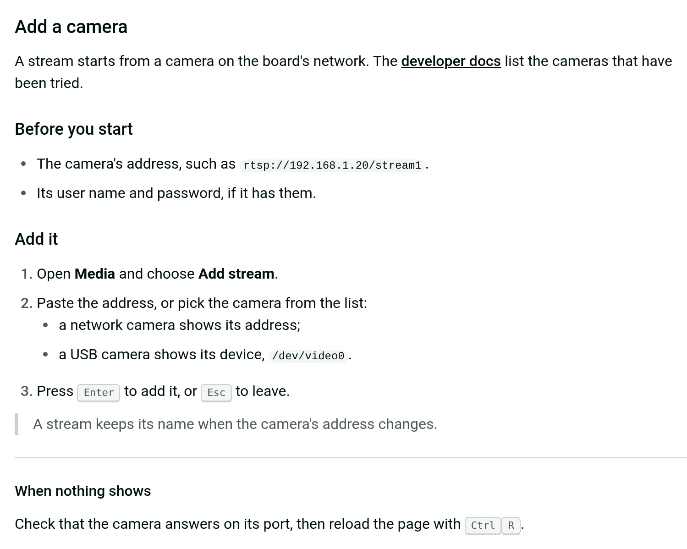
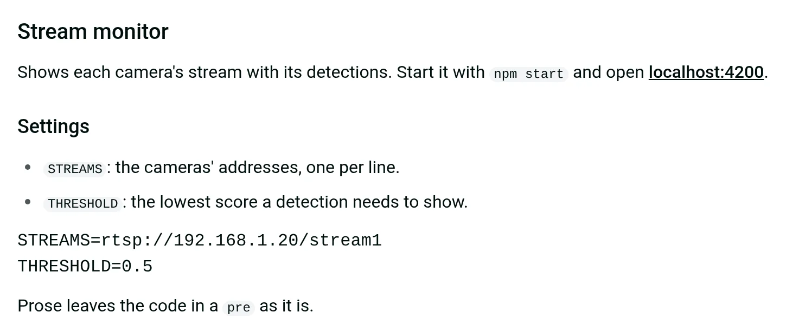

<!-- Written by `npm run docs:pages` from the kit and its examples. Do not edit. -->

# Prose

_Layout_ · [All topics](../README.md)

Long-form text in the kit's type: the headings, paragraphs, lists, links, code, keys, quotes and rules inside its host.

```html
<article neatProse>
  <h2>Connect a camera</h2>
  <p>Add it on the <a routerLink="/media">Media</a> page, then press <kbd>Enter</kbd>.</p>
  <ul>
    <li>An RTSP camera needs its address, such as <code>rtsp://…/stream1</code>.</li>
    <li>A USB camera shows up by itself.</li>
  </ul>
</article>
```

<picture>
<source media="(prefers-color-scheme: dark)" srcset="../images/prose/help-page.dark.webp">

</picture>

```ts
import { NeatProse } from '@sima/neat-ui';
```

## Examples

### Help page

A page of help as prose: headings, paragraphs, lists, a link, code, keys, a quote and a rule. Only the container is marked `neatProse`. The elements inside are plain HTML.

For an app's own shortcut, `neat-shortcut` shows the keys a Mac has. A `kbd` here shows the one set of keys it is given.

<picture>
<source media="(prefers-color-scheme: dark)" srcset="../images/prose/help-page.dark.webp">

</picture>

<details>
<summary>Code</summary>

`1-help-page.example.ts`

```ts
import { ChangeDetectionStrategy, Component } from '@angular/core';
import { NeatProse } from '@sima/neat-ui';

@Component({
  selector: 'app-help-page',
  imports: [NeatProse],
  changeDetection: ChangeDetectionStrategy.OnPush,
  templateUrl: './1-help-page.example.html',
  styleUrl: './prose.example.css',
})
export class HelpPage {}
```

`1-help-page.example.html`

```html
<article neatProse class="text">
  <h2>Add a camera</h2>
  <p>
    A stream starts from a camera on the board's network. The
    <a href="https://developer.sima.ai">developer docs</a> list the cameras that have been tried.
  </p>
  <h3>Before you start</h3>
  <ul>
    <li>The camera's address, such as <code>rtsp://192.168.1.20/stream1</code>.</li>
    <li>Its user name and password, if it has them.</li>
  </ul>
  <h3>Add it</h3>
  <ol>
    <li>Open <strong>Media</strong> and choose <strong>Add stream</strong>.</li>
    <li>
      Paste the address, or pick the camera from the list:
      <ul>
        <li>a network camera shows its address;</li>
        <li>a USB camera shows its device, <code>/dev/video0</code>.</li>
      </ul>
    </li>
    <li>Press <kbd>Enter</kbd> to add it, or <kbd>Esc</kbd> to leave.</li>
  </ol>
  <blockquote>
    <p>A stream keeps its name when the camera's address changes.</p>
  </blockquote>
  <hr />
  <h4>When nothing shows</h4>
  <p>
    Check that the camera answers on its port, then reload the page with <kbd>Ctrl</kbd>
    <kbd>R</kbd>.
  </p>
</article>
```

`prose.example.css`

```css
/* A readable measure for the text, which the app sets: prose sets no width. */
.text {
  max-width: 46rem;
}
```

</details>

### Converted README

Text from elsewhere, here a README converted from Markdown, set with `[innerHTML]`. Prose styles its plain HTML, so the app adds nothing inside it.

<picture>
<source media="(prefers-color-scheme: dark)" srcset="../images/prose/converted-readme.dark.webp">

</picture>

<details>
<summary>Code</summary>

`2-converted-readme.example.ts`

```ts
import { ChangeDetectionStrategy, Component } from '@angular/core';
import { NeatProse } from '@sima/neat-ui';

/** A README as a server might send it, converted from Markdown to HTML. */
const README = `
<h2>Stream monitor</h2>
<p>Shows each camera's stream with its detections. Start it with <code>npm start</code> and open
<a href="http://localhost:4200">localhost:4200</a>.</p>
<h3>Settings</h3>
<ul>
  <li><code>STREAMS</code>: the cameras' addresses, one per line.</li>
  <li><code>THRESHOLD</code>: the lowest score a detection needs to show.</li>
</ul>
<pre><code>STREAMS=rtsp://192.168.1.20/stream1
THRESHOLD=0.5</code></pre>
<p>Prose leaves the code in a <code>pre</code> as it is.</p>
`;

@Component({
  selector: 'app-converted-readme',
  imports: [NeatProse],
  changeDetection: ChangeDetectionStrategy.OnPush,
  templateUrl: './2-converted-readme.example.html',
  styleUrl: './prose.example.css',
})
export class ConvertedREADME {
  protected readonly readme = README;
}
```

`2-converted-readme.example.html`

```html
<div neatProse class="text" [innerHTML]="readme"></div>
```

`prose.example.css`

```css
/* A readable measure for the text, which the app sets: prose sets no width. */
.text {
  max-width: 46rem;
}
```

</details>

## API

### `NeatProse`

Directive from `@sima/neat-ui`, selector `[neatProse]`.

Use it for text a page shows at length: help, an explanation, a README. The elements inside are plain HTML, so content set with `[innerHTML]` (a README converted from Markdown) is styled too. Outside it, the kit's reset stays: lists have no markers and links no underline.

What it styles:

- Headings `h1` to `h4`, paragraphs, bulleted lists, quotes and inline code are Spartan's typography, the same look the typography directives ([`NEAT_TYPOGRAPHY`](../layout/typography.md#neat_typography), such as `neatH2`) give single elements. So a page can mix the two without a seam.
- Blocks are 1.5rem apart, Spartan's space between blocks, with none before the first, so the container's edges stay free.
- `h5` and `h6`, which Spartan lacks, are a step below the text, `h6` muted.
- Lists have bullets or numbers, muted, and are inset by 1.5rem. Their items are 0.5rem apart, and a list may hold another. Blocks inside an item are `--neat-space-3` apart.
- A link is underlined and medium weight, in its text's color. So it holds the contrast of its text on any surface, and the underline, not a color, marks it.
- Inline code is `code[neatCode]`'s look, Spartan's chip. Code in a `pre` is left as it is.
- A `kbd` is a key as `neat-shortcut` draws one.
- A quote is italic, with a border at its start.

It sets no size for the body text and no width. The text takes its container's size, and the app sets the measure (the showcase's pages use 46rem to 52rem).

It styles its own flow: its children, the items of its lists and its quotes, and the links, code and keys in their text. A kit part placed in it, such as a chart or a callout, is spaced as a block and keeps its own look. Text inside such a part is not the prose's. Mark that text with `neatProse` too where it is long-form.

Its rules weigh the least of the kit's styles, so a kit part and the app's own styles override them. The host stays a block: a flex or grid host would add its gap to the spacing.
