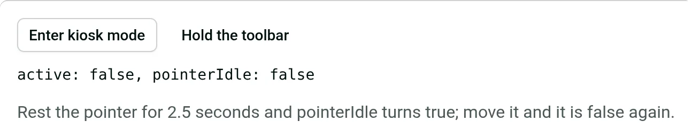
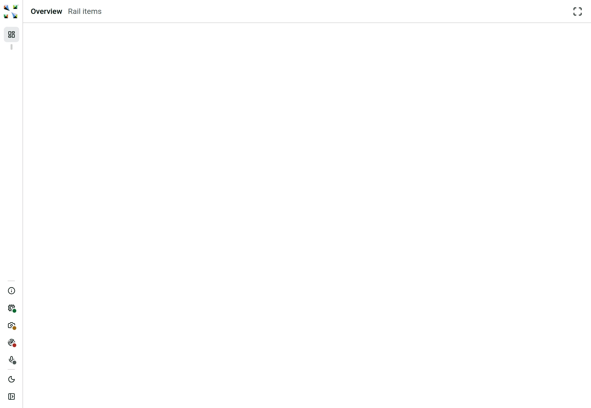

<!-- Written by `npm run docs:pages` from the kit and its examples. Do not edit. -->

# Shell

_Layout_ · [All topics](../README.md)

The app frame: the top bar, which is the page's, across the full width at the top, and below it the rail on the left, which is the app's, and the content area for the routed page. The top bar comes first in the DOM, so the tab order is the visual one: top bar, rail, content. It fills the viewport, or the bounded box it is placed in; the content area gives its page the remaining space and never scrolls itself, so pages own their scrolling (see `neat-page`).

<picture>
<source media="(prefers-color-scheme: dark)" srcset="../images/shell/kiosk.dark.webp">

</picture>

```ts
import { NeatShell, NeatRailItem, NeatRailDivider, provideNeatTitles, KioskService, KIOSK_POINTER_IDLE_MS } from '@sima/neat-ui';
```

## Examples

### Kiosk

Kiosk mode for an expo, from [`KioskService`](../layout/shell.md#kioskservice). `toggle()` enters it, which hides the shell's rail and top bar and asks for fullscreen, and leaves it, which a floating exit control also does. `pointerIdle` turns true once the pointer has rested for [`KIOSK_POINTER_IDLE_MS`](../layout/shell.md#kiosk_pointer_idle_ms), which is how a page hides its own chrome; a component that has UI of its own outside the floating bar holds it open with `holdToolbar()` until it releases it.

<picture>
<source media="(prefers-color-scheme: dark)" srcset="../images/shell/kiosk.dark.webp">

</picture>

<details>
<summary>Code</summary>

`1-kiosk.example.ts`

```ts
import { ChangeDetectionStrategy, Component, DestroyRef, inject, signal } from '@angular/core';
import { KIOSK_POINTER_IDLE_MS, KioskService, NeatButton } from '@sima/neat-ui';

@Component({
  selector: 'app-kiosk',
  imports: [NeatButton],
  changeDetection: ChangeDetectionStrategy.OnPush,
  template: `
    <div class="showcase-row">
      <button neatButton type="button" variant="outlined" size="small" (click)="kiosk.toggle()">
        {{ kiosk.active() ? 'Leave' : 'Enter' }} kiosk mode
      </button>
      <button
        neatButton
        type="button"
        variant="text"
        size="small"
        [pressed]="release() !== null"
        (click)="hold()"
      >
        Hold the toolbar
      </button>
    </div>
    <p class="showcase-code">
      active: {{ kiosk.active() }}, pointerIdle: {{ kiosk.pointerIdle() }}
    </p>
    <p class="showcase-muted">
      Rest the pointer for {{ idleSeconds }} seconds and pointerIdle turns true; move it and it is
      false again.
    </p>
  `,
  styleUrl: './kiosk.example.css',
})
export class Kiosk {
  protected readonly kiosk = inject(KioskService);
  protected readonly idleSeconds = KIOSK_POINTER_IDLE_MS / 1000;
  /** Releases the hold the button took; null while there is none. */
  protected readonly release = signal<(() => void) | null>(null);

  constructor() {
    inject(DestroyRef).onDestroy(() => this.release()?.());
  }

  protected hold(): void {
    const release = this.release();
    if (release) {
      release();
      this.release.set(null);
    } else {
      this.release.set(this.kiosk.holdToolbar());
    }
  }
}
```

`kiosk.example.css`

```css
:host {
  display: flex;
  flex-direction: column;
  gap: var(--neat-space-3);
}

p {
  margin: 0;
}
```

</details>

### Rail items

The app's own items at the bottom of the rail, in a shell of their own. Each element marked `neatRailEnd` goes in the rail's end slot, above the kit's theme switch and the rail's control: [`NeatRailItem`](../layout/shell.md#neatrailitem)s, and a [`NeatRailDivider`](../layout/shell.md#neatraildivider) between groups of them. The board says its state with the item's `tone`, `text` and `detail`, and the devices after it show the other tones; each item's `label` is the whole sentence, its tooltip and its name. The first page has `children`, which unfold under it while it is the active page and the rail is expanded.

_This example needs a page of its own: it runs in the showcase._

<picture>
<source media="(prefers-color-scheme: dark)" srcset="../images/shell/rail-items.dark.webp">

</picture>

<details>
<summary>Code</summary>

`2-rail-items.example.ts`

```ts
import { ChangeDetectionStrategy, Component, inject } from '@angular/core';
import { NeatIcon, NeatNavItem, NeatRailDivider, NeatRailItem, NeatShell } from '@sima/neat-ui';
import { NeatToasts } from '@sima/neat-ui/toast';

@Component({
  selector: 'app-rail-items',
  imports: [NeatIcon, NeatRailDivider, NeatRailItem, NeatShell],
  changeDetection: ChangeDetectionStrategy.OnPush,
  template: `
    <neat-shell appName="Demo app" [navItems]="navItems">
      <button
        neatRailEnd
        neatRailItem
        type="button"
        label="About this app"
        (click)="toasts.status('An about item would open its dialog here.')"
      >
        <neat-icon name="info" />
      </button>
      <button
        neatRailEnd
        neatRailItem
        type="button"
        label="Demo board, 192.168.1.20, connected"
        text="Demo board"
        detail="192.168.1.20"
        tone="success"
        (click)="toasts.status('A board item would open its dialog here.')"
      >
        <neat-icon name="board" />
      </button>
      <button
        neatRailEnd
        neatRailItem
        type="button"
        label="Front camera, reconnecting"
        text="Front camera"
        detail="Reconnecting"
        tone="warning"
        (click)="toasts.status('A device item would open its dialog here.')"
      >
        <neat-icon name="camera" />
      </button>
      <button
        neatRailEnd
        neatRailItem
        type="button"
        label="Lidar, no data"
        text="Lidar"
        detail="No data"
        tone="danger"
        (click)="toasts.status('A device item would open its dialog here.')"
      >
        <neat-icon name="lidar" />
      </button>
      <button
        neatRailEnd
        neatRailItem
        type="button"
        label="Microphone, idle"
        text="Microphone"
        detail="Idle"
        tone="neutral"
        (click)="toasts.status('A device item would open its dialog here.')"
      >
        <neat-icon name="microphone" />
      </button>
      <!-- Sets the devices apart from the items below them, as the kit's line above the group
           does. -->
      <hr neatRailEnd neatRailDivider />
    </neat-shell>
  `,
})
export class RailItems {
  protected readonly toasts = inject(NeatToasts);
  /**
   * The app's pages: here this example alone, with three sub-pages to show the rail's second
   * level. All stay under the example's own route, which serves its sub-paths with the same example, so a
   * press changes the URL and the open sub-page without leaving the docs. The first sub-page has
   * the page's own path, so the page needs no redirect.
   */
  protected readonly navItems: NeatNavItem[] = [
    {
      label: 'Rail items',
      icon: 'viewer',
      path: '/demo/shell/rail-items',
      children: [
        { label: 'Overview', path: '/demo/shell/rail-items' },
        { label: 'Devices', path: '/demo/shell/rail-items/devices' },
        { label: 'Settings', path: '/demo/shell/rail-items/settings' },
      ],
    },
  ];
}
```

</details>

### The showcase's shell

The showcase's own root. [`NeatShell`](../layout/shell.md#neatshell) takes the app's name and its navigation (`navItems`), here Getting started and one rail item per group of the docs, with the group's topics or categories as the item's `children`, and [`NeatToastHost`](../components/toast.md#neattoasthost) is rendered once, beside the shell. The rail keeps only the kit's theme switch and its control at its bottom; the Rail items example shows an app's own items there.

<details>
<summary>Code</summary>

`app.ts`

```ts
import { Component } from '@angular/core';
import { RouterOutlet } from '@angular/router';
import { NeatNavItem, NeatShell } from '@sima/neat-ui';
import { NeatToastHost } from '@sima/neat-ui/toast';
import { GETTING_STARTED } from './app.routes';
import { groupNavItems } from './docs/docs-routes';
import { GROUPS } from './docs/topics';

@Component({
  imports: [NeatShell, NeatToastHost, RouterOutlet],
  selector: 'app-root',
  template: `
    <neat-shell appName="neat-ui showcase" [navItems]="navItems">
      <router-outlet />
    </neat-shell>
    <neat-toast-host />
  `,
})
export class App {
  /** Getting started, then the docs' groups (Theme, Layout, Components) with their sub-pages. */
  protected readonly navItems: NeatNavItem[] = [
    { label: 'Getting started', icon: 'info', path: `/${GETTING_STARTED}` },
    ...groupNavItems(GROUPS),
  ];
}
```

</details>

## API

### `NeatShell`

Component from `@sima/neat-ui`, selector `neat-shell`.

The rail holds the pages (`navItems`) and, at its bottom below a divider, the app's own items (elements marked `neatRailEnd`: `neatRailItem`s, and `neatRailDivider`s between groups of them), then the kit's theme item, then the rail's control. Expanded, its items show icon and label; collapsed, the icon with the label as a tooltip and as hidden text. The theme item and the control are actions named for what a click does: "Dark theme" or "Light theme", "Show labels" or "Collapse".

A page with `children` unfolds them under its item while it is the active page and the rail shows its labels (expanded, or floating open on a narrow screen): rows of text, indented under a thin line, the open one in the rail's current-page look. The item then keeps its label in full text color at weight 500 without the fill, so one row alone reads as current, and only that row carries `aria-current="page"`. Only the active page's children show, so the rail does not grow with every page's sub-pages.

Collapsed, the rail has no room for them: its item for a page with `children` stays a link to the page's `path`, and a press just navigates, as on any rail item. The menu of the sub-pages beside the rail is a companion of mouse hover and keyboard focus only (Tab steps from the item into its links, Escape closes it); a tap shows none, as the rail can be expanded. The item keeps the current-page look while the route belongs to the page. The menu's heading is the page's label, which is why that item has no tooltip.

The top bar holds the logo, the app name and the page title, then at its right the active page's tools (`*neatPageToolbar`), elements marked `neatTopbarEnd`, the kiosk button (the one app control there, since it changes how the page is shown), and last, at the right edge above the aside, the page's aside toggle (`neat-aside-toggle`) when the page has one. The page title is the matching nav item's label, else the route's `title`; on a page with sub-pages it is the open sub-page's label with the page's label beside it, muted, or, on a route deeper than the sub-page whose own `title` is set (not an ancestor's), that title with "page › sub-page" beside it. The default slot is the content area (usually a `<router-outlet />`).

Kiosk mode ([`KioskService`](../layout/shell.md#kioskservice), entered from the top bar or with `?kiosk`) drops the rail and the top bar, gives the content area the whole viewport and floats an exit control over its top right corner while the pointer moves; the page toolbar, then the aside toggle, float beside it on the same terms. Their views are re-created on entering and leaving kiosk mode, so the page keeps their state.

On a narrow screen ([`NeatViewport`](../layout/page.md#neatviewport), below 48rem) the app name and the page title are visually hidden but stay for screen readers (the title as the page's `h1`; the name beside the logo, which is also named "SiMa.ai"). The logo, the end slot, the kiosk button and the aside toggle share the first row, the end slot growing from a zero basis and the toggle last, and the page toolbar takes its own full-width second row. An expanded rail floats over the content, below the top bar, instead of squeezing it, starts collapsed without touching the remembered choice, and collapses when one of its links is followed. The host's `data-narrow` says which, and the CSS reacts to that, never to a second `@media`.

**Inputs**

- **`appName`** `string`, required

  The app's name, shown in the top bar beside the logo on a wide screen; on a narrow one it is read out only.

- **`navItems`** `NeatNavItem[]`, required

  The pages the rail links to, in order: each an icon, a label and an absolute path.

### `NeatRailItem`

Component from `@sima/neat-ui`, selector `button[neatRailItem], a[neatRailItem]`.

An item of the shell's rail, the one look of the page links, the theme item, the rail's own control and an app's items at the bottom of the rail (`[neatRailEnd]`):

```html
<button neatRailEnd neatRailItem type="button" label="System information" (click)="…">
  <neat-icon name="info" />
</button>
```

The content is the icon. `label` is the visible text while the rail is expanded; collapsed, it stays as the item's visually hidden text, so the name is kept, and shows as a tooltip on the right.

An item with a state (a board, a connection) says it with the kit's inputs:

```html
<button neatRailEnd neatRailItem type="button" label="DevKit, 192.168.100.2, connected"
        text="DevKit" detail="192.168.100.2" tone="success" (click)="…">
  <neat-icon name="board" />
</button>
```

`tone` puts a dot on the icon's corner, `text` is the visible first line (the label by default) and `detail` a smaller second line in the tone's color, both cut with an ellipsis and hidden with the label while the rail is collapsed. `label` stays the tooltip and the name, so it is the whole sentence, with the state the dot alone shows: brain's tooltip takes its text from the template only, so the kit cannot compose it from the lines. While the lines say other than `label`, they are `aria-hidden` and the label is visually hidden text beside them, so the name still comes from the content and an `aria-label` the app sets still wins (a kit `aria-label` binding would remove the app's).

Visible text the inputs cannot say goes in an element marked `neatRailItemLabel`, which takes the label's place; `label` stays the tooltip, so it should say at least what that text says. Its name is then that text, unless the app gives an `aria-label`. The lines of such an element are the app's, which the kit's stylesheet cannot reach: each ellipsizes itself (`min-width: 0`, `overflow: hidden`, `white-space: nowrap`, `text-overflow: ellipsis`).

An item is an action, never a toggle: its label says what a click does ("Dark theme" while light, "Light theme" while dark), so it has no pressed state, and the rail's selection fill means only "the current page" (`aria-current="page"`).

The host stays the native button or link, with its own click, focus and `routerLink`. A link followed on a narrow screen puts the floating rail away; a button leaves it, since its action may want the rail (a theme switch) or open a dialog over it.

Brain's tooltip is a host directive here, not `neatTooltip`, because the item names its own tooltip from `label`: a host directive's inputs come from the template that uses the element, and `label` feeds both the item and the tooltip. It is switched off while the labels show, and on the shell's items that show a menu of sub-pages on hover and focus (a collapsed page with `children`), whose menu names the page itself.

**Inputs**

- **`label`** `string`, required

  The item's name and tooltip, and its visible text while the rail is expanded unless `text` or `detail` say otherwise.

- **`text`** `string`

  The visible first line, when it says less than `label` (a board's name, its state aside).

- **`detail`** `string`

  A smaller second line under the first (an address, a state), in the tone's color.

- **`tone`** `NeatTone`

  The state a dot on the icon's corner shows; no dot without it.

### `NeatRailDivider`

Directive from `@sima/neat-ui`, selector `hr[neatRailDivider]`.

A line between groups of the rail's bottom items: `<hr neatRailEnd neatRailDivider />` among an app's `[neatRailEnd]` items (below a board block, for example). The shell draws the line above the whole group with the same element, so the look is stated once: 1px of `--sidebar-border`, a quarter step of margin above and below, which with the group's quarter-step gap leaves half a step to the items around it. Decorative (`aria-hidden`): the items' names say what they are, and a separator announced between them would only be noise.

### `NeatNavItem`

Interface from `@sima/neat-ui`.

One page in the shell's rail.

**Members**

- **`label`** `string`

  Shown as the link's name, its tooltip and, while the page is active, the page title.

- **`icon`** `NeatIconName`

- **`path`** `string`

  Absolute app path, for example `/media`; the item stays active on routes nested under it.

- **`children`** `readonly NeatNavChild[]`, optional

  The page's sub-pages, the only second level of the rail's navigation (more than a few, or deeper levels, belong in the page nav). They unfold under the item while the page is active and the rail shows its labels; the open one carries `aria-current="page"` and the item then does not. The item's link still goes to `path`: the app routes it to the first sub-page, or gives the first sub-page the page's own path. The kit does not redirect. Collapsed, a press on the item goes to `path` as well, and hovering it with a mouse or focusing it with the keyboard shows them as a menu beside the rail.

### `NeatNavChild`

Interface from `@sima/neat-ui`.

One sub-page of a page in the shell's rail. It has no icon: sub-pages are rows of text under their page, which carries the icon.

**Members**

- **`label`** `string`

  Shown as the link's name and, while it is open, the page title.

- **`path`** `string`

  Absolute app path, for example `/theme/colors`. It is open on its own path and every route nested under it, whatever the query; a child whose path is its page's own (a first view at `/stats`, beside `/stats/runs`) is open on that path only, so it is not open on its siblings' routes. Where two children match, the one with the longer path is open.

### `provideNeatTitles`

Function from `@sima/neat-ui`.

Titles the document `<appName> · <route title>`, or `<appName>` alone on a route without a title, so every app's browser tabs read the same way: `provideNeatTitles('Neat Insight')` beside `provideRouter` in the app's providers. The page title in the shell's top bar is the shell's own and does not come from here.

```ts
provideNeatTitles(appName: string): EnvironmentProviders
```

### `KioskService`

Service from `@sima/neat-ui`.

Kiosk mode for expos: the shell hides its rail and top bar, and pages can hide their own chrome while the pointer rests (`pointerIdle`). Kiosk keeps the current color scheme and is not persisted; it comes from the button or from a `?kiosk` URL parameter read once at start.

`enter()` also asks for browser fullscreen. The URL parameter does not, because browsers refuse fullscreen without a user gesture; booth machines use the browser's own kiosk flag instead. If fullscreen was obtained by `enter()`, leaving it (Esc) leaves kiosk mode too.

A component whose UI lives outside the floating chrome but belongs to it (a popover opened from the page toolbar) holds the toolbar with `holdToolbar()`, so the chrome does not fade under it.

The document listeners are plain DOM listeners outside change detection; signals change only when the state does, so pointer movement does not cause renders.

**Properties**

- **`active`** `Signal<boolean>`

- **`pointerIdle`** `Signal<boolean>`

  True once the pointer has rested for [`KIOSK_POINTER_IDLE_MS`](../layout/shell.md#kiosk_pointer_idle_ms); false again on pointer or touch input, and false throughout a `holdToolbar()`.

**Methods**

- **`enter`**

  ```ts
  enter(): Promise<void>
  ```

  Turns kiosk on and asks for fullscreen; kiosk stays on if fullscreen is refused.

- **`exit`**

  ```ts
  exit(): Promise<void>
  ```

  Turns kiosk off, leaving fullscreen only if `enter()` obtained it.

- **`toggle`**

  ```ts
  toggle(): Promise<void>
  ```

- **`holdToolbar`**

  ```ts
  holdToolbar(): () => void
  ```

  Keeps `pointerIdle` false, so the kiosk chrome stays shown, until the returned function is called. Holds stack: the pointer can go idle again only once every hold is released, and then only after resting a full [`KIOSK_POINTER_IDLE_MS`](../layout/shell.md#kiosk_pointer_idle_ms). Releasing twice counts once.

### `KIOSK_POINTER_IDLE_MS`

Constant from `@sima/neat-ui`.

How long the pointer must rest before [`KioskService.pointerIdle`](../layout/shell.md#kioskservice) turns true.

```ts
const KIOSK_POINTER_IDLE_MS: 2500
```
