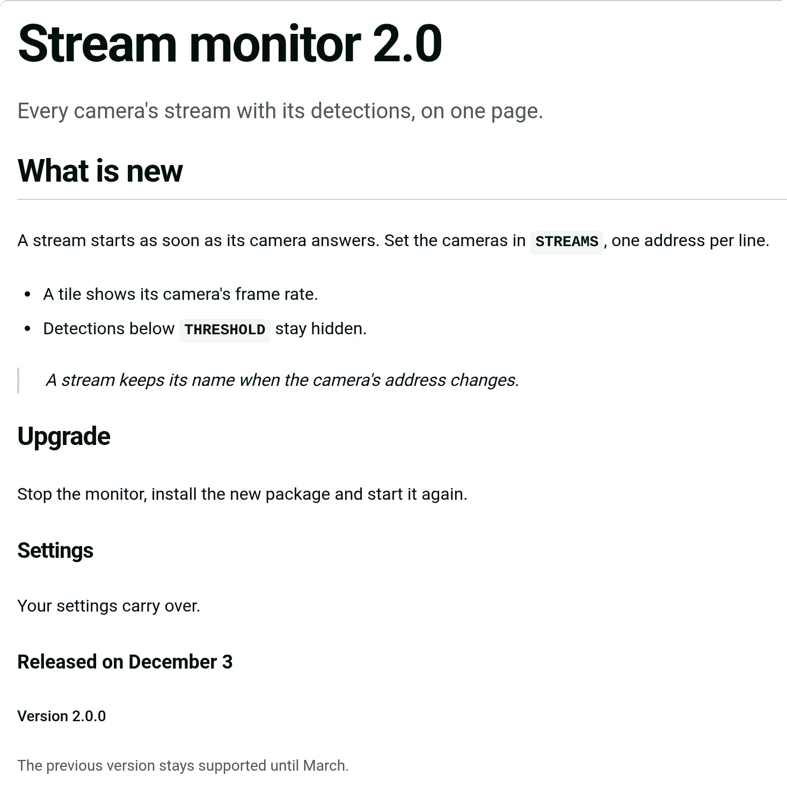

<!-- Written by `npm run docs:pages` from the kit and its examples. Do not edit. -->

# Typography

_Layout_ · [All topics](../README.md)

Spartan's typography, one directive per element, for text an app sets element by element: the headings `h1[neatH1]` to `h4[neatH4]`, `p[neatP]`, `p[neatLead]`, `[neatLarge]`, `small[neatSmall]`, `p[neatMuted]`, `blockquote[neatBlockquote]` and `ul[neatUl]`. This array holds them all, for a component's `imports`.

```ts
@Component({ imports: [NEAT_TYPOGRAPHY], templateUrl: './release-note.html' })
```

<picture>
<source media="(prefers-color-scheme: dark)" srcset="../images/typography/a-release-note.dark.webp">

</picture>

```ts
import { NEAT_TYPOGRAPHY, NeatH1, NeatH2, NeatH3, NeatH4, NeatP, NeatLead, NeatLarge, NeatSmall, NeatMuted, NeatBlockquote, NeatUl } from '@sima/neat-ui';
```

## Examples

### A release note

A short page set element by element: each heading, paragraph, list and quote takes its own typography directive, and inline code is `neatCode`. The directives set the look; the space between the blocks is the page's, in its stylesheet, as `neatProse` spaces them.

For a container of plain HTML, such as a README, `neatProse` gives the same look.

<picture>
<source media="(prefers-color-scheme: dark)" srcset="../images/typography/a-release-note.dark.webp">

</picture>

<details>
<summary>Code</summary>

`1-a-release-note.example.ts`

```ts
import { ChangeDetectionStrategy, Component } from '@angular/core';
import {
  NeatBlockquote,
  NeatCode,
  NeatH1,
  NeatH2,
  NeatH3,
  NeatH4,
  NeatLarge,
  NeatLead,
  NeatMuted,
  NeatP,
  NeatSmall,
  NeatUl,
} from '@sima/neat-ui';

@Component({
  selector: 'app-a-release-note',
  imports: [
    NeatBlockquote,
    NeatCode,
    NeatH1,
    NeatH2,
    NeatH3,
    NeatH4,
    NeatLarge,
    NeatLead,
    NeatMuted,
    NeatP,
    NeatSmall,
    NeatUl,
  ],
  changeDetection: ChangeDetectionStrategy.OnPush,
  templateUrl: './1-a-release-note.example.html',
  styleUrl: './typography.example.css',
})
export class AReleaseNote {}
```

`1-a-release-note.example.html`

```html
<article class="note">
  <h1 neatH1>Stream monitor 2.0</h1>
  <p neatLead>Every camera's stream with its detections, on one page.</p>
  <h2 neatH2>What is new</h2>
  <p neatP>
    A stream starts as soon as its camera answers. Set the cameras in
    <code neatCode>STREAMS</code>, one address per line.
  </p>
  <ul neatUl>
    <li>A tile shows its camera's frame rate.</li>
    <li>Detections below <code neatCode>THRESHOLD</code> stay hidden.</li>
  </ul>
  <blockquote neatBlockquote>A stream keeps its name when the camera's address changes.</blockquote>
  <h3 neatH3>Upgrade</h3>
  <p neatP>Stop the monitor, install the new package and start it again.</p>
  <h4 neatH4>Settings</h4>
  <p neatP>Your settings carry over.</p>
  <div neatLarge>Released on December 3</div>
  <p><small neatSmall>Version 2.0.0</small></p>
  <p neatMuted>The previous version stays supported until March.</p>
</article>
```

`typography.example.css`

```css
/* A readable measure for the text, which the app sets. */
.note {
  max-width: 46rem;
}

/*
 * The directives space a paragraph, a list and a quote but not a heading, the lead or small print
 * (Spartan's), so the page spaces its blocks as `neatProse` does: 1.5rem apart.
 */
.note > * + * {
  margin-block-start: var(--neat-space-6);
}
```

</details>

## API

### `NEAT_TYPOGRAPHY`

Constant from `@sima/neat-ui`.

```html
<h2 neatH2>What is new</h2>
<p neatP>A stream starts as soon as its camera answers.</p>
```

Inline code is `code[neatCode]` ([`NeatCode`](../layout/aside.md#neatcode)), Spartan's inline code. Keys are `neat-shortcut`'s.

For a container of text, such as help or a README converted from Markdown, use `neatProse`. It gives the plain elements inside it the same look, so the two never show a seam, and it covers what Spartan has no directive for: `h5`, `h6`, numbered lists, links and keys.

The directives set the look of their element only. A paragraph, a list and a quote bring Spartan's space above them; a heading, the lead and small print bring none, so the page spaces them. `neatProse` spaces all its blocks 1.5rem apart.

```ts
const NEAT_TYPOGRAPHY: readonly [typeof NeatH1, typeof NeatH2, typeof NeatH3, typeof NeatH4, typeof NeatP, typeof NeatLead, typeof NeatLarge, typeof NeatSmall, typeof NeatMuted, typeof NeatBlockquote, typeof NeatUl]
```

### `NeatH1`

Directive from `@sima/neat-ui`, selector `h1[neatH1]`.

A page's title in Spartan's type: the largest size, extra bold, larger again on a wide screen.

### `NeatH2`

Directive from `@sima/neat-ui`, selector `h2[neatH2]`.

A section heading in Spartan's type: semibold, ruled off below, with no space above it as the first element of its container.

### `NeatH3`

Directive from `@sima/neat-ui`, selector `h3[neatH3]`.

A heading below a section's, in Spartan's type: semibold, a size below `neatH2`.

### `NeatH4`

Directive from `@sima/neat-ui`, selector `h4[neatH4]`.

The smallest heading of Spartan's type: semibold, a size above the text.

### `NeatP`

Directive from `@sima/neat-ui`, selector `p[neatP]`.

A paragraph in Spartan's type: a roomy line height, and 1.5rem above it unless it is the first element of its container.

### `NeatLead`

Directive from `@sima/neat-ui`, selector `p[neatLead]`.

The paragraph that opens a page and says what it is for: large and muted.

### `NeatLarge`

Directive from `@sima/neat-ui`, selector `[neatLarge]`.

Text a step larger than the body and semibold, on any element: a figure or a short statement that stands out without being a heading.

### `NeatSmall`

Directive from `@sima/neat-ui`, selector `small[neatSmall]`.

Small print in medium weight, on one tight line: a label or a remark beside a value.

### `NeatMuted`

Directive from `@sima/neat-ui`, selector `p[neatMuted]`.

A paragraph in the small size and the muted text color, for a remark under a block of text.

Under a control or a heading, use `neatNote`, the kit's remark beside what it is about.

### `NeatBlockquote`

Directive from `@sima/neat-ui`, selector `blockquote[neatBlockquote]`.

A quote in Spartan's type: italic, set off by a border at its start, 1.5rem above it.

### `NeatUl`

Directive from `@sima/neat-ui`, selector `ul[neatUl]`.

A bulleted list in Spartan's type: inset by 1.5rem, 1.5rem above and below it, its items 0.5rem apart.

The items are plain `li` elements. A numbered list has no directive (Spartan has none): put it in a `neatProse` container.
