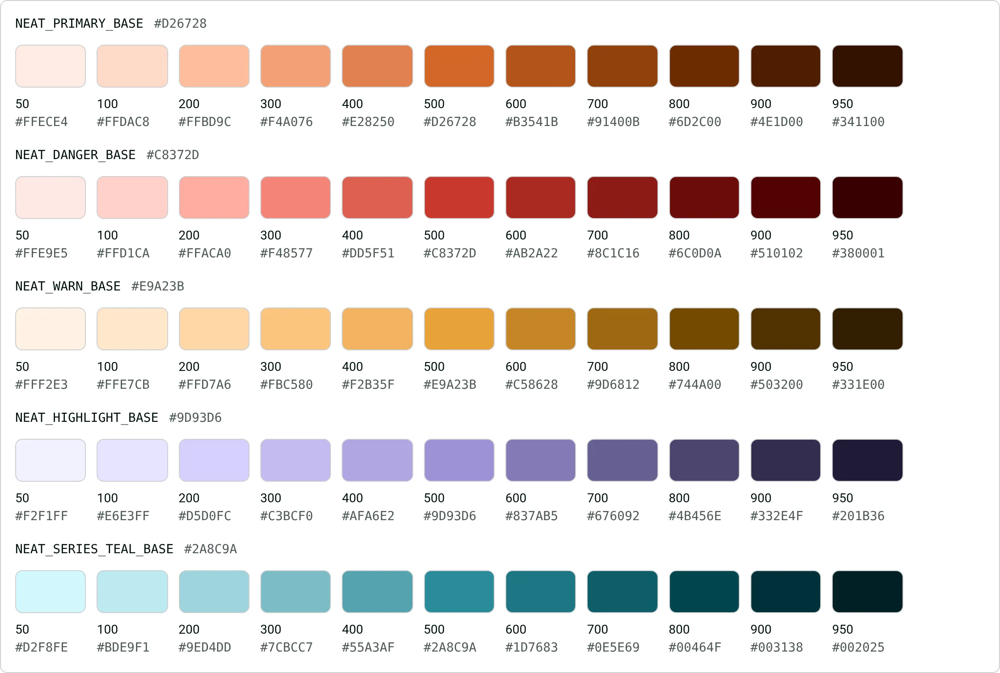
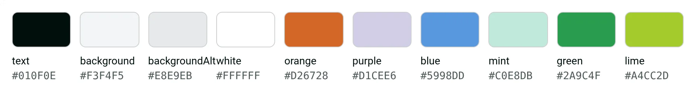
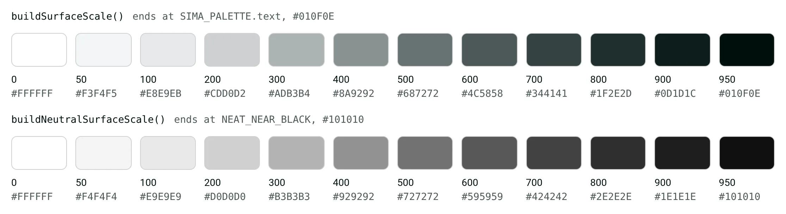
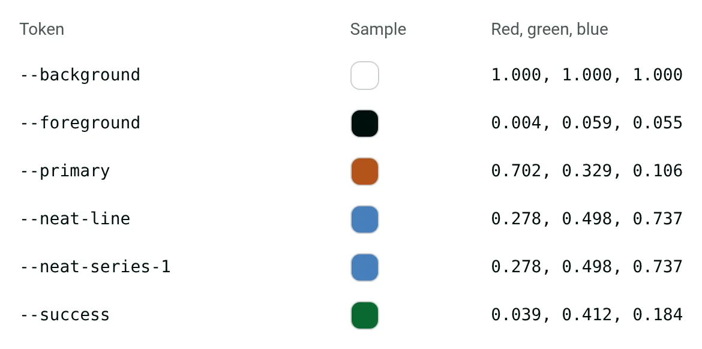
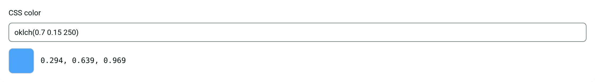
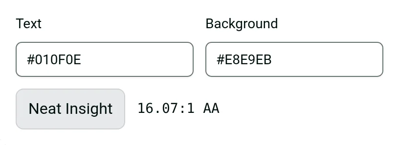

<!-- Written by `npm run docs:pages` from the kit and its examples. Do not edit. -->

# Colors

_Theme_ · [All topics](../README.md)

Light/dark switch for the kit. Light is the default regardless of the OS preference (which is deliberately never read); dark is opt-in and persisted.

<picture>
<source media="(prefers-color-scheme: dark)" srcset="../images/colors/color-scales.dark.webp">

</picture>

```ts
import { ThemeService, provideNeatUi, neatThemeColors, neatResolveColor, buildColorScale, buildSurfaceScale, buildNeutralSurfaceScale, contrastRatio, SIMA_PALETTE, NEAT_PRIMARY_BASE, NEAT_DANGER_BASE, NEAT_HIGHLIGHT_BASE, NEAT_WARN_BASE, NEAT_SERIES_TEAL_BASE, NEAT_NEAR_BLACK } from '@sima/neat-ui';
```

## Examples

### Color scheme

The scheme the page is in (`scheme`), and two ways to change it. Light is the default, whatever the operating system prefers.

`toggle()` is what the shell's theme item does, and it stores the choice for the next page load. `setScheme` with `persist: false` holds for this page load only, as a link that themes itself needs. It leaves the stored choice as it was.

<details>
<summary>Code</summary>

`1-color-scheme.example.ts`

```ts
import { ChangeDetectionStrategy, Component, computed, inject } from '@angular/core';
import { NeatButton, type NeatColorScheme, ThemeService } from '@sima/neat-ui';

@Component({
  selector: 'app-color-scheme',
  imports: [NeatButton],
  changeDetection: ChangeDetectionStrategy.OnPush,
  template: `
    <p>
      The scheme is <strong>{{ theme.scheme() }}</strong
      >.
    </p>
    <div class="showcase-row">
      <button neatButton type="button" variant="outlined" size="small" (click)="theme.toggle()">
        Switch to {{ other() }}
      </button>
      <button neatButton type="button" variant="text" size="small" (click)="tryOther()">
        Show {{ other() }} without saving
      </button>
    </div>
  `,
})
export class ColorScheme {
  protected readonly theme = inject(ThemeService);
  protected readonly other = computed<NeatColorScheme>(() =>
    this.theme.scheme() === 'dark' ? 'light' : 'dark',
  );

  protected tryOther(): void {
    this.theme.setScheme(this.other(), { persist: false });
  }
}
```

</details>

### Palette

Every color of [`SIMA_PALETTE`](../theme/colors.md#sima_palette), the brand's fixed palette, with its value under the name.

<picture>
<source media="(prefers-color-scheme: dark)" srcset="../images/colors/palette.dark.webp">

</picture>

<details>
<summary>Code</summary>

`2-palette.example.ts`

```ts
import { ChangeDetectionStrategy, Component } from '@angular/core';
import { SIMA_PALETTE } from '@sima/neat-ui';

@Component({
  selector: 'app-palette',
  changeDetection: ChangeDetectionStrategy.OnPush,
  template: `
    <div class="ramp">
      @for (color of colors; track color.name) {
        <div>
          <div class="chip" [style.background]="color.hex"></div>
          <div class="name">{{ color.name }}</div>
          <div class="showcase-code showcase-muted">{{ color.hex }}</div>
        </div>
      }
    </div>
  `,
  styleUrl: './swatches.css',
})
export class Palette {
  protected readonly colors = Object.entries(SIMA_PALETTE).map(([name, hex]) => ({ name, hex }));
}
```

`swatches.css`

```css
:host {
  container-type: inline-size;
  display: flex;
  flex-direction: column;
  gap: var(--neat-space-4);
}

/*
 * One ramp: a chip per step, each labeled by text, so no label depends on the color. A ramp has
 * 11 or 12 steps: one row while all of them fit, otherwise two even rows (6 + 6 or 6 + 5), never a
 * short leftover row. A hex value is about 3.7rem wide, so 12 columns need 57rem, 6 need 27rem;
 * only a container narrower than that, a phone's, falls back to 3 columns.
 */
.ramp {
  display: grid;
  gap: var(--neat-space-3);
  grid-template-columns: repeat(3, minmax(0, 1fr));
}

@container (min-width: 27rem) {
  .ramp {
    grid-template-columns: repeat(6, minmax(0, 1fr));
  }
}

@container (min-width: 57rem) {
  .ramp {
    grid-template-columns: repeat(12, minmax(0, 1fr));
  }
}

.chip {
  height: 3rem;
  border: 1px solid var(--border);
  border-radius: var(--radius);
}

.name {
  margin-top: var(--neat-space-2);
  font-size: var(--neat-text-sm);
}
```

</details>

### Color scales

A ramp from step 50 to 950 for each base color the theme names, made with [`buildColorScale`](../theme/colors.md#buildcolorscale).

The base is step 500, unchanged. The lighter steps move from it in OKLCH towards near-white, and the darker towards near-black, with the chroma pulled back into sRGB.

The primary ramp is the accent's. The others are the functional colors the palette lacks, and the chart series' teal.

<picture>
<source media="(prefers-color-scheme: dark)" srcset="../images/colors/color-scales.dark.webp">

</picture>

<details>
<summary>Code</summary>

`3-color-scales.example.ts`

```ts
import { ChangeDetectionStrategy, Component } from '@angular/core';
import {
  buildColorScale,
  NEAT_DANGER_BASE,
  NEAT_HIGHLIGHT_BASE,
  NEAT_PRIMARY_BASE,
  NEAT_SERIES_TEAL_BASE,
  NEAT_WARN_BASE,
} from '@sima/neat-ui';

interface Ramp {
  readonly name: string;
  readonly base: string;
  readonly steps: readonly (readonly [step: string, hex: string])[];
}

const BASES = [
  ['NEAT_PRIMARY_BASE', NEAT_PRIMARY_BASE],
  ['NEAT_DANGER_BASE', NEAT_DANGER_BASE],
  ['NEAT_WARN_BASE', NEAT_WARN_BASE],
  ['NEAT_HIGHLIGHT_BASE', NEAT_HIGHLIGHT_BASE],
  ['NEAT_SERIES_TEAL_BASE', NEAT_SERIES_TEAL_BASE],
] as const;

@Component({
  selector: 'app-color-scales',
  changeDetection: ChangeDetectionStrategy.OnPush,
  template: `
    @for (ramp of ramps; track ramp.name) {
      <section>
        <h4>
          <span class="showcase-code">{{ ramp.name }}</span>
          <span class="showcase-code showcase-muted">{{ ramp.base }}</span>
        </h4>
        <div class="ramp">
          @for (step of ramp.steps; track step[0]) {
            <div>
              <div class="chip" [style.background]="step[1]"></div>
              <div class="name">{{ step[0] }}</div>
              <div class="showcase-code showcase-muted">{{ step[1] }}</div>
            </div>
          }
        </div>
      </section>
    }
  `,
  styleUrls: ['./swatches.css', './ramp-title.css'],
})
export class ColorScales {
  protected readonly ramps: readonly Ramp[] = BASES.map(([name, base]) => ({
    name,
    base,
    steps: Object.entries(buildColorScale(base)),
  }));
}
```

`swatches.css`

```css
:host {
  container-type: inline-size;
  display: flex;
  flex-direction: column;
  gap: var(--neat-space-4);
}

/*
 * One ramp: a chip per step, each labeled by text, so no label depends on the color. A ramp has
 * 11 or 12 steps: one row while all of them fit, otherwise two even rows (6 + 6 or 6 + 5), never a
 * short leftover row. A hex value is about 3.7rem wide, so 12 columns need 57rem, 6 need 27rem;
 * only a container narrower than that, a phone's, falls back to 3 columns.
 */
.ramp {
  display: grid;
  gap: var(--neat-space-3);
  grid-template-columns: repeat(3, minmax(0, 1fr));
}

@container (min-width: 27rem) {
  .ramp {
    grid-template-columns: repeat(6, minmax(0, 1fr));
  }
}

@container (min-width: 57rem) {
  .ramp {
    grid-template-columns: repeat(12, minmax(0, 1fr));
  }
}

.chip {
  height: 3rem;
  border: 1px solid var(--border);
  border-radius: var(--radius);
}

.name {
  margin-top: var(--neat-space-2);
  font-size: var(--neat-text-sm);
}
```

`ramp-title.css`

```css
/* A ramp's title: what it is built from, and the value. */
h4 {
  display: flex;
  flex-wrap: wrap;
  align-items: baseline;
  gap: var(--neat-space-3);
  margin: 0 0 var(--neat-space-3);
  font-weight: 500;
}
```

</details>

### Surface scales

The two surface ramps, from white at step 0 to the darkest at step 950.

[`buildSurfaceScale`](../theme/colors.md#buildsurfacescale) is the light scheme's: white, the two palette backgrounds and the palette text, with the steps between interpolated. [`buildNeutralSurfaceScale`](../theme/colors.md#buildneutralsurfacescale) is the dark scheme's, the same construction in grays only, down to the near-black [`NEAT_NEAR_BLACK`](../theme/colors.md#neat_near_black).

They start at 0 because white sits above the brand's off-white 50 and 100. That keeps the step numbers aligned across all the ramps.

<picture>
<source media="(prefers-color-scheme: dark)" srcset="../images/colors/surface-scales.dark.webp">

</picture>

<details>
<summary>Code</summary>

`4-surface-scales.example.ts`

```ts
import { ChangeDetectionStrategy, Component } from '@angular/core';
import {
  buildNeutralSurfaceScale,
  buildSurfaceScale,
  NEAT_NEAR_BLACK,
  SIMA_PALETTE,
  type SurfaceScale,
} from '@sima/neat-ui';

interface Ramp {
  readonly name: string;
  /** What the darkest step is made from, and its value. */
  readonly darkest: readonly [name: string, hex: string];
  readonly steps: readonly (readonly [step: string, hex: string])[];
}

const ramp = (name: string, darkest: Ramp['darkest'], scale: SurfaceScale): Ramp => ({
  name,
  darkest,
  steps: Object.entries(scale),
});

@Component({
  selector: 'app-surface-scales',
  changeDetection: ChangeDetectionStrategy.OnPush,
  template: `
    @for (ramp of ramps; track ramp.name) {
      <section>
        <h4>
          <span class="showcase-code">{{ ramp.name }}</span>
          <span class="showcase-code showcase-muted">
            ends at {{ ramp.darkest[0] }}, {{ ramp.darkest[1] }}
          </span>
        </h4>
        <div class="ramp">
          @for (step of ramp.steps; track step[0]) {
            <div>
              <div class="chip" [style.background]="step[1]"></div>
              <div class="name">{{ step[0] }}</div>
              <div class="showcase-code showcase-muted">{{ step[1] }}</div>
            </div>
          }
        </div>
      </section>
    }
  `,
  styleUrls: ['./swatches.css', './ramp-title.css'],
})
export class SurfaceScales {
  protected readonly ramps: readonly Ramp[] = [
    ramp('buildSurfaceScale()', ['SIMA_PALETTE.text', SIMA_PALETTE.text], buildSurfaceScale()),
    ramp(
      'buildNeutralSurfaceScale()',
      ['NEAT_NEAR_BLACK', NEAT_NEAR_BLACK],
      buildNeutralSurfaceScale(),
    ),
  ];
}
```

`swatches.css`

```css
:host {
  container-type: inline-size;
  display: flex;
  flex-direction: column;
  gap: var(--neat-space-4);
}

/*
 * One ramp: a chip per step, each labeled by text, so no label depends on the color. A ramp has
 * 11 or 12 steps: one row while all of them fit, otherwise two even rows (6 + 6 or 6 + 5), never a
 * short leftover row. A hex value is about 3.7rem wide, so 12 columns need 57rem, 6 need 27rem;
 * only a container narrower than that, a phone's, falls back to 3 columns.
 */
.ramp {
  display: grid;
  gap: var(--neat-space-3);
  grid-template-columns: repeat(3, minmax(0, 1fr));
}

@container (min-width: 27rem) {
  .ramp {
    grid-template-columns: repeat(6, minmax(0, 1fr));
  }
}

@container (min-width: 57rem) {
  .ramp {
    grid-template-columns: repeat(12, minmax(0, 1fr));
  }
}

.chip {
  height: 3rem;
  border: 1px solid var(--border);
  border-radius: var(--radius);
}

.name {
  margin-top: var(--neat-space-2);
  font-size: var(--neat-text-sm);
}
```

`ramp-title.css`

```css
/* A ramp's title: what it is built from, and the value. */
h4 {
  display: flex;
  flex-wrap: wrap;
  align-items: baseline;
  gap: var(--neat-space-3);
  margin: 0 0 var(--neat-space-3);
  font-weight: 500;
}
```

</details>

### Theme colors as numbers

Six tokens as the numbers [`neatThemeColors`](../theme/colors.md#neatthemecolors) answers, each red, green and blue from 0 to 1, as code that draws outside CSS takes a color. The signal reads them again when the scheme changes: switch the theme at the bottom of the rail and the numbers follow.

<picture>
<source media="(prefers-color-scheme: dark)" srcset="../images/colors/theme-colors-as-numbers.dark.webp">

</picture>

<details>
<summary>Code</summary>

`5-theme-colors-as-numbers.example.ts`

```ts
import { ChangeDetectionStrategy, Component, computed } from '@angular/core';
import { type NeatRgb, neatThemeColors } from '@sima/neat-ui';

/** The tokens a WebGL or canvas drawing might take, named as the drawing names them. */
const TOKENS = {
  background: '--background',
  foreground: '--foreground',
  primary: '--primary',
  line: '--neat-line',
  series1: '--neat-series-1',
  success: '--success',
} as const;

const format = (rgb: NeatRgb | null): string =>
  rgb ? rgb.map((channel) => channel.toFixed(3)).join(', ') : 'not a color';

@Component({
  selector: 'app-theme-colors-as-numbers',
  changeDetection: ChangeDetectionStrategy.OnPush,
  template: `
    <table>
      <thead>
        <tr>
          <th scope="col">Token</th>
          <th scope="col">Sample</th>
          <th scope="col">Red, green, blue</th>
        </tr>
      </thead>
      <tbody>
        @for (row of rows(); track row.token) {
          <tr>
            <th scope="row" class="showcase-code">{{ row.token }}</th>
            <td><span class="sample" [style.background]="'var(' + row.token + ')'"></span></td>
            <td class="showcase-code">{{ row.rgb }}</td>
          </tr>
        }
      </tbody>
    </table>
  `,
  styleUrl: './theme-colors-as-numbers.example.css',
})
export class ThemeColorsAsNumbers {
  private readonly colors = neatThemeColors(TOKENS);
  protected readonly rows = computed(() => {
    const colors = this.colors();
    return Object.entries(TOKENS).map(([name, token]) => ({
      token,
      rgb: format(colors[name as keyof typeof TOKENS]),
    }));
  });
}
```

`theme-colors-as-numbers.example.css`

```css
table {
  width: 100%;
  max-width: 46rem;
  border-collapse: collapse;
}

th,
td {
  padding: var(--neat-space-2) var(--neat-space-3) var(--neat-space-2) 0;
  text-align: left;
  font-weight: 400;
  font-size: var(--neat-text-sm);
}

thead th {
  color: var(--muted-foreground);
}

.sample {
  display: inline-block;
  width: 1.5rem;
  height: 1.5rem;
  border: 1px solid var(--border);
  border-radius: var(--radius);
  vertical-align: middle;
}
```

</details>

### Resolve a color

Any one CSS color as red, green and blue from 0 to 1, resolved by [`neatResolveColor`](../theme/colors.md#neatresolvecolor): hex, `rgb()`, `oklch()` or a color's name. It answers null for text that is no color, and where the browser has no canvas to resolve it on.

<picture>
<source media="(prefers-color-scheme: dark)" srcset="../images/colors/resolve-a-color.dark.webp">

</picture>

<details>
<summary>Code</summary>

`6-resolve-a-color.example.ts`

```ts
import { ChangeDetectionStrategy, Component, computed, signal } from '@angular/core';
import { neatResolveColor } from '@sima/neat-ui';
import { NeatInput } from '@sima/neat-ui/input';

@Component({
  selector: 'app-resolve-a-color',
  imports: [NeatInput],
  changeDetection: ChangeDetectionStrategy.OnPush,
  template: `
    <label class="field">
      <span>CSS color</span>
      <input neatInput #css [value]="text()" (input)="text.set(css.value)" />
    </label>
    <div class="showcase-row">
      <span class="swatch" [style.background]="text()"></span>
      <span class="showcase-code">{{ result() }}</span>
    </div>
  `,
  styleUrls: ['./color-field.css', './resolve-a-color.example.css'],
})
export class ResolveAColor {
  protected readonly text = signal('oklch(0.7 0.15 250)');
  protected readonly result = computed(() => {
    const rgb = neatResolveColor(this.text());
    return rgb ? rgb.map((channel) => channel.toFixed(3)).join(', ') : 'not a color';
  });
}
```

`color-field.css`

```css
:host {
  display: flex;
  flex-direction: column;
  gap: var(--neat-space-3);
}

.field {
  display: flex;
  flex-direction: column;
  gap: var(--neat-space-2);
  font-size: var(--neat-text-sm);
}
```

`resolve-a-color.example.css`

```css
/* The color typed, drawn as a chip. */
.swatch {
  width: 3rem;
  height: 3rem;
  border: 1px solid var(--border);
  border-radius: var(--radius);
}
```

</details>

### Contrast

The WCAG 2.x contrast ratio of two colors, from [`contrastRatio`](../theme/colors.md#contrastratio), in either order. It takes `#RRGGBB` only and throws on anything else, so the field asks for that form first. AA for normal text is 4.5:1.

<picture>
<source media="(prefers-color-scheme: dark)" srcset="../images/colors/contrast.dark.webp">

</picture>

<details>
<summary>Code</summary>

`7-contrast.example.ts`

```ts
import { ChangeDetectionStrategy, Component, computed, signal } from '@angular/core';
import { contrastRatio, SIMA_PALETTE } from '@sima/neat-ui';
import { NeatInput } from '@sima/neat-ui/input';

const HEX = /^#[0-9a-f]{6}$/i;
/** WCAG 2.x AA for normal text. */
const AA = 4.5;

@Component({
  selector: 'app-contrast',
  imports: [NeatInput],
  changeDetection: ChangeDetectionStrategy.OnPush,
  template: `
    <div class="showcase-row">
      <label class="field">
        <span>Text</span>
        <input neatInput #text [value]="foreground()" (input)="foreground.set(text.value)" />
      </label>
      <label class="field">
        <span>Background</span>
        <input neatInput #fill [value]="background()" (input)="background.set(fill.value)" />
      </label>
    </div>
    <div class="showcase-row">
      <span class="sample" [style.color]="foreground()" [style.background]="background()">
        Neat Insight
      </span>
      <span class="showcase-code">{{ result() }}</span>
    </div>
  `,
  styleUrls: ['./color-field.css', './contrast.example.css'],
})
export class Contrast {
  protected readonly foreground = signal<string>(SIMA_PALETTE.text);
  protected readonly background = signal<string>(SIMA_PALETTE.backgroundAlt);
  protected readonly result = computed(() => {
    const [foreground, background] = [this.foreground(), this.background()];
    if (!HEX.test(foreground) || !HEX.test(background)) return 'Both colors as #RRGGBB.';
    const ratio = contrastRatio(foreground, background);
    return `${ratio.toFixed(2)}:1 ${ratio >= AA ? 'AA' : 'below AA'}`;
  });
}
```

`color-field.css`

```css
:host {
  display: flex;
  flex-direction: column;
  gap: var(--neat-space-3);
}

.field {
  display: flex;
  flex-direction: column;
  gap: var(--neat-space-2);
  font-size: var(--neat-text-sm);
}
```

`contrast.example.css`

```css
/* The pair typed, drawn as text on its background. */
.sample {
  padding: var(--neat-space-2) var(--neat-space-3);
  border: 1px solid var(--border);
  border-radius: var(--radius);
}
```

</details>

## API

### `ThemeService`

Service from `@sima/neat-ui`.

**Properties**

- **`scheme`** `Signal<NeatColorScheme>`

**Methods**

- **`setScheme`**

  ```ts
  setScheme(scheme: NeatColorScheme, { persist = true }: { persist?: boolean } = {}): void
  ```

  Applies `scheme` and, unless `persist` is false, stores it for later page loads.

  Without storing, the scheme holds for this page load only, as a URL parameter that themes a shared link needs. The user's stored choice stays, and a later toggle stores as usual.

- **`toggle`**

  ```ts
  toggle(): void
  ```

  Switches to the other scheme and stores the choice, as the shell's theme item does.

### `provideNeatUi`

Function from `@sima/neat-ui`.

The kit's start-up in one call: it applies the stored color scheme before the first render. The colors themselves come from the kit stylesheet (`@sima/neat-ui/styles/neat-ui.css`).

```ts
provideNeatUi(): EnvironmentProviders
```

### `NeatColorScheme`

Type from `@sima/neat-ui`.

The two color schemes the kit has, which [`ThemeService`](../theme/colors.md#themeservice) switches between.

```ts
type NeatColorScheme = 'light' | 'dark'
```

### `neatThemeColors`

Function from `@sima/neat-ui`.

The theme's colors, as numbers, for code that draws outside CSS.

```ts
readonly colors = neatThemeColors({ line: '--neat-line', grid: '--border' });
```

`tokens` maps the app's names to custom properties. The signal answers each resolved, as [`neatResolveColor`](../theme/colors.md#neatresolvecolor) does, or null where the property is not set or not a color. Call it in an injection context.

The colors are read from `element`: the document element by default, or while `element` answers undefined. They are read again when the color scheme changes, which [`ThemeService`](../theme/colors.md#themeservice) applies before the signal is read again.

```ts
neatThemeColors<K extends string>(tokens: Record<K, string>, element?: () => Element | undefined): Signal<Record<K, NeatRgb | null>>
```

### `neatResolveColor`

Function from `@sima/neat-ui`.

A CSS color as sRGB channels from 0 to 1, for code that draws outside CSS.

```ts
const [r, g, b] = neatResolveColor('oklch(0.62 0.19 260)') ?? [0, 0, 0];
```

It takes any notation the browser knows: hex, `rgb()`, `oklch()`, a name. It is for code that draws outside CSS, such as three.js or a canvas, which takes colors as numbers. That may be the theme's colors or any other color an app holds.

The color is resolved by drawing it on a 1×1 canvas and reading the pixel back, so the kit parses no color syntax of its own. The answer is null where there is no canvas, or the color does not parse. Alpha is ignored, so a token with alpha, such as a scrim, is not a fit.

```ts
neatResolveColor(css: string): NeatRgb | null
```

### `buildColorScale`

Function from `@sima/neat-ui`.

Builds a 50-950 ramp in OKLCH around `base`, which becomes step 500 unchanged.

```ts
buildColorScale(base: string): ColorScale
```

### `buildSurfaceScale`

Function from `@sima/neat-ui`.

Builds the brand surface ramp, the light scheme's surfaces.

White, the two palette backgrounds and the palette text are its anchors. Steps 200-900 are interpolated in OKLab between the alternate background and the text.

```ts
buildSurfaceScale(): SurfaceScale
```

### `buildNeutralSurfaceScale`

Function from `@sima/neat-ui`.

Builds the neutral surface ramp, the dark scheme's surfaces, which carry no hue of their own.

It is the brand ramp's construction in grays only. It runs from grays as light as the two palette backgrounds down to the near-black ([`NEAT_NEAR_BLACK`](../theme/colors.md#neat_near_black)).

```ts
buildNeutralSurfaceScale(): SurfaceScale
```

### `contrastRatio`

Function from `@sima/neat-ui`.

WCAG 2.x contrast ratio (1 to 21) between two `#RRGGBB` colors, in either order; AA for normal text asks for 4.5:1.

```ts
contrastRatio(a: string, b: string): number
```

### `ColorScale`

Type from `@sima/neat-ui`.

A color ramp: a hex color for each step from 50 to 950, as [`buildColorScale`](../theme/colors.md#buildcolorscale) makes it.

```ts
type ColorScale = Record<Exclude<ColorStep, 0>, string>
```

### `ColorStep`

Type from `@sima/neat-ui`.

A step of a ramp, named as Tailwind names its shades: 50 the lightest through 950 the darkest. Step 0 exists only in a surface ramp, where it is white.

```ts
type ColorStep = 0 | 50 | 100 | 200 | 300 | 400 | 500 | 600 | 700 | 800 | 900 | 950
```

### `SurfaceScale`

Type from `@sima/neat-ui`.

A ramp of surface colors, white at step 0 to the darkest at 950, from the surface builders.

```ts
type SurfaceScale = Record<ColorStep, string>
```

### `NeatRgb`

Type from `@sima/neat-ui`.

A color as sRGB red, green and blue, each from 0 to 1, as WebGL and canvas code take it.

```ts
type NeatRgb = readonly [red: number, green: number, blue: number]
```

### `NeatTone`

Type from `@sima/neat-ui`.

What a status color says.

It says nothing in particular (`neutral`), that it went well, to take note, that it failed, or that it is for information. `highlight`, the brand purple, is a distinct state that is none of these.

A status chip's fill and a select-list row's tint both take it. So a row and its chip, given the same tone, say the same.

```ts
type NeatTone = 'neutral' | 'success' | 'warning' | 'danger' | 'info' | 'highlight'
```

### `SIMA_PALETTE`

Constant from `@sima/neat-ui`.

The fixed SiMa.ai brand palette (identical to the Slides/PowerPoint theme).

```ts
const SIMA_PALETTE: { readonly text: "#010F0E"; readonly background: "#F3F4F5"; readonly backgroundAlt: "#E8E9EB"; readonly white: "#FFFFFF"; readonly orange: "#D26728"; readonly purple: "#D1CEE6"; readonly blue: "#5998DD"; readonly mint: "#C0E8DB"; readonly green: "#2A9C4F"; readonly lime: "#A4CC2D"; }
```

### `NEAT_PRIMARY_BASE`

Constant from `@sima/neat-ui`.

Base of the primary scale. Swapping it (for example to the palette blue) re-derives the whole primary ramp.

```ts
const NEAT_PRIMARY_BASE: string
```

### `NEAT_DANGER_BASE`

Constant from `@sima/neat-ui`.

Functional colors outside the palette, which has no red or amber but errors and warnings need them.

```ts
const NEAT_DANGER_BASE: "#C8372D"
```

### `NEAT_HIGHLIGHT_BASE`

Constant from `@sima/neat-ui`.

The hue of the highlight tone, which marks a distinct state that is none of the statuses.

It is the palette purple's hue (291° in OKLCH) at about three times its chroma. The palette purple itself is too pale to work from. A row tint of 10% of it on white is #FAFAFD, no tint at all. And no step of its scale is a fill that white text reads on and that still looks purple.

```ts
const NEAT_HIGHLIGHT_BASE: "#9D93D6"
```

### `NEAT_WARN_BASE`

Constant from `@sima/neat-ui`.

Used unchanged as the warning fill (step 500 of its scale), with palette text color on it.

```ts
const NEAT_WARN_BASE: "#E9A23B"
```

### `NEAT_SERIES_TEAL_BASE`

Constant from `@sima/neat-ui`.

Base of the series teal, taken from the colors mockup: a hue the palette lacks.

Chart series need a fourth hue next to blue, purple and orange that is not a status color. Green, amber and red stay free to mean status.

```ts
const NEAT_SERIES_TEAL_BASE: "#2A8C9A"
```

### `NEAT_NEAR_BLACK`

Constant from `@sima/neat-ui`.

The dark scheme's darkest surface, its page: a neutral near-black. The dark surfaces are grays from here up ([`buildNeutralSurfaceScale`](../theme/colors.md#buildneutralsurfacescale)) rather than steps towards the palette text, whose teal made a whole dark page read green.

```ts
const NEAT_NEAR_BLACK: "#101010"
```
