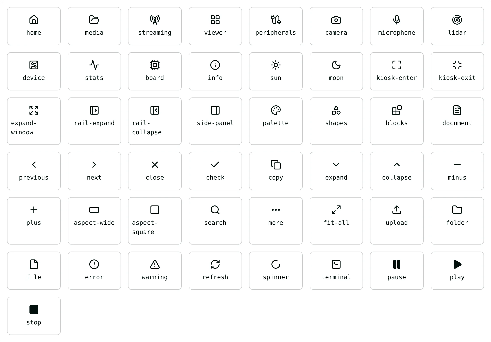
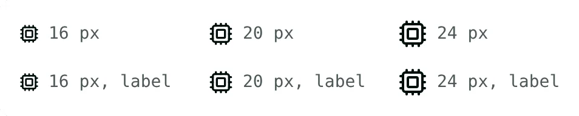
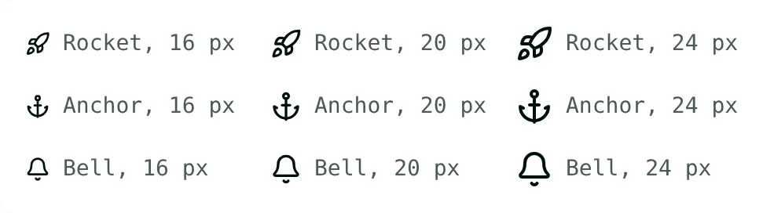

<!-- Written by `npm run docs:pages` from the kit and its examples. Do not edit. -->

# Icons

_Theme_ · [All topics](../README.md)

An icon from the kit's set, named for what it means.

```html
<neat-icon name="info" />
```

<picture>
<source media="(prefers-color-scheme: dark)" srcset="../images/icons/gallery.dark.webp">

</picture>

```ts
import { NeatIcon, NEAT_ICON_NAMES } from '@sima/neat-ui';
```

## Examples

### Gallery

Every name `neat-icon` accepts, in the order of [`NEAT_ICON_NAMES`](../theme/icons.md#neat_icon_names), drawn at 24 px. An icon takes its color from the text around it.

<picture>
<source media="(prefers-color-scheme: dark)" srcset="../images/icons/gallery.dark.webp">

</picture>

<details>
<summary>Code</summary>

`1-gallery.example.ts`

```ts
import { ChangeDetectionStrategy, Component } from '@angular/core';
import { NEAT_ICON_NAMES, NeatIcon } from '@sima/neat-ui';

@Component({
  selector: 'app-gallery',
  imports: [NeatIcon],
  changeDetection: ChangeDetectionStrategy.OnPush,
  template: `
    <div class="showcase-grid">
      @for (name of names; track name) {
        <div class="icon-card">
          <neat-icon [name]="name" [size]="24" />
          <span class="showcase-code">{{ name }}</span>
        </div>
      }
    </div>
  `,
  styleUrl: './gallery.example.css',
})
export class Gallery {
  protected readonly names = NEAT_ICON_NAMES;
}
```

`gallery.example.css`

```css
.icon-card {
  display: flex;
  flex-direction: column;
  align-items: center;
  gap: var(--neat-space-2);
  padding: var(--neat-space-4) var(--neat-space-2);
  border: 1px solid var(--border);
  border-radius: var(--radius);
}
```

</details>

### Sizes and labels

An icon at 16, 20 (the default) and 24 px. Without a `label` it is decorative and hidden from assistive technology; with one it is exposed as an image with that name.

<picture>
<source media="(prefers-color-scheme: dark)" srcset="../images/icons/sizes-and-labels.dark.webp">

</picture>

<details>
<summary>Code</summary>

`2-sizes-and-labels.example.ts`

```ts
import { ChangeDetectionStrategy, Component } from '@angular/core';
import { NeatIcon } from '@sima/neat-ui';

@Component({
  selector: 'app-sizes-and-labels',
  imports: [NeatIcon],
  changeDetection: ChangeDetectionStrategy.OnPush,
  template: `
    <div class="showcase-row">
      @for (size of sizes; track size) {
        <div class="sample">
          <neat-icon name="board" [size]="size" />
          <span class="showcase-code showcase-muted">{{ size }} px</span>
        </div>
      }
    </div>
    <div class="showcase-row">
      @for (size of sizes; track size) {
        <div class="sample">
          <neat-icon name="board" [size]="size" label="Board" />
          <span class="showcase-code showcase-muted">{{ size }} px, label</span>
        </div>
      }
    </div>
  `,
  styleUrl: './sizes-and-labels.example.css',
})
export class SizesAndLabels {
  protected readonly sizes = [16, 20, 24] as const;
}
```

`sizes-and-labels.example.css`

```css
:host {
  display: flex;
  flex-direction: column;
  gap: var(--neat-space-4);
}

.sample {
  display: flex;
  align-items: center;
  gap: var(--neat-space-2);
  min-width: 9rem;
}
```

</details>

### Any lucide glyph

A glyph the kit's set has no name for, imported from `@sima/neat-ui/lucide` and given to the icon as its `name`, at the kit's sizes. Reach for it only where no name of the set fits, and never import Lucide from its own package: the kit keeps the icon library swappable.

<picture>
<source media="(prefers-color-scheme: dark)" srcset="../images/icons/any-lucide-glyph.dark.webp">

</picture>

<details>
<summary>Code</summary>

`3-any-lucide-glyph.example.ts`

```ts
import { ChangeDetectionStrategy, Component } from '@angular/core';
import { NeatIcon } from '@sima/neat-ui';
import { Anchor, Bell, Rocket } from '@sima/neat-ui/lucide';

@Component({
  selector: 'app-any-lucide-glyph',
  imports: [NeatIcon],
  changeDetection: ChangeDetectionStrategy.OnPush,
  template: `
    @for (glyph of glyphs; track glyph.label) {
      <div class="showcase-row">
        @for (size of sizes; track size) {
          <div class="sample">
            <neat-icon [name]="glyph.drawing" [size]="size" [label]="glyph.label" />
            <span class="showcase-code showcase-muted">{{ glyph.label }}, {{ size }} px</span>
          </div>
        }
      </div>
    }
  `,
  styleUrl: './any-lucide-glyph.example.css',
})
export class AnyLucideGlyph {
  protected readonly sizes = [16, 20, 24] as const;
  protected readonly glyphs = [
    { drawing: Rocket, label: 'Rocket' },
    { drawing: Anchor, label: 'Anchor' },
    { drawing: Bell, label: 'Bell' },
  ] as const;
}
```

`any-lucide-glyph.example.css`

```css
:host {
  display: flex;
  flex-direction: column;
  gap: var(--neat-space-4);
}

.sample {
  display: flex;
  align-items: center;
  gap: var(--neat-space-2);
  min-width: 9rem;
}
```

</details>

## API

### `NeatIcon`

Component from `@sima/neat-ui`, selector `neat-icon`.

Where no name of the set fits, give it a glyph from `@sima/neat-ui/lucide` instead: `<neat-icon [name]="Rocket" />`, with `Rocket` imported from that entry point.

An icon is decorative by default, hidden from assistive technology. Give it a `label` when it carries meaning on its own. It takes its color from the surrounding text.

The `spinner` turns, and stays still for a user who asked for reduced motion. It says nothing of waiting, so the control it sits in does, with `aria-busy` or a held state.

**Inputs**

- **`name`** `NeatIconName | NeatIconGlyph`, required

  Which glyph to draw: a name of the kit's set ([`NEAT_ICON_NAMES`](../theme/icons.md#neat_icon_names) lists them all) first, and only where none fits a glyph imported from `@sima/neat-ui/lucide`.

- **`size`** `number`, default `20`

  Edge length in pixels.

- **`label`** `string`

  Accessible name; leave unset for a decorative icon.

### `NeatIconName`

Type from `@sima/neat-ui`.

The name of a glyph in the kit's curated icon set, what `neat-icon`'s `name` takes.

```ts
type NeatIconName = keyof typeof NEAT_ICONS
```

### `NeatIconGlyph`

Type from `@sima/neat-ui`.

A Lucide drawing (what `@sima/neat-ui/lucide` exports for each glyph), what `neat-icon`'s `name` takes where no name of the kit's set fits.

```ts
type NeatIconGlyph = IconNode
```

### `NEAT_ICON_NAMES`

Constant from `@sima/neat-ui`.

Every name in the registry, in registry order, for galleries and pickers. Play, pause and stop are the only filled glyphs, since media controls are solid by convention; every other name is an outline.

```ts
const NEAT_ICON_NAMES: readonly NeatIconName[]
```

### `lucide`

Package from `@sima/neat-ui/lucide`.

Every glyph of Lucide, for `neat-icon` to draw: `<neat-icon [name]="Rocket" />` with `import { Rocket } from '@sima/neat-ui/lucide'`. Use a name of the kit's own set first ([`NEAT_ICON_NAMES`](../theme/icons.md#neat_icon_names)) and a glyph from here only where no name fits.

A secondary entry point, so a glyph reaches an app's bundle only where it is imported (Lucide marks its package side-effect free). Apps import Lucide through this entry and never directly, so the icon library stays swappable in the kit.
